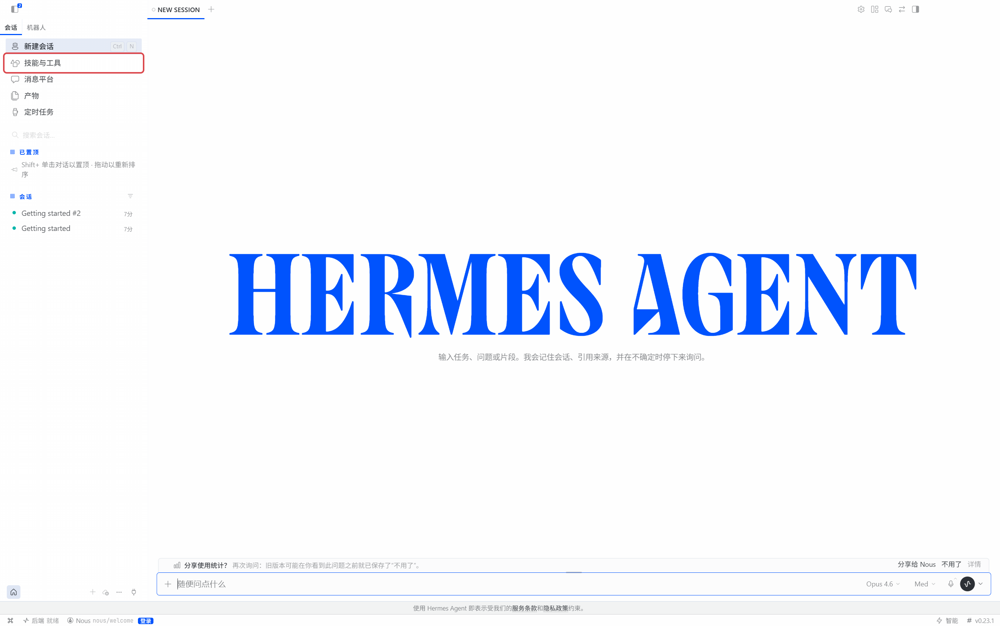
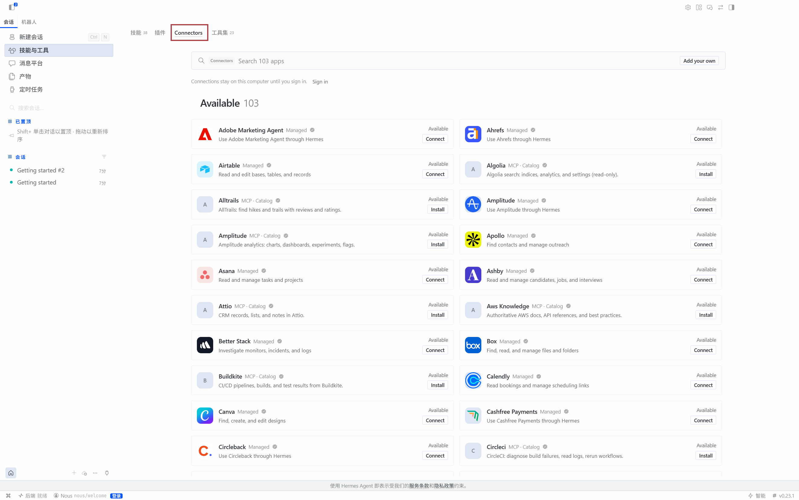
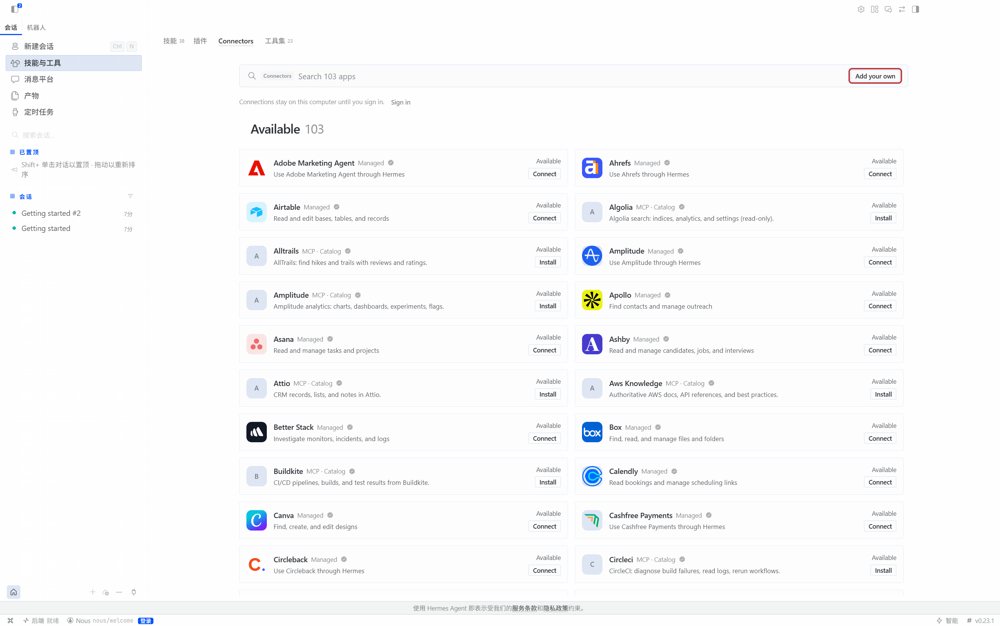
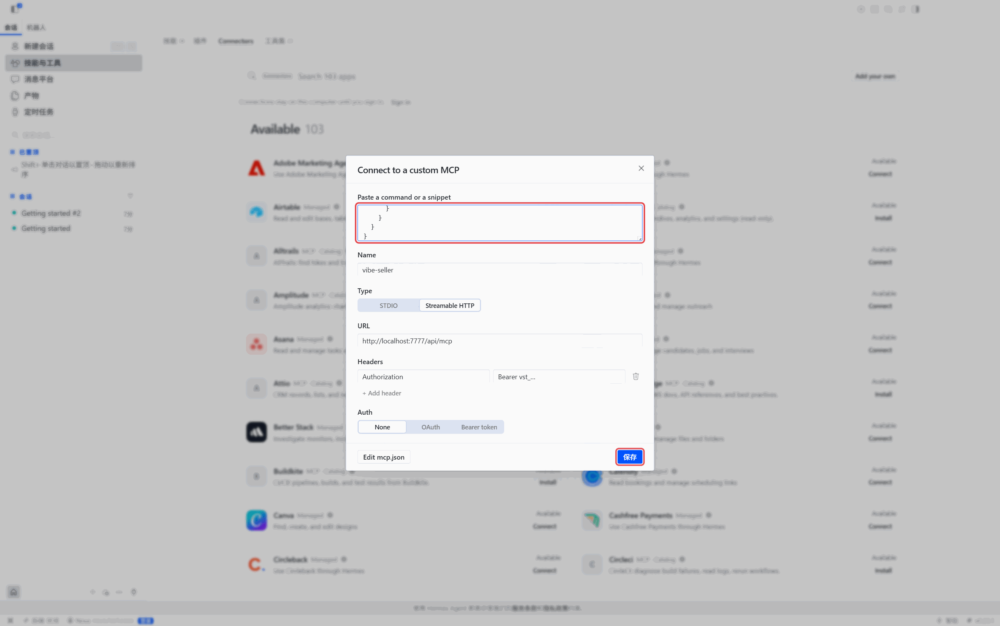
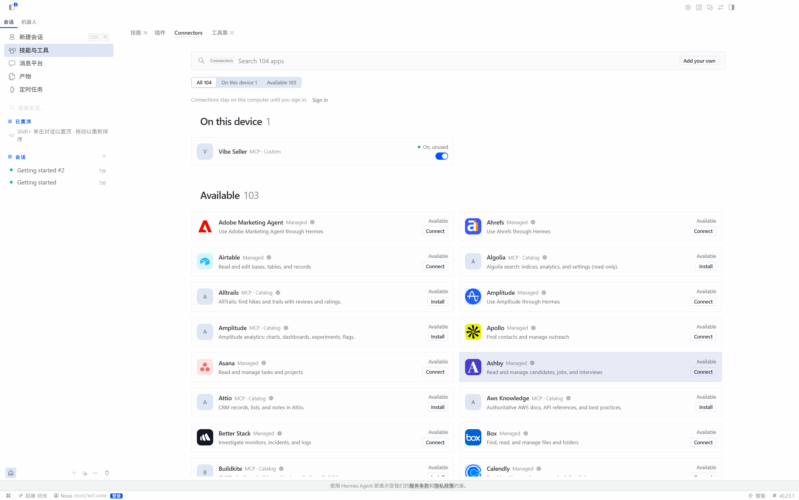
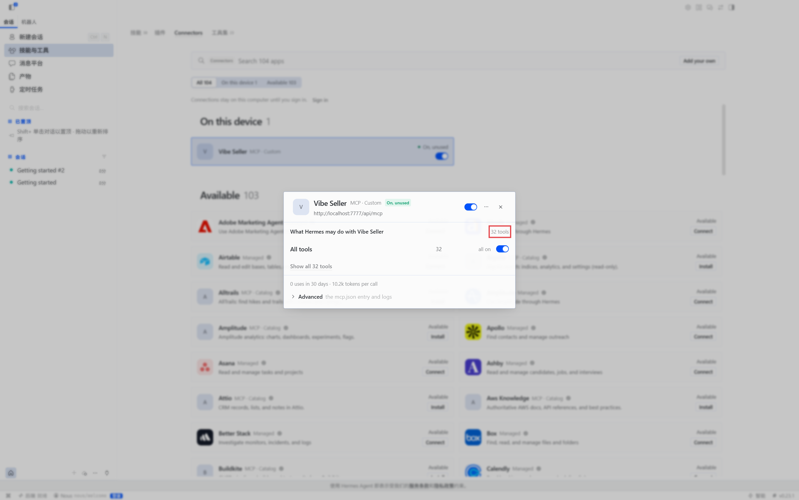
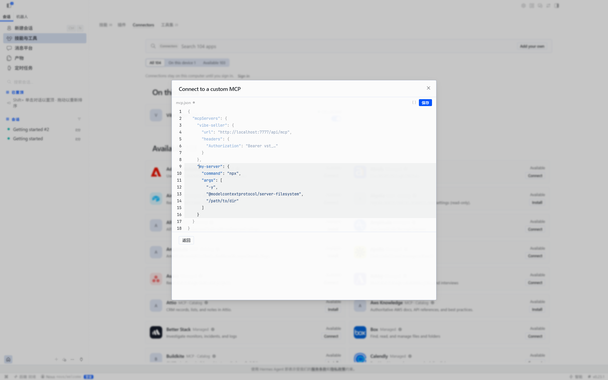
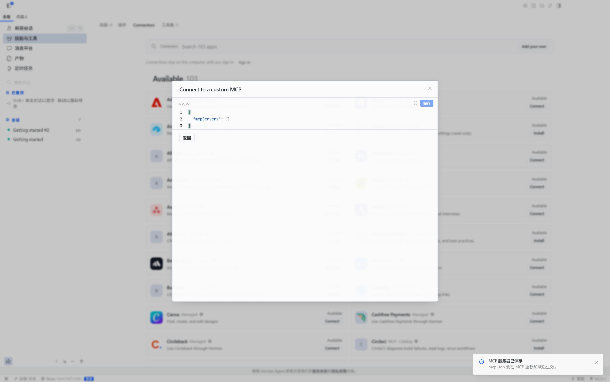

# 在 Hermes Agent 里接入 Vibe Seller

接好之后，在 Hermes 的对话里就能让 Vibe Seller 建任务、跟进进度、回答提问。

需要准备两样东西：

1. 一个 API Key：见[第一步：创建 API Key](mcp.md#第一步创建-api-key)。创建
   成功后弹出的窗口（下文称「弹窗」）里有你的服务器地址和 Hermes 的现成
   配置；
2. 已经安装 Hermes Agent：按
   [官方安装说明](https://hermes-agent.nousresearch.com/docs/getting-started/installation)
   装好桌面应用。

## 接入

=== "界面操作"

    1. 打开左侧的「技能与工具」，切换到「Connectors」标签。

        

        

    2. 点右上角的「Add your own」。

        

    3. 复制弹窗「界面操作」标签里的 JSON，粘贴到最上面的
       「Paste a command or a snippet」输入框。名称、类型（Streamable
       HTTP）、URL 和请求头会自动填好，核对一遍再点「保存」。

        

        !!! warning "这里只认 JSON"
            把「命令行 / 配置文件」标签里那段 YAML 贴进来不会被识别：
            字段全是空的，类型还停在 STDIO。那段 YAML 是用来写文件的。

    4. 保存后，连接器出现在「On this device」下面。

        

=== "命令行 / 配置文件"

    配置写在 `~/.hermes/config.yaml` 的 `mcp_servers` 下（Windows 原生安装
    在 `%LOCALAPPDATA%\hermes\config.yaml`）。把弹窗「命令行 / 配置文件」
    标签里那段加进去；文件里已经有 `mcp_servers:` 的话，只把
    `vibe-seller:` 这一项放到它下面。保存后在 Hermes 的会话里执行
    `/reload-mcp`，或者重启 Hermes。这一段长这样：

    ```yaml
    mcp_servers:
      vibe-seller:
        # 默认连本机；Vibe Seller 在另一台电脑上时，把 localhost 换成那台电脑的地址
        url: "http://localhost:7777/api/mcp"
        headers:
          Authorization: "Bearer vst_…"
    ```

## 确认接好了

新建一个对话，问“现在 vibe-seller 里有几个店铺？”。它把你的店铺列出来，
就接好了。还没有配好模型时，先点开 Vibe Seller 卡片：详情里 URL 正确、
32 个工具全部开启，说明已经连上了。



## 修改或移除

卡片的「…」菜单里没有删除，只有刷新工具和打开连接器管理。要改地址或换
Key，就再点一次「Add your own」→ 左下角「Edit mcp.json」，在编辑器里改
`vibe-seller` 那一段；删掉这一段再「保存」就是移除。





!!! warning "这个编辑器会明文显示 Key"
    「Edit mcp.json」里能看到完整的 Key。把截图发给别人之前，先遮住
    `vst_` 开头的内容。

## 接下来

接入之后怎么用，见[可以这样用](mcp.md#可以这样用)；一步步的完整示例见
[使用示例](examples.md)。
