# Connect Vibe Seller to Qoder

Once it's connected, you can ask Qoder to create Vibe Seller tasks, follow
their progress and answer their questions.

Two things to get ready first:

1. An API key — see [First: create an API key](mcp.md#first-create-an-api-key).
   Right after you create it, the dialog shows your server address and a
   ready-made Qoder config;
2. Qoder installed (the China edition is called **Qoder CN**).

## Connect

=== "In the app"

    1. Open **Extensions** in the left column and switch to the
       **Connectors** tab.

        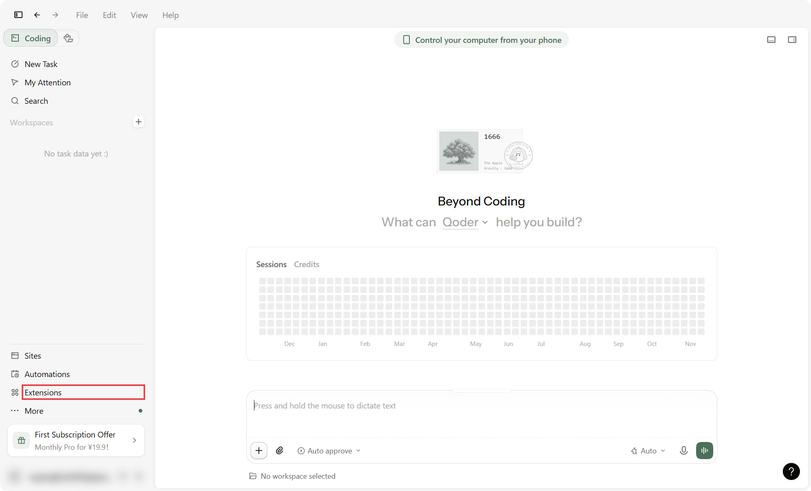

        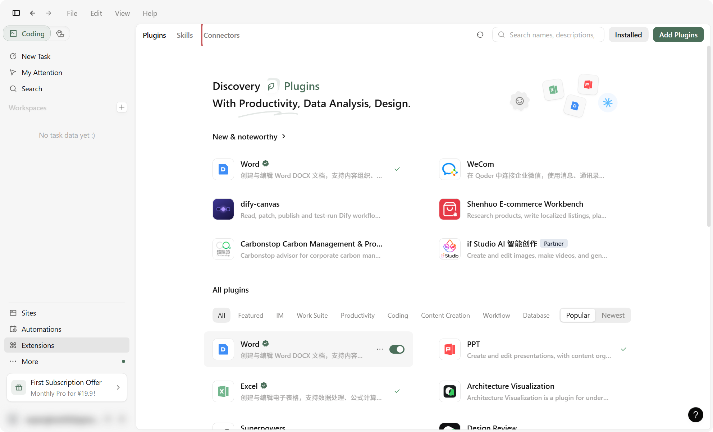

    2. Click **Add Connector** at the top right and switch the dialog to its
       **JSON** tab.

        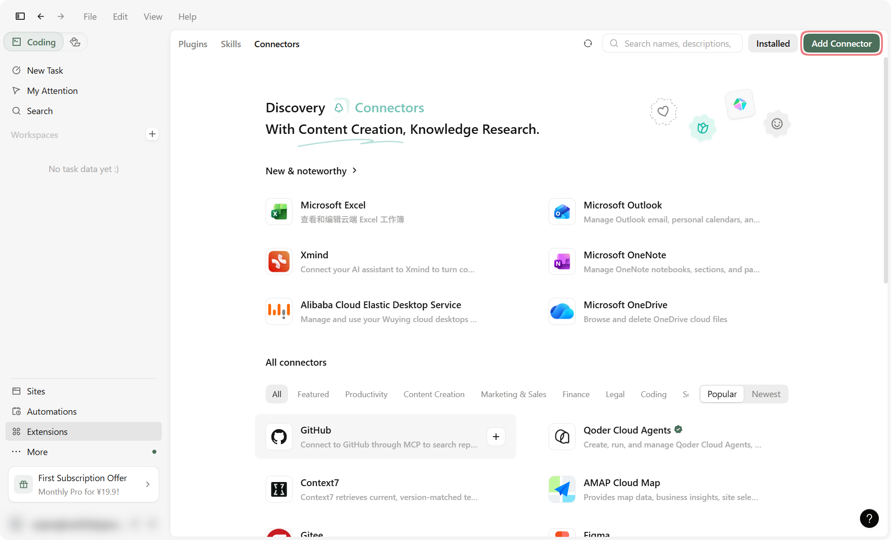

        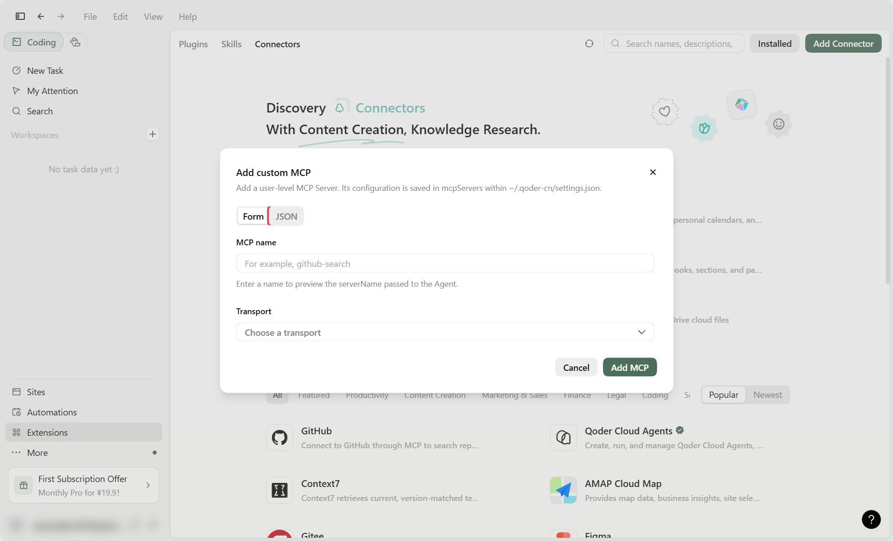

    3. Copy the JSON from the dialog's **In the app** tab, paste it in and
       click **Preview import**.

        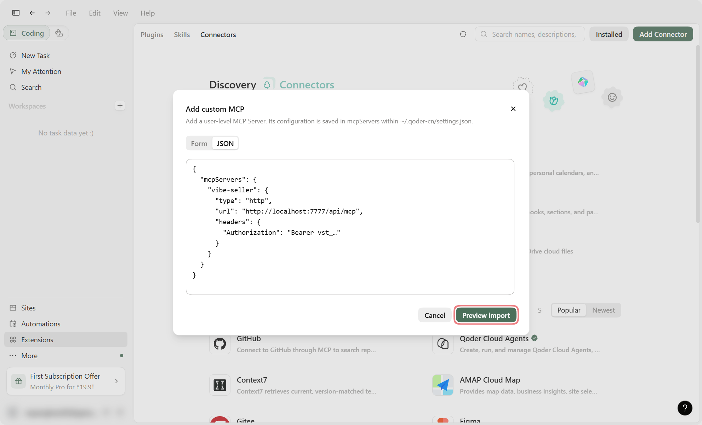

    4. Check the entry and click **Import 1 MCPs**. If vibe-seller was set up
       before, the preview says it will be replaced — importing overwrites the
       old entry.

        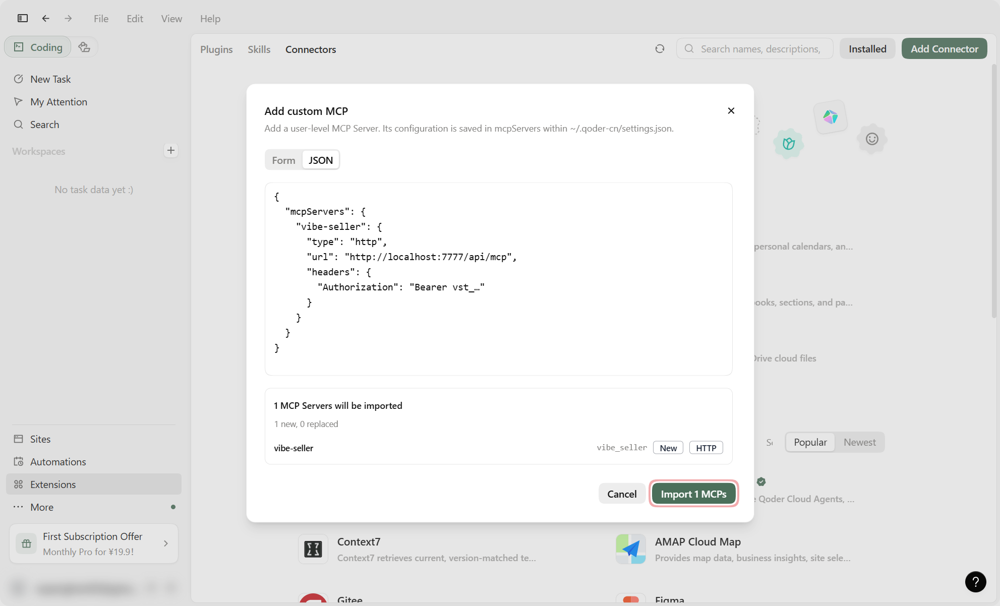

    5. The list now reads `vibe-seller · Ready · HTTP`, and the server is
       usable right away.

        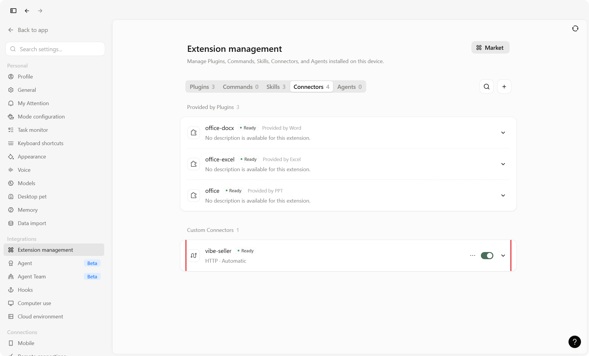

=== "Command line / config file"

    Write the entry into `mcpServers` in `~/.qoder-cn/settings.json` (China
    edition) or `~/.qoder/settings.json` (international), save and reopen
    Qoder. If you edit the file directly, trust the connector again in Qoder.
    The block looks like this:

    ```json
    {
      "mcpServers": {
        "vibe-seller": {
          "type": "http",
          "url": "http://localhost:7777/api/mcp",
          "headers": {
            "Authorization": "Bearer vst_…"
          }
        }
      }
    }
    ```

## Check it works

Start a new chat and ask “how many stores are in vibe-seller right now?”. If it
names your stores, you're connected.

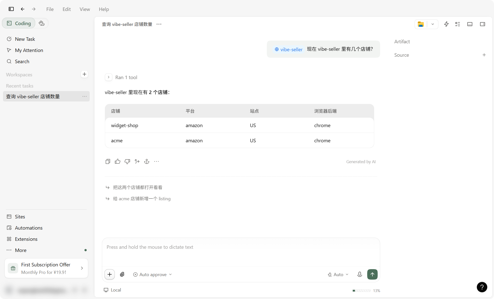

## Change or remove

Open **Settings → Extension management → Connectors**: the "…" menu on the
`vibe-seller` row has **Edit** for changing the address or the key, and
**Delete** — confirm with **Delete MCP** to remove it.

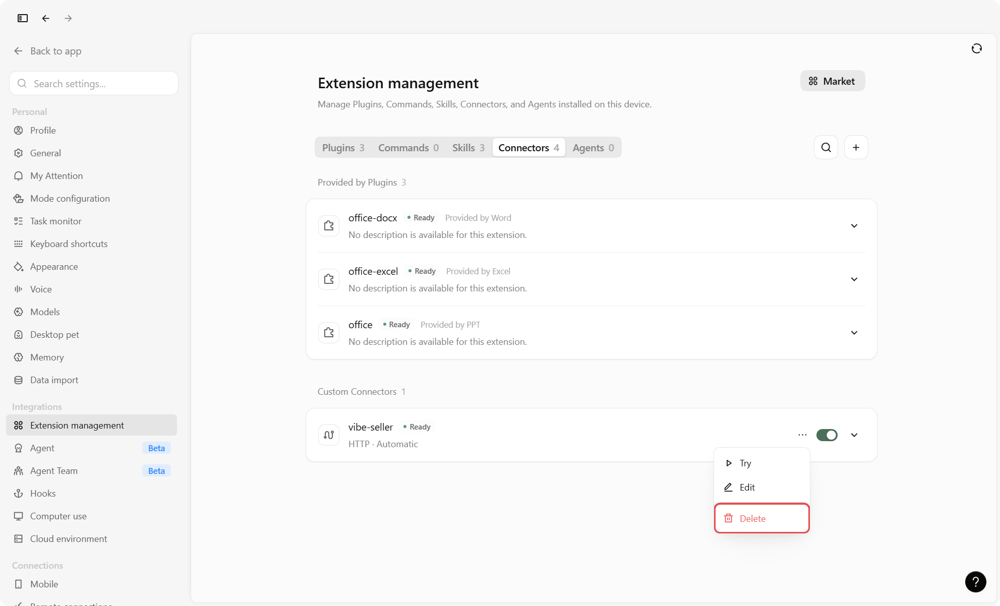

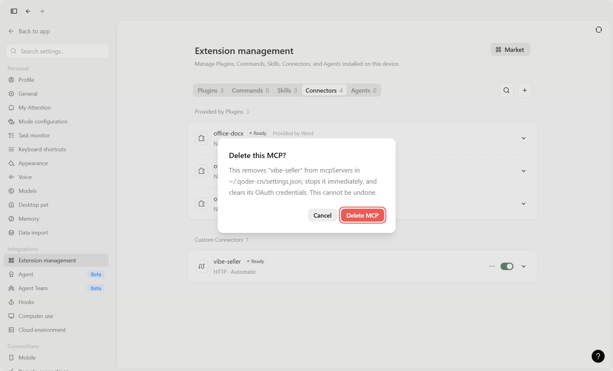

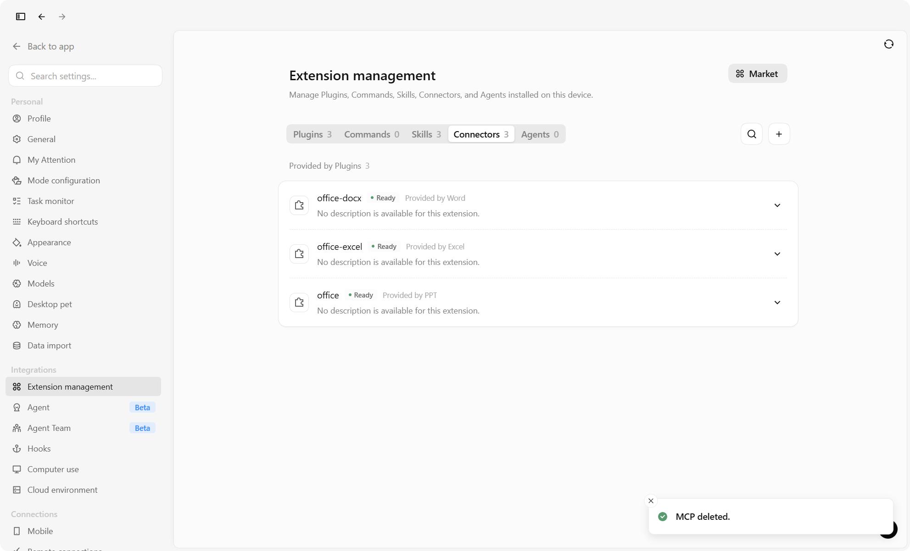

## Next

See [What you can ask](mcp.md#what-you-can-ask) for what to say once you're
connected, and [Examples](examples.md) for full walkthroughs.

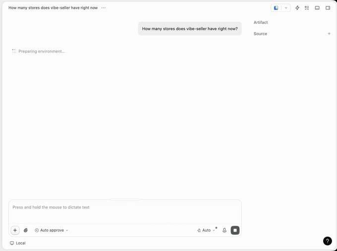
