# 在 Qoder 里接入 Vibe Seller

接好之后，在 Qoder 的对话里就能让 Vibe Seller 建任务、跟进进度、回答提问。

需要准备两样东西：

1. 一个 API Key：见[第一步：创建 API Key](mcp.md#第一步创建-api-key)。创建
   成功后弹出的窗口里有你的服务器地址和 Qoder 的现成
   配置；
2. 已经安装 Qoder：从 [qoder.com/download](https://qoder.com/download) 下载
   （国内版的应用名是 **Qoder CN**）。

## 接入

=== "界面操作"

    1. 打开左侧的「扩展」，切换到「连接器」标签。

        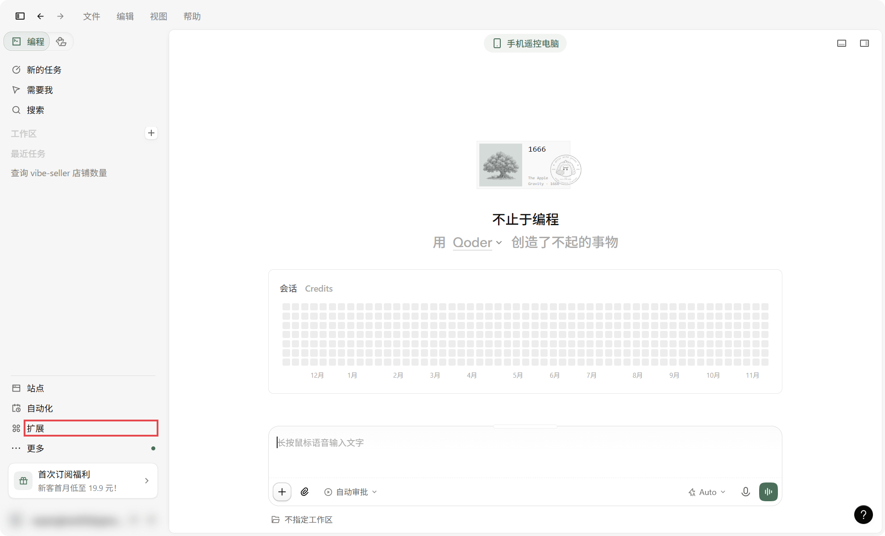

        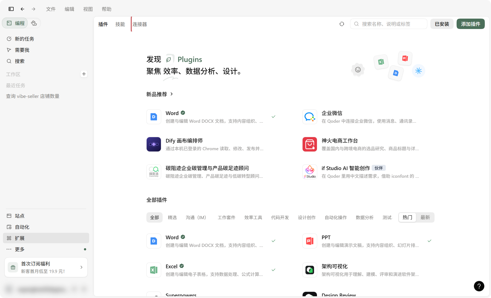

    2. 点右上角「添加连接器」，把对话框切到「JSON」标签。

        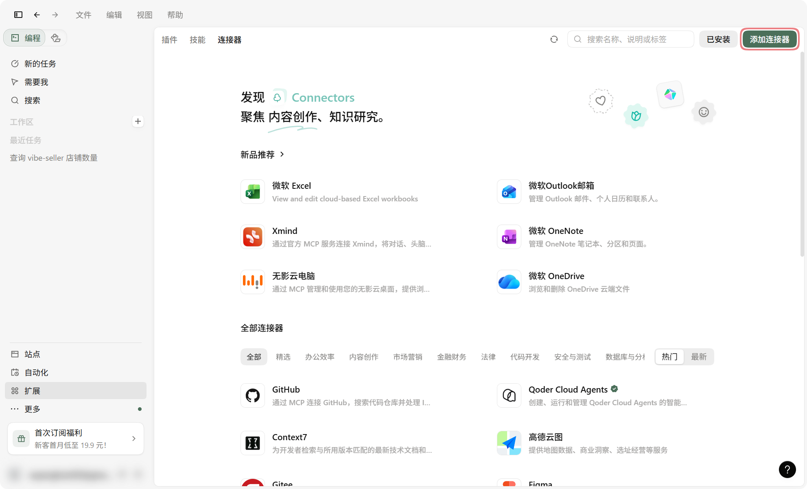

        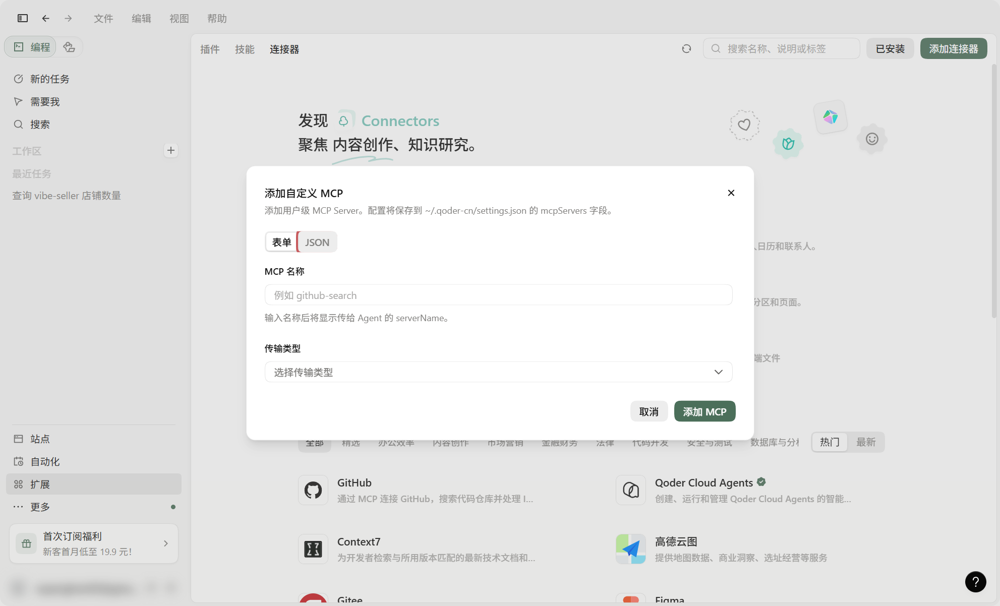

    3. 复制弹窗「界面操作」标签里的 JSON，粘贴进去，点「预览导入」。

        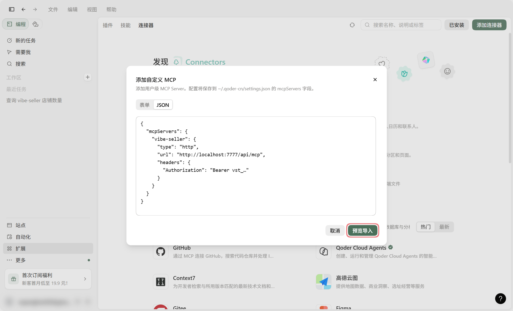

    4. 确认要导入的条目，点「导入 1 个 MCP」。之前添加过 vibe-seller 的
       话，预览会提示将被替换，确认导入就覆盖旧配置。

        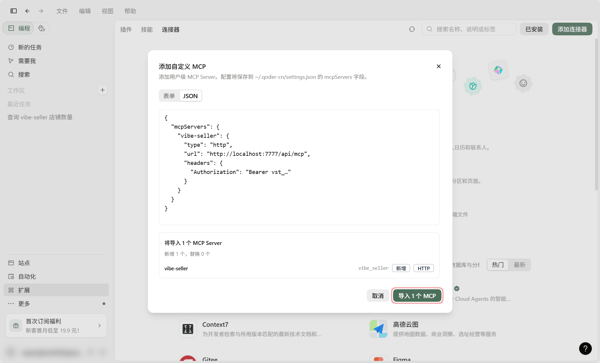

    5. 导入后显示「已安装」（可用 · HTTP），可以直接使用。

        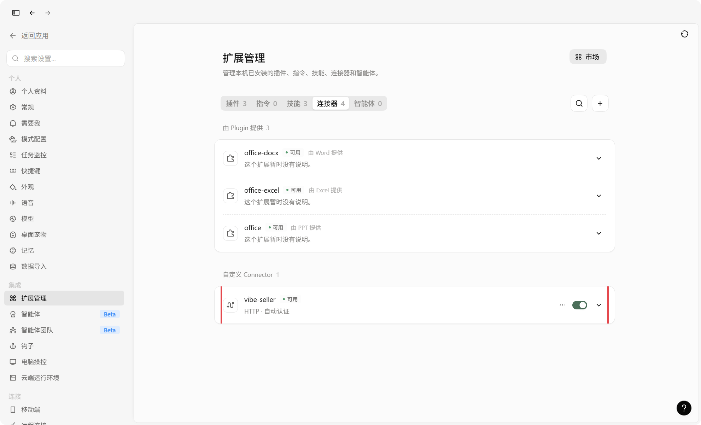

=== "命令行 / 配置文件"

    配置写在 `~/.qoder-cn/settings.json`（国内版）或
    `~/.qoder/settings.json`（国际版）的 `mcpServers` 里，保存后重新打开
    Qoder。直接改文件时，改完要在 Qoder 里再点一次「信任」。这一段长这样：

    ```json
    {
      "mcpServers": {
        "vibe-seller": {
          "type": "http",
          "url": "http://localhost:7777/api/mcp",
          "headers": {
            "Authorization": "Bearer vst_…"
          }
        }
      }
    }
    ```

## 确认接好了

新建一个对话，问“现在 vibe-seller 里有几个店铺？”。它把你的店铺列出来，
就接好了。

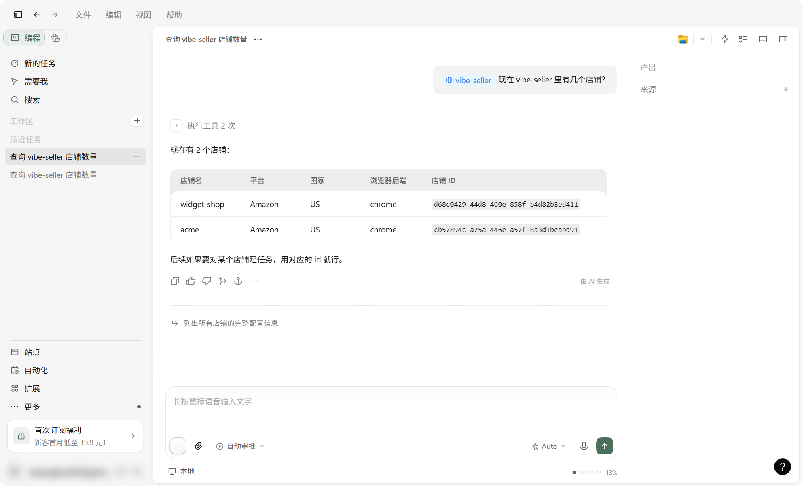

## 修改或移除

在「设置」里打开扩展管理，切到「连接器」标签：`vibe-seller` 那一行的「…」
里有「编辑」，改地址或换 Key 都在那里；「删除」→「删除 MCP」确认后即移除。

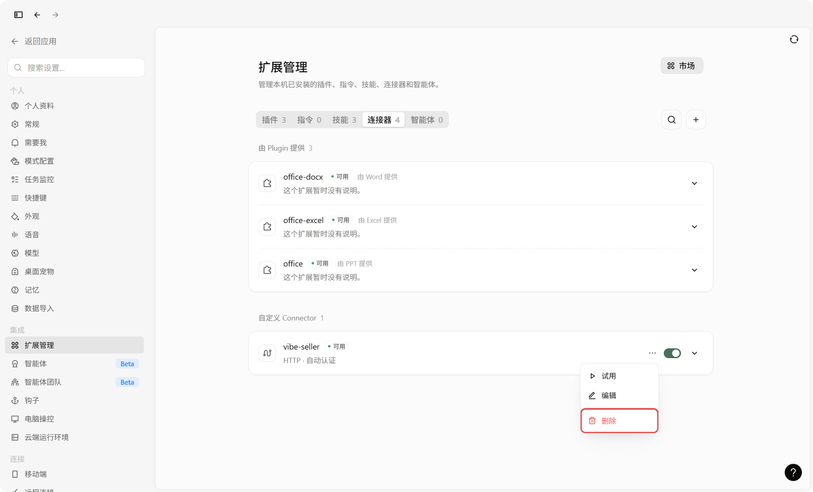

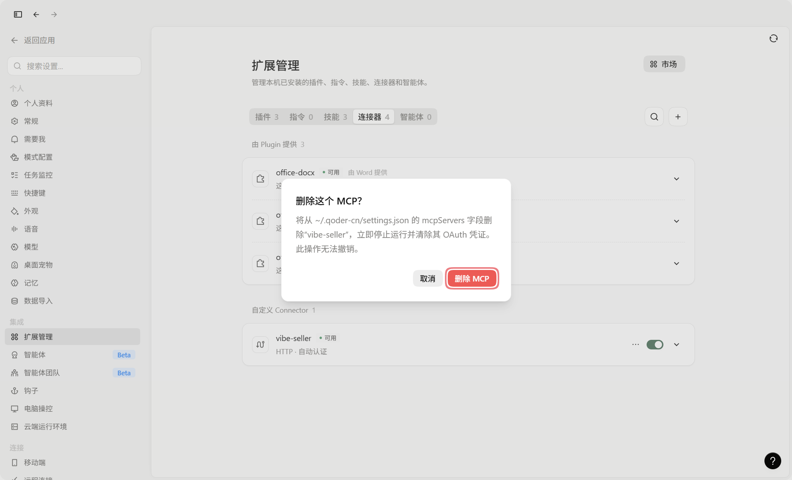

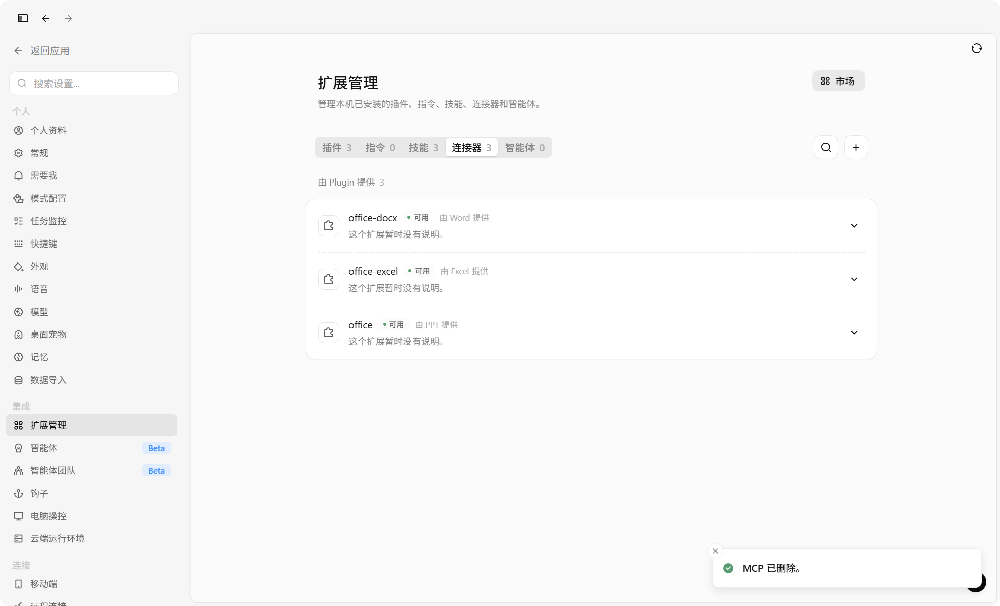

## 接下来

接入之后怎么用，见[可以这样用](mcp.md#可以这样用)；一步步的完整示例见
[使用示例](examples.md)。

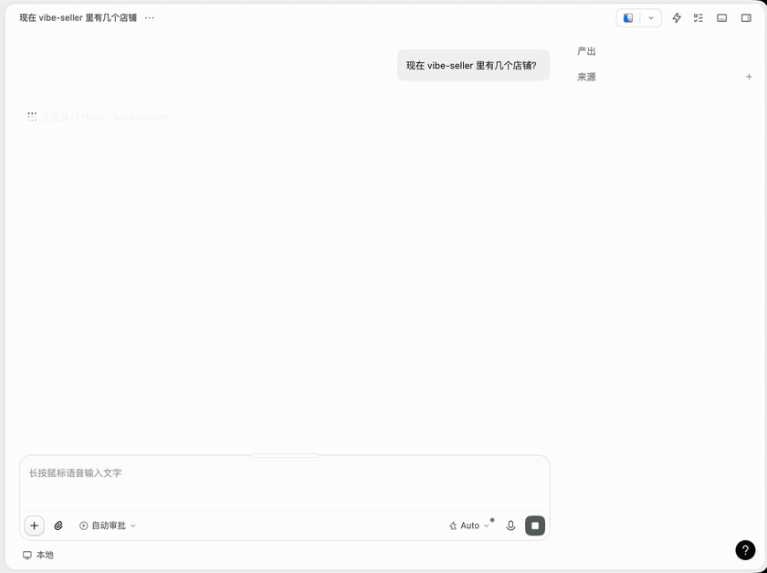
