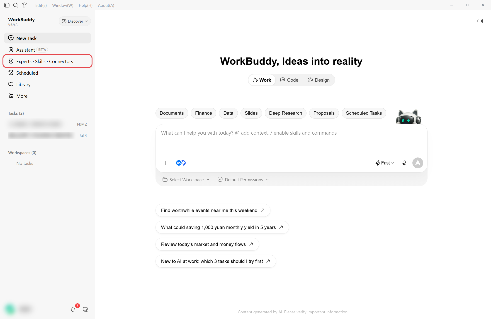
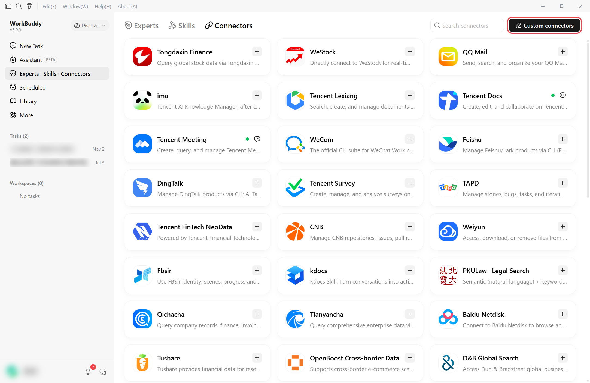
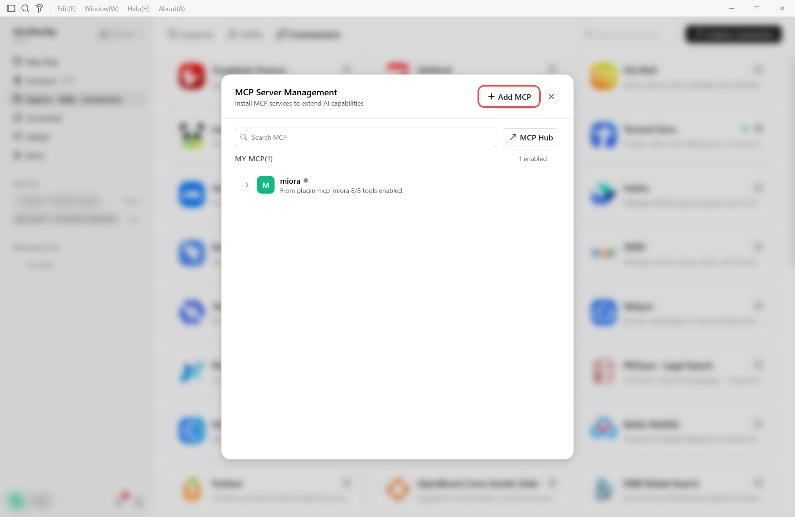
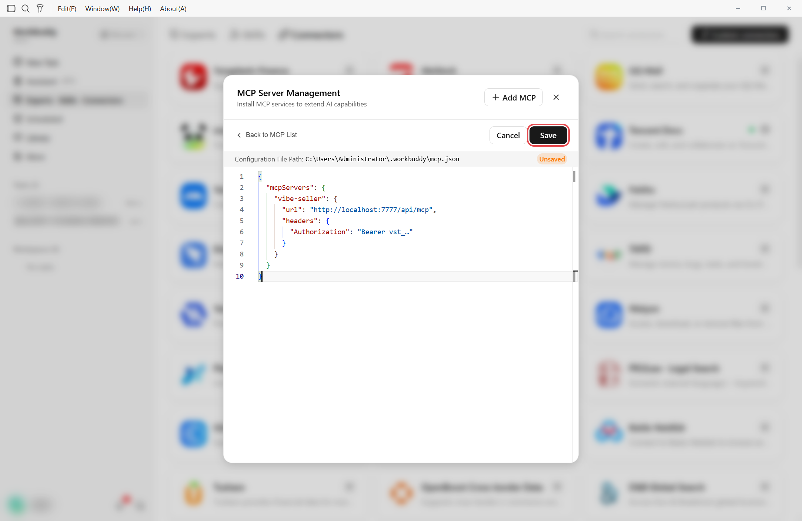
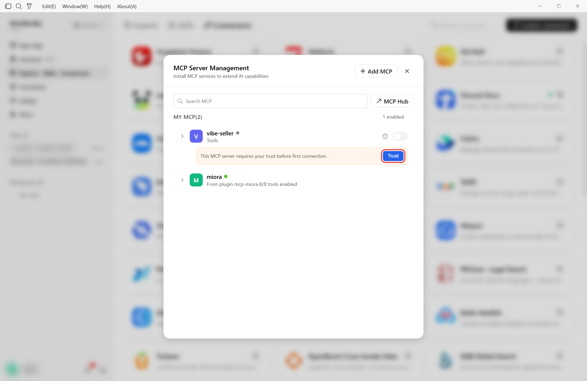
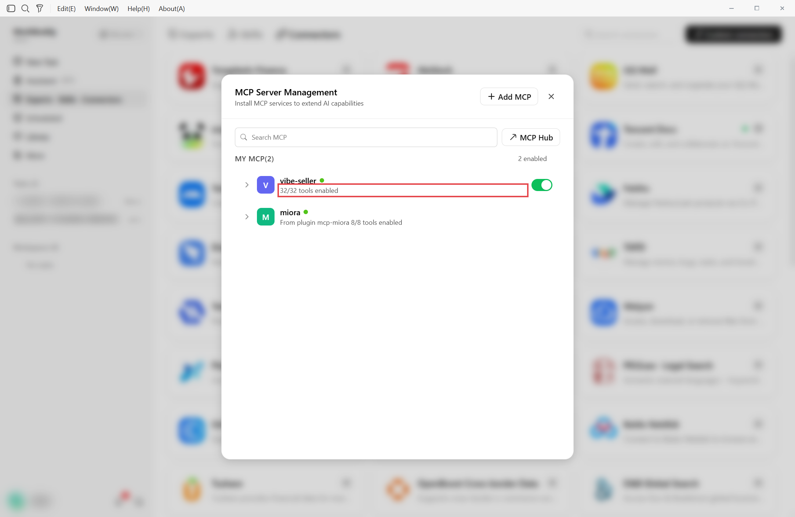
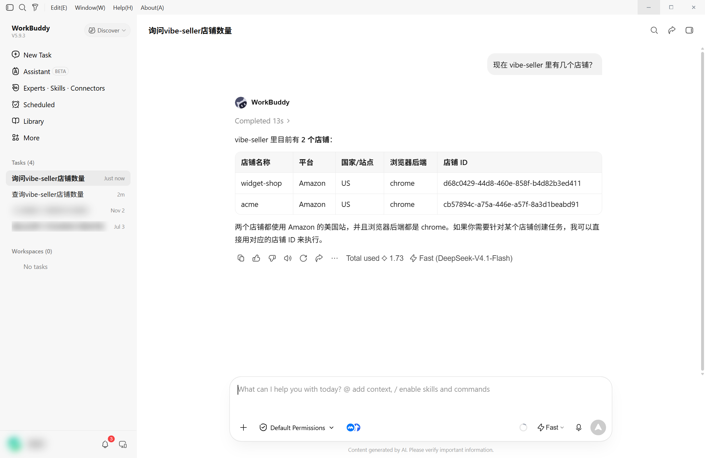
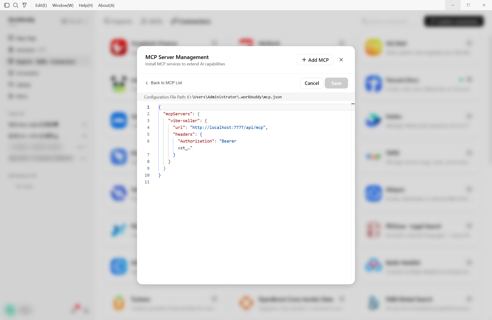
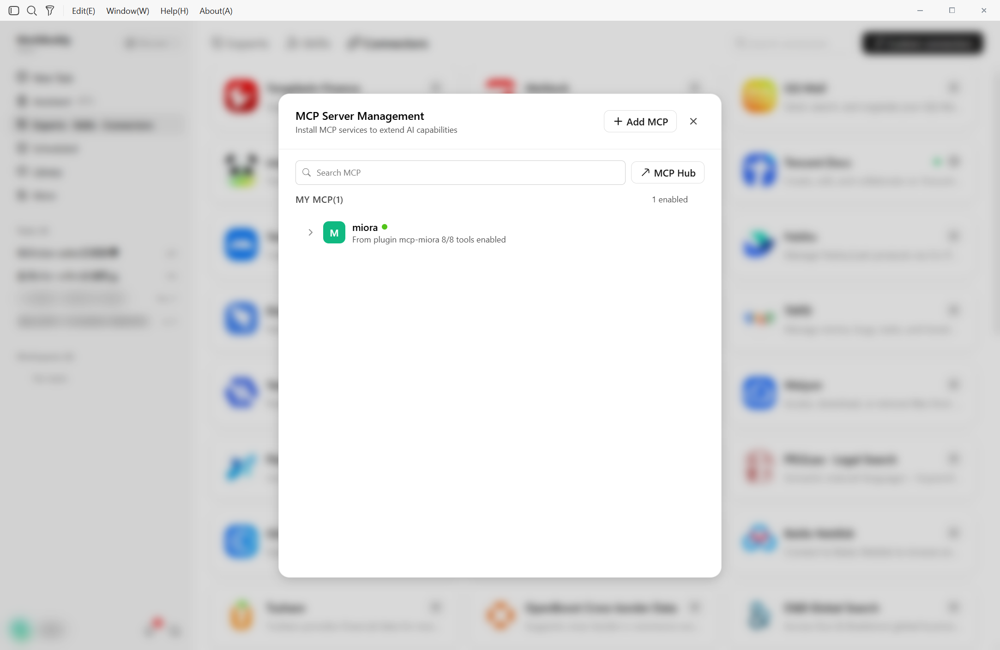
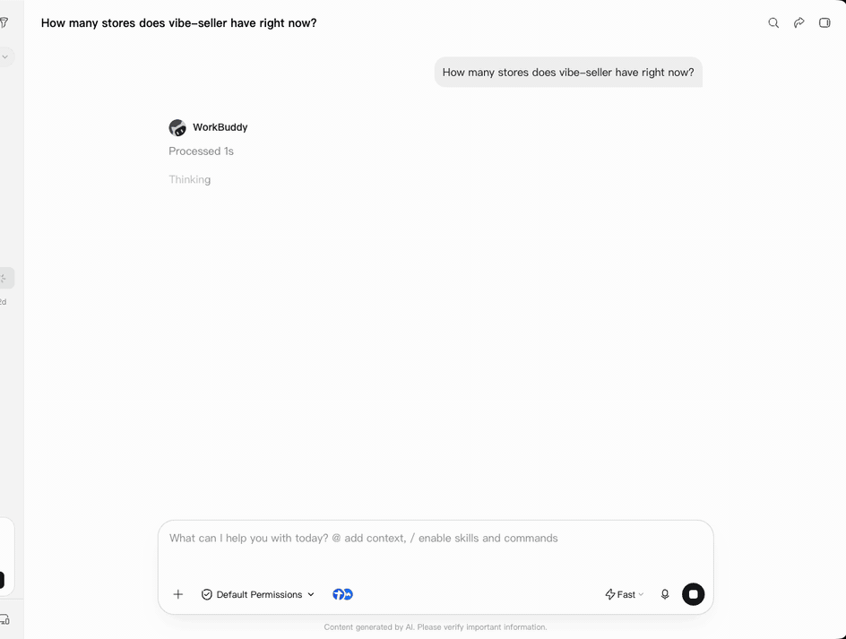

# Connect Vibe Seller to WorkBuddy

Once it's connected, you can ask WorkBuddy to create Vibe Seller tasks, follow
their progress and answer their questions.

Two things to get ready first:

1. An API key — see [First: create an API key](mcp.md#first-create-an-api-key).
   Right after you create it, the dialog shows your server address and a
   ready-made WorkBuddy config;
2. WorkBuddy installed.

## Connect

=== "In the app"

    1. Open **Experts · Skills · Connectors** in the left column and switch
       to the **Connectors** tab.

        

    2. In the **Custom connectors** area, click **+ Add MCP** under
       **MCP Server Management** to open the editor.

        

        

    3. Copy the JSON from the dialog's **In the app** tab, paste it into the
       editor and click **Save**. The editor starts with an empty
       `{"mcpServers": {}}`, so `Ctrl+A` then `Ctrl+V` works.

        

        !!! warning "If the editor already lists other servers, don't select-all-replace"
            Selecting all and replacing would delete those servers too. Add
            just the `"vibe-seller": {…}` entry inside the `mcpServers`
            braces, then save.

    4. Back in the list, click **Trust** on `vibe-seller`. It enables and the
       list reads `32/32 tools enabled`.

        

        

=== "Command line / config file"

    The file is `~/.workbuddy/mcp.json` — on Windows
    `%USERPROFILE%\.workbuddy\mcp.json`. Write the JSON from the dialog's
    **In the app** tab into it, save, reopen WorkBuddy and click **Trust** in
    the list. The block looks like this:

    ```json
    {
      "mcpServers": {
        "vibe-seller": {
          "url": "http://localhost:7777/api/mcp",
          "headers": {
            "Authorization": "Bearer vst_…"
          }
        }
      }
    }
    ```

## Check it works

Start a new chat and ask “how many stores are in vibe-seller right now?”. If it
names your stores, you're connected.



## Change or remove

To pause it, flip the switch off in the list. To remove it, click **+ Add MCP**
again, delete the `"vibe-seller": {…}` entry in the editor and save.





## Next

See [What you can ask](mcp.md#what-you-can-ask) for what to say once you're
connected, and [Examples](examples.md) for full walkthroughs.


