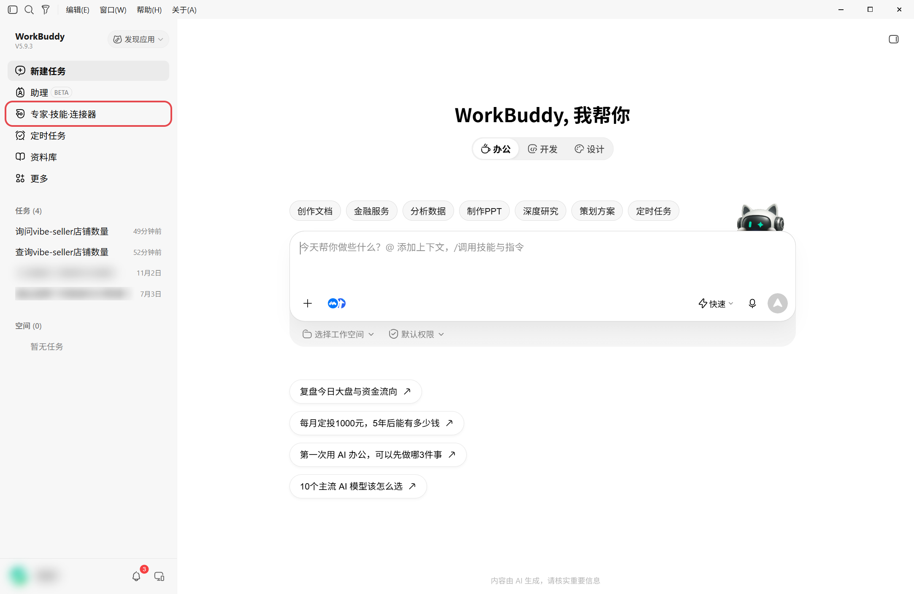
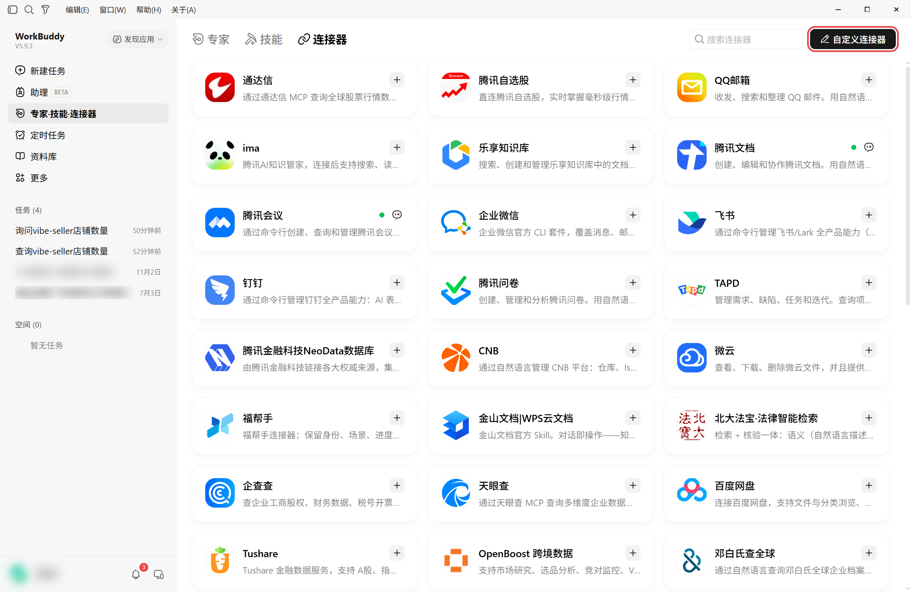
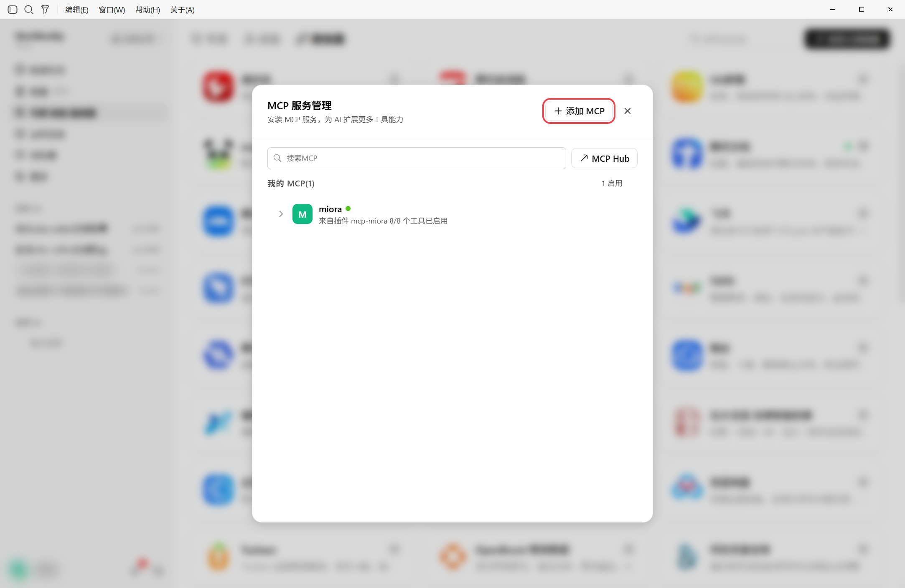
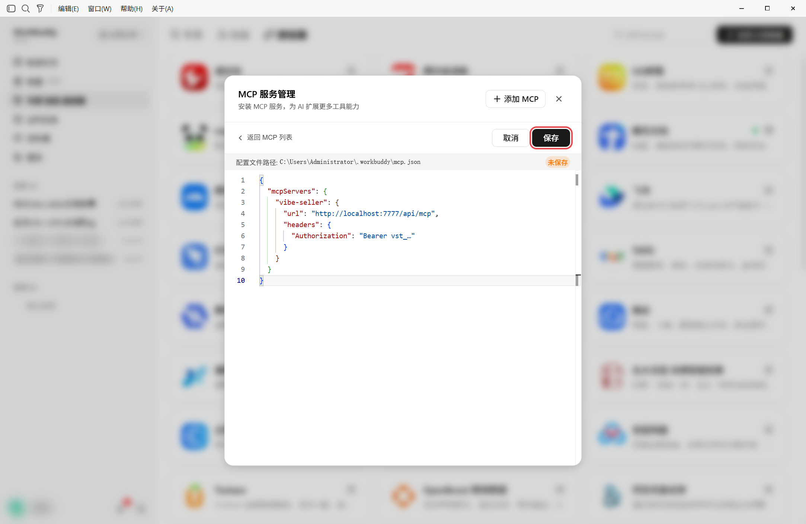
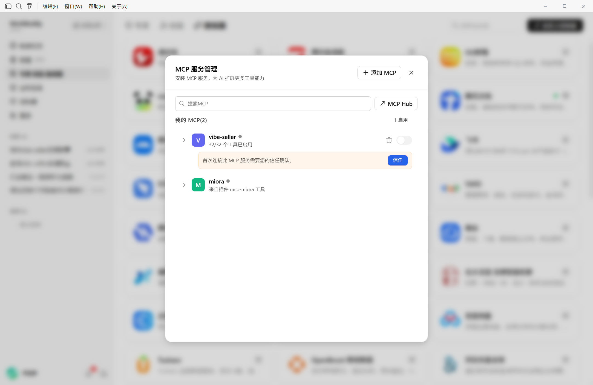
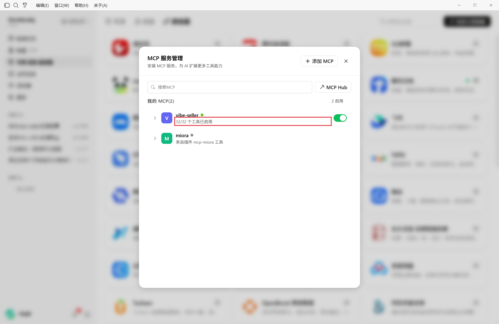
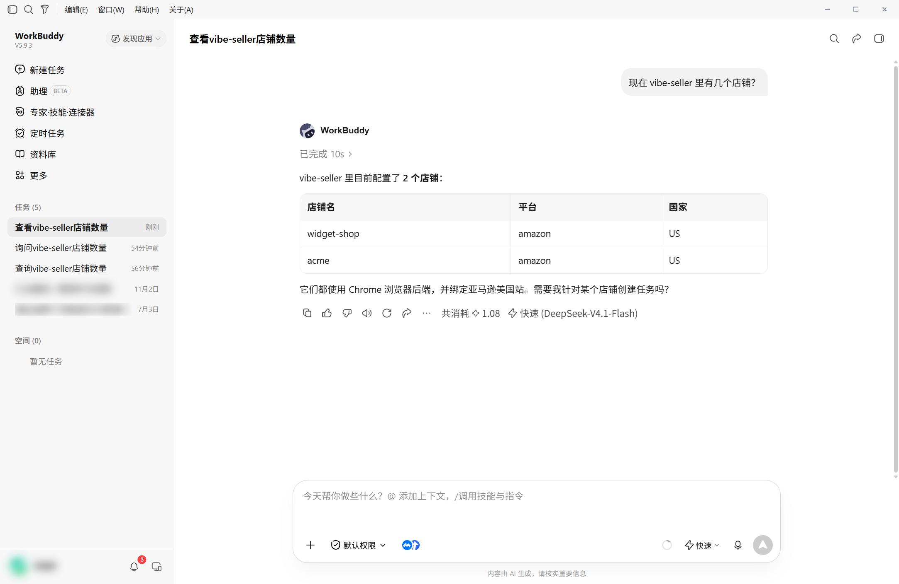
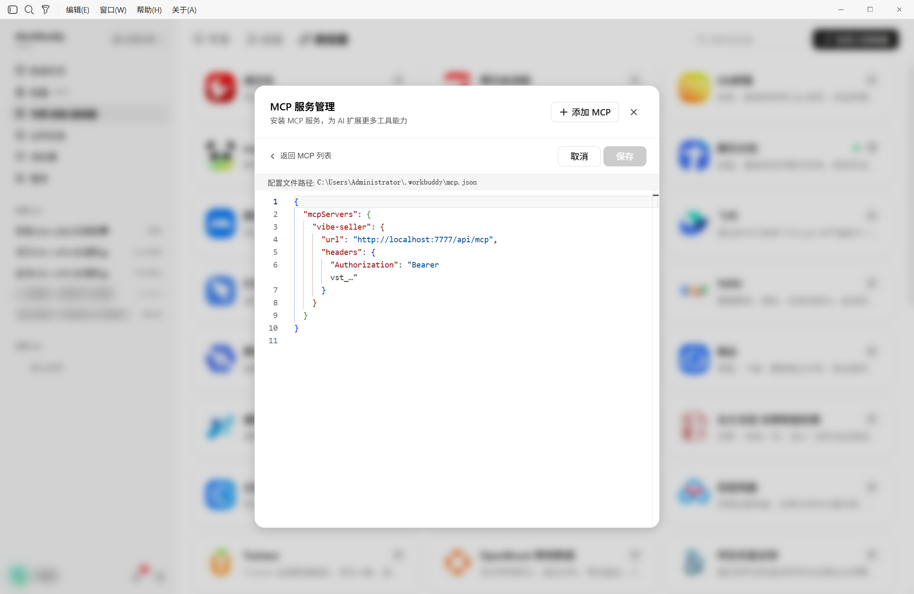
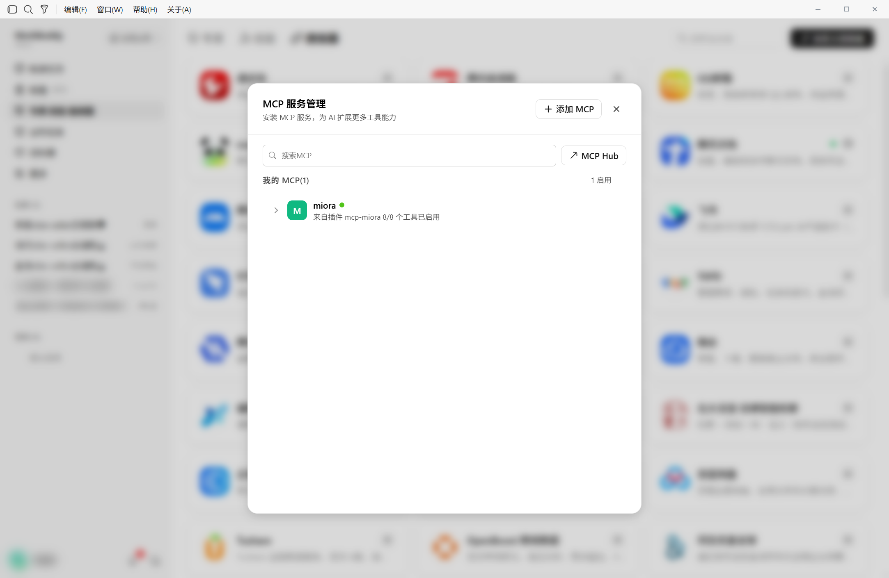
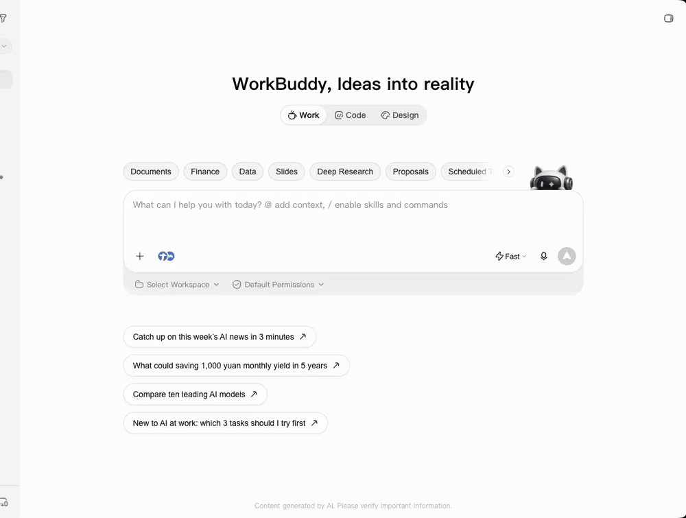

# 在 WorkBuddy 里接入 Vibe Seller

接好之后，在 WorkBuddy 的对话里就能让 Vibe Seller 建任务、跟进进度、回答提问。

需要准备两样东西：

1. 一个 API Key：见[第一步：创建 API Key](mcp.md#第一步创建-api-key)。创建
   成功后弹出的窗口（下文称「弹窗」）里有你的服务器地址和 WorkBuddy 的
   现成配置；
2. 已经安装 WorkBuddy：从 [workbuddy.cn](https://www.workbuddy.cn)（国内版）
   或 [workbuddy.ai](https://www.workbuddy.ai)（国际版）下载。

## 接入

=== "界面操作"

    1. 打开左栏的「专家·技能·连接器」，切换到「连接器」标签。

        

    2. 在「自定义连接器」区域点「+ 添加 MCP」，打开编辑器。

        

        

    3. 复制弹窗「界面操作」标签里的 JSON，粘贴到编辑器里，点「保存」。
       编辑器原本只有一个空的 `{"mcpServers": {}}`，可以 `Ctrl+A` 全选
       后 `Ctrl+V` 粘贴。

        

        !!! warning "编辑器里已经有别的服务器时，不要全选替换"
            全选替换会把别的服务器一起删掉。这种情况下只把
            `"vibe-seller": {…}` 这一段加进 `mcpServers` 的大括号里，
            再保存。

    4. 返回 MCP 列表，点 `vibe-seller` 的「信任」。启用后列表显示
       「32/32 个工具已启用」。

        

        

=== "命令行 / 配置文件"

    配置文件在 `~/.workbuddy/mcp.json`（Windows 上是
    `%USERPROFILE%\.workbuddy\mcp.json`）。把弹窗「界面操作」标签里那段
    JSON 原样写进去，保存后重新打开 WorkBuddy，同样在列表里点「信任」。
    这一段长这样：

    ```json
    {
      "mcpServers": {
        "vibe-seller": {
          "url": "http://localhost:7777/api/mcp",
          "headers": {
            "Authorization": "Bearer vst_…"
          }
        }
      }
    }
    ```

## 确认接好了

新建一个对话，问“现在 vibe-seller 里有几个店铺？”。它把你的店铺列出来，
就接好了。



## 修改或移除

临时停用只要在列表里关掉开关。要彻底删除，就再点「+ 添加 MCP」打开编辑器，
删掉 `"vibe-seller": {…}` 这一段，保存即可。





!!! warning "编辑器会明文显示 Key"
    编辑器里能看到完整的 Key。把截图发给别人之前，先遮住 `vst_` 开头的内容。

## 接下来

接入之后怎么用，见[可以这样用](mcp.md#可以这样用)；一步步的完整示例见
[使用示例](examples.md)。


