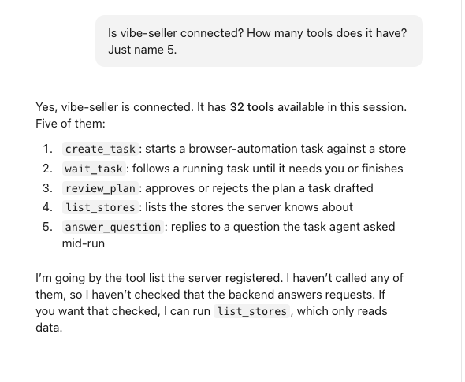
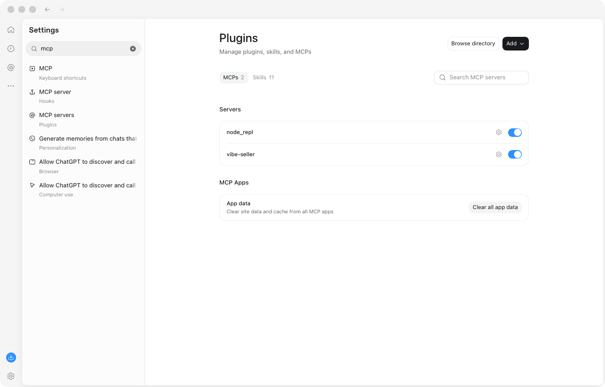
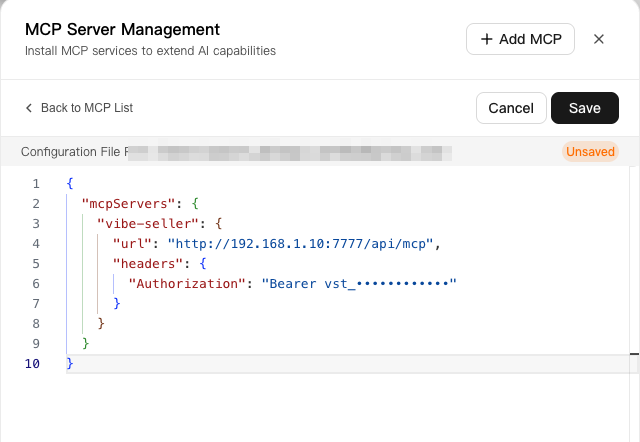
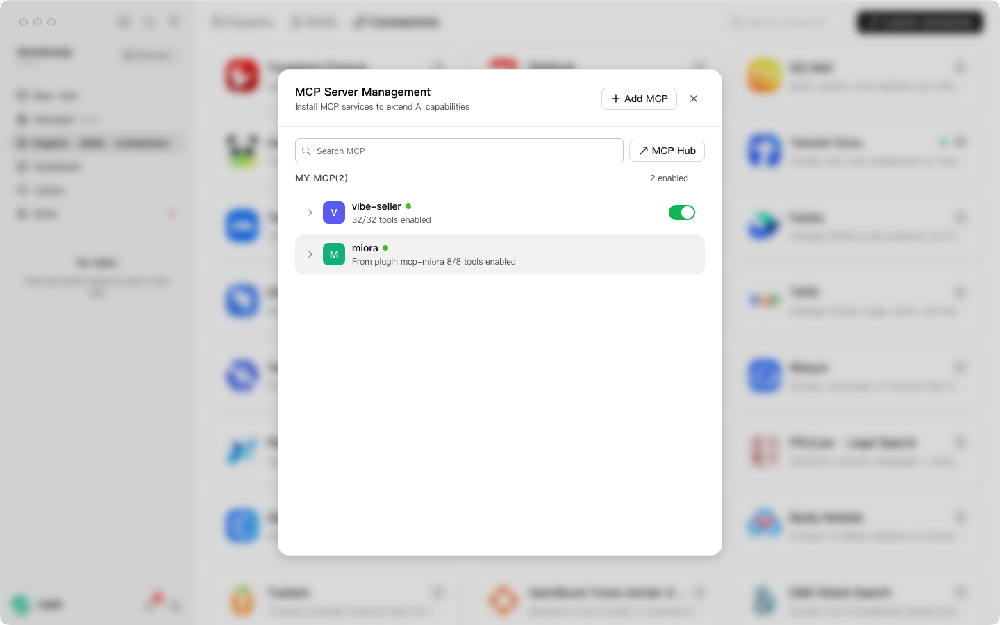
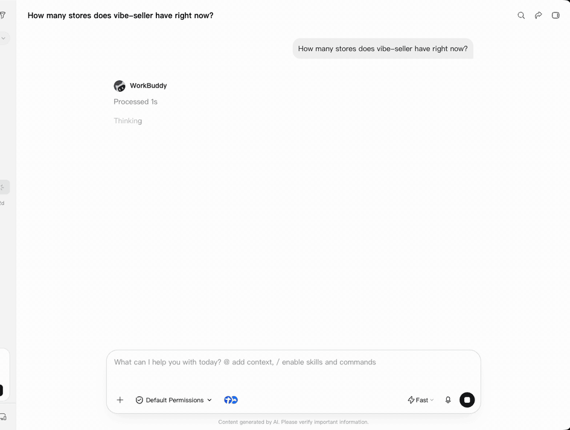
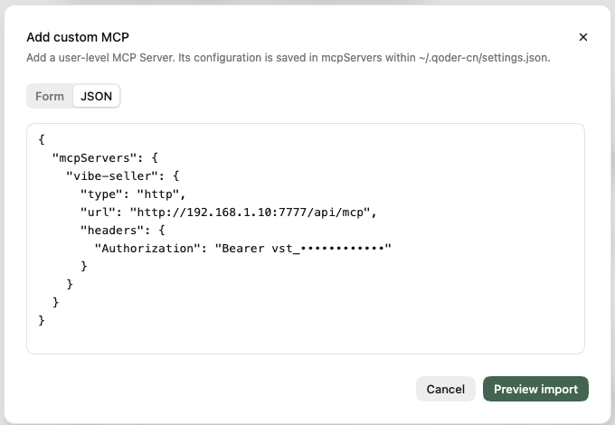
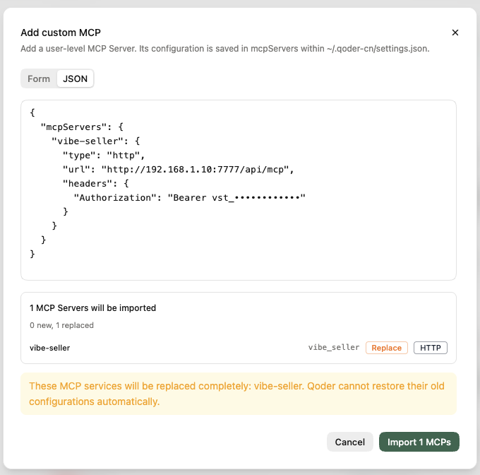
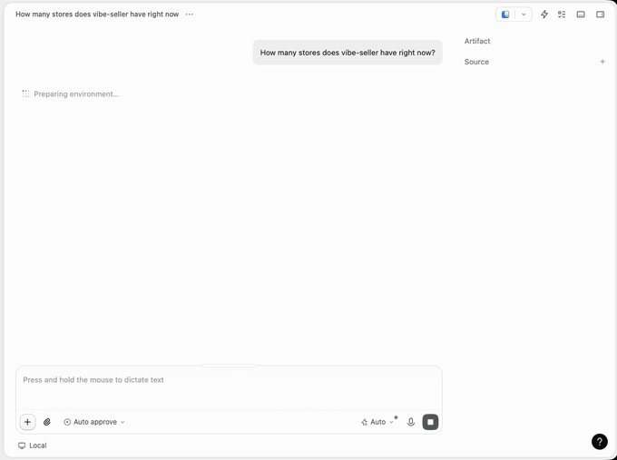

# MCP setup

Already live in Claude, Codex, WorkBuddy, Qoder, Hermes Agent or Pi? You can now
drive Vibe Seller from those tools.

Once connected, just say something like "look at acme's ads from last week" in
the chat. The tool creates the task in Vibe Seller, keeps an eye on it, and
brings the summary back to you. Questions the task wants to ask you, and plans
that need your nod, all happen in the same conversation — no more hopping
between windows.

Any MCP-capable tool works; all you need is an API key.

> **Safety**: an AI tool can only ask Vibe Seller to run tasks. It never touches
> your browser and can never edit your store directly. Plan approval, the
> ad-scope checks and the rest of the gates work exactly as they do in the web
> UI.

This page covers the four desktop apps plus two terminal agents, Hermes Agent
and Pi. If you use another command-line tool (Claude Code CLI, Codex CLI, …) or
want the technical details (the protocol, all 32 tools,
curl examples), see [Connect an External Agent](agents.md).

## What you can ask

Once connected, just talk to it like a colleague:

- "How many stores does vibe-seller have right now?"
- "Look at acme's ad spend over the past week and suggest improvements — don't
  change anything yet."
- "What is that task doing at the moment? How far along is it?"
- "Turn this week's inspection into a weekly Monday-morning run — show me the
  plan first."

You don't need to remember any commands — the tool figures out what to call.

## What it can and cannot do

| | |
|---|---|
| ✅ Can | Create tasks (with attachments), follow progress, answer the task's questions, approve or reject plans, confirm generated images, send follow-ups, stop / retry / delete tasks, read a task's output files, manage the knowledge base, skills and schedules |
| ❌ Cannot | Drive the browser (click, open pages, take screenshots) or edit your store directly. Anything store-facing happens inside a Vibe Seller task and goes through every check. Routing through Vibe Seller keeps each store's data isolated and keeps the AI from going hands-on |

Ad tasks created from an AI tool follow the same rules as ones you create in
the web UI: before any work starts the task must state exactly what it will
check and change; a report that skips marketplaces gets sent back to finish the
job; and a report-only task never touches your ads.

> The screenshots and recordings below were made on macOS; the steps are the
> same on Windows and Linux. Check each tool's download page for supported
> systems.
> On this page, `~` means your user folder — `C:\Users\<your-username>` on
> Windows.

## First: create an API key

In the Vibe Seller web UI, open **Settings → Integrations → API key** and
create one:

1. Give it a name you'll recognise later, like `claude-desktop`;
2. Pick an expiry: 30 days, 90 days, 365 days, or never;
3. **Copy the key** right away. It is shown only once — close the dialog and
   it's gone for good.


The dialog also hands you ready-to-paste configs for every tool below. Set the
**server address** to one the tool can reach first — the configs update as you
type:


A few things to keep in mind:

- Keys start with `vst_`. **Treat one like a password**: a tool holding it acts
  as you, with your permissions.
- Revoke it in the same place whenever you like — if you're done with it or
  suspect it leaked.
- Create a key even if your Vibe Seller runs without login. Turn login on later
  and the tool won't suddenly stop connecting.

## Claude desktop

### Install

Download the build for your system from
[claude.com/download](https://claude.com/download) and install it.

### Connect

The **Code tab** in the Claude desktop app is Claude Code, so one run of the
command from the dialog in any terminal sets the app up too:

```bash
# Connects to this machine; if Vibe Seller runs elsewhere, use its address instead of localhost
claude mcp add --scope user --transport http vibe-seller \
  http://localhost:7777/api/mcp --header "Authorization: Bearer vst_…"
```

The dialog pre-fills the server address with the one your page was served from.
If the tool runs on another machine, change it to an address that machine can
reach.

For smoother runs, also install the `vibe-seller` **plugin** (see
[agents.md](agents.md) for how). It ships instructions that teach the agent
when to plan first, how to follow a task, how to answer its questions, and to
only ever report results the task really produced — never invented ones.

> If your Vibe Seller is reachable from the public internet you can also
> connect from Claude's chat page: **Settings → Connectors → Add custom
> connector**, with the server address and an
> `Authorization: Bearer vst_…` request header. That route is brokered through
> Claude's cloud, which cannot reach a `localhost` or LAN address — for local
> installs, use the command above.

### Verify

Open a new Code session and ask "how many stores does vibe-seller have?". If it
answers with the store list — or you see tools like `list_stores` and
`create_task` in the tool list — you're connected.



### Try it

Send these one after another and watch it run an ad analysis for you:

1. "How many stores are in vibe-seller right now?"
2. "Look at acme's ad spend for the past week, give me some optimization
   suggestions — use common-sense defaults, don't ask me — and don't change
   anything yet."
3. "What is this task doing right now, which step is it on?"
4. "OK, follow it through and summarize when it's done."

## Codex desktop

### Install

Download the desktop app from [chatgpt.com/codex](https://chatgpt.com/codex).
Codex now ships inside the ChatGPT desktop app — install it and switch to
Codex. First launch asks you to sign in with a ChatGPT account.

### Connect

The Codex desktop app and the Codex CLI share `~/.codex/config.toml`. Paste the
block from the dialog into it:

```toml
[mcp_servers.vibe-seller]
# Connects to this machine; if Vibe Seller runs elsewhere, use its address instead of localhost
url = "http://localhost:7777/api/mcp"
http_headers = { "Authorization" = "Bearer vst_…" }
```

Save and restart Codex.

> Put the key in the config itself — don't use `bearer_token_env_var`. A
> desktop app launched from the Dock, Start menu or a desktop icon never sees
> environment variables you exported in a terminal, and the server will never
> connect.

To run Codex on your own model instead of ChatGPT quota, add a
`[model_providers.…]` block (any OpenAI-compatible or Responses-API provider)
to the same file and point `model_provider` at it.

### Verify

Ask "how many stores does vibe-seller have?" in Codex, or open
**Settings → Plugins → MCPs** (searching "mcp" in Settings finds it too) and
check that `vibe-seller` is switched on.



### Try it

Send these one after another and watch it run an ad analysis for you:

1. "How many stores are in vibe-seller right now?"
2. "Look at acme's ad spend for the past week, give me some optimization
   suggestions — use common-sense defaults, don't ask me — and don't change
   anything yet."
3. "What is this task doing right now, which step is it on?"
4. "OK, follow it through and summarize when it's done."

## WorkBuddy (Tencent)

### Install

Download the build for your system from
[workbuddy.cn](https://www.workbuddy.cn) (China edition) or
[workbuddy.ai](https://www.workbuddy.ai) (international). First launch asks you
to sign in.

### Connect

The dialog hands you a WorkBuddy-specific config. Use either way:

- **Edit the file**: write the config as-is into `~/.workbuddy/mcp.json`;
- **In the app**: **Connectors → Custom connectors → MCP Server Management →
  + Add MCP**, and paste the same config.

```json
{
  "mcpServers": {
    "vibe-seller": {
      "url": "http://localhost:7777/api/mcp",
      "headers": {
        "Authorization": "Bearer vst_…"
      }
    }
  }
}
```

This connects to this machine; if Vibe Seller runs on another one, replace
`localhost` with that machine's address.



The entry then appears in the list. **You must also click "Trust" and flip its
switch on** before it actually connects. Any later edit to the config file
requires trusting it again.

### Verify

MCP Server Management reads `vibe-seller · 32/32 tools enabled` — that means
it's connected. Then try asking "how many stores does vibe-seller have?" in a
chat:



### Try it

Send these one after another and watch it run an ad analysis for you:

1. "How many stores are in vibe-seller right now?"
2. "Look at acme's ad spend for the past week, give me some optimization
   suggestions — use common-sense defaults, don't ask me — and don't change
   anything yet."
3. "What is this task doing right now, which step is it on?"
4. "OK, follow it through and summarize when it's done."



## Qoder (Alibaba)

### Install

Download the build for your system from
[qoder.com/download](https://qoder.com/download) — the China edition ships as
**Qoder CN**. First launch asks you to sign in to a Qoder account (Google /
GitHub / email sign-up).

### Connect

Open **Extensions → Connectors**, click **Add Connector** at the top right,
switch to the JSON tab and paste the config from the dialog:

```json
{
  "mcpServers": {
    "vibe-seller": {
      "type": "http",
      "url": "http://localhost:7777/api/mcp",
      "headers": {
        "Authorization": "Bearer vst_…"
      }
    }
  }
}
```

This connects to this machine; if Vibe Seller runs on another one, replace
`localhost` with that machine's address.



Click **Preview import** to confirm, then **Import** and you're done.



If vibe-seller is already set up, the preview says it will be replaced —
importing overwrites the old entry.

The config is saved in `mcpServers` within `~/.qoder-cn/settings.json` (the
international edition uses `~/.qoder/settings.json`). If you edit that file
later, trust the connector again in Qoder.

### Verify

Under **Settings → Extension management → Connectors**, `vibe-seller · Ready ·
HTTP` means it's connected; expand it for the full tool list. Then try asking
"how many stores does vibe-seller have?" in a chat.

### Try it

Send these one after another and watch it run an ad analysis for you:

1. "How many stores are in vibe-seller right now?"
2. "Look at acme's ad spend for the past week, give me some optimization
   suggestions — use common-sense defaults, don't ask me — and don't change
   anything yet."
3. "What is this task doing right now, which step is it on?"
4. "OK, follow it through and summarize when it's done."



## Hermes Agent (Nous Research)

### Install

Follow the
[official Hermes Agent install guide](https://hermes-agent.nousresearch.com/docs/getting-started/installation)
— it supports macOS, Linux and Windows.

### Connect

Hermes reads MCP servers from `mcp_servers` in `~/.hermes/config.yaml`. Add the
block from the dialog:

```yaml
mcp_servers:
  vibe-seller:
    # Connects to this machine; if Vibe Seller runs elsewhere, use its address instead of localhost
    url: "http://localhost:7777/api/mcp"
    headers:
      Authorization: "Bearer vst_…"
```

If the file already has an `mcp_servers:` key, put just the `vibe-seller:`
entry under it — don't add a second `mcp_servers:`. Save, then run
`/reload-mcp` in a Hermes session, or restart Hermes.

### Verify

Run `hermes mcp test vibe-seller` in a terminal. `✓ Connected` and
`Tools discovered: 32` mean you're connected. Then ask "how many stores does
vibe-seller have?" in a chat.

### Try it

Send these one after another and watch it run an ad analysis for you:

1. "How many stores are in vibe-seller right now?"
2. "Look at acme's ad spend for the past week, give me some optimization
   suggestions — use common-sense defaults, don't ask me — and don't change
   anything yet."
3. "What is this task doing right now, which step is it on?"
4. "OK, follow it through and summarize when it's done."

## Pi

### Install

Install it as described on [pi.dev](https://pi.dev):

```bash
npm install -g --ignore-scripts @earendil-works/pi-coding-agent
```

MCP support is built in — no extension needed.

### Connect

Run the command from the dialog in a terminal:

```bash
# Connects to this machine; if Vibe Seller runs elsewhere, use its address instead of localhost
pi mcp add vibe-seller --url http://localhost:7777/api/mcp --header "Authorization=Bearer vst_…"
```

It writes `~/.pi/agent/mcp.json`. Note that `--header` takes `Name=value`, not
`Name: value`. In a Pi session that is already open, run `/reload` once.

### Verify

Run `pi mcp list` in a terminal. `vibe-seller: connected, 32 tools` means
you're connected. Then ask "how many stores does vibe-seller have?" in a chat.

By default Pi has the model call these tools from a short script (Pi calls this
codemode), so the chat shows a script call rather than individual tool names.
That's expected.

### Try it

Send these one after another and watch it run an ad analysis for you:

1. "How many stores are in vibe-seller right now?"
2. "Look at acme's ad spend for the past week, give me some optimization
   suggestions — use common-sense defaults, don't ask me — and don't change
   anything yet."
3. "What is this task doing right now, which step is it on?"
4. "OK, follow it through and summarize when it's done."

## Troubleshooting

**401 Unauthorized**

The key is wrong, revoked, or expired, or its owner is deactivated. Check the
key under **Settings → Integrations → API key**. A revoked or expired key is
rejected even when the server runs with login off — revoking really revokes.

**405**

The address is wrong, or your Vibe Seller is too old to have the MCP endpoint.
Make sure the address ends in `/api/mcp`, and upgrade Vibe Seller if needed.

**Connection refused, or certificate (TLS) errors**

Check the address and port, and whether the tool's machine can reach Vibe
Seller at all. A server bound to `127.0.0.1` is only reachable from the same
machine; put an HTTPS reverse proxy in front for remote use.

**Tools are listed but every call fails**

Usually a wrong address. All the configs above want the address ending at
`/api/mcp`; the only exception is the Claude **plugin**, which takes just the
server root (e.g. `http://localhost:7777`) and appends `/api/mcp` itself. Also check
for a stray trailing slash.

**It answers without creating a task**

It answered from its own knowledge instead of running anything. The Claude
plugin helps a lot here — it requires the agent to report only what the task
really produced. You can also say outright "use vibe-seller to create a task
for this".

**Will a screenshot leak the key?**

Config UIs usually mask it, but scrub anything starting with `vst_` before
sharing a screenshot.
