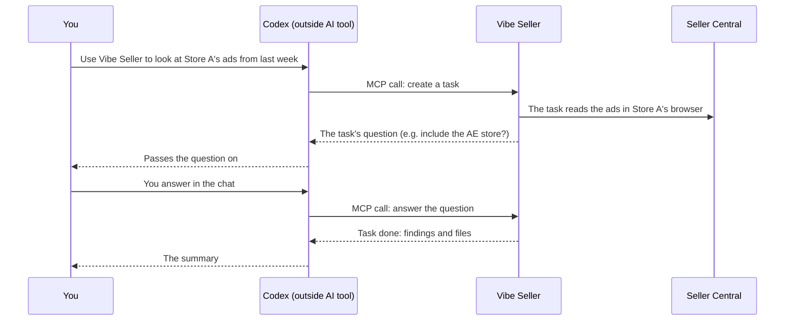

# MCP setup

MCP setup lets an **outside AI tool** — Codex, Claude, WorkBuddy, Qoder, Hermes
Agent, Pi — call Vibe Seller. You talk to Codex in its chat; Codex calls the tools
Vibe Seller exposes over MCP: create tasks, check progress, answer the tasks'
questions, fetch results and files. The work inside Seller Central is still done
by Vibe Seller's tasks; Codex hands them out, follows them and sums them up for you.

The rest of this page uses Codex as the example; the other tools work the same way.

!!! note "Everything on this page is said to Codex"
    The example sentences below go into **Codex's chat box**, and Codex decides
    which Vibe Seller tool to call. They are not task descriptions for Vibe
    Seller — when Codex creates a task, it writes the task description itself.

Any MCP-capable tool works; all you need is an API key. Where each integration
is configured and how they divide up: see the
[Integrations overview](integrations.md).

## What you can ask

Once connected, talk to Codex like a colleague. Mentioning "Vibe Seller" in the
sentence helps Codex think of calling it:

| You say in Codex | What Codex does in Vibe Seller |
|---|---|
| “How many stores are in Vibe Seller right now?” | Reads the store list and answers — no task |
| “Use Vibe Seller to look at Store A's ad spend over the past week and suggest improvements — don't change anything yet.” | Creates a task on Store A, waits for it, brings the findings back to the chat |
| “How far along is that task?” | Reads the task's progress and tells you |
| “In Vibe Seller, schedule this check for every Monday morning — show me the plan first.” | Creates a schedule and brings its plan back for you to review |

No commands to learn — Codex decides which tool to call. When a task needs an
answer from you or a plan approved, the question shows up in the Codex chat; answer
it there, no need to switch to the Vibe Seller web app. A full walkthrough:
[Export a Ziniao store's financial data with Codex and analyse it](example-mcp.en.md).

## What it can and cannot do

- **Can**: create tasks (with attachments), follow progress, answer the task's
  questions, approve or reject plans, confirm generated images, send
  follow-ups, stop / retry / delete tasks, read a task's output files, manage
  the knowledge base, skills and schedules.
- **Cannot**: drive the browser (click, open pages, take screenshots) or edit
  your store directly.

Anything store-facing happens inside a Vibe Seller task, and plan approval,
the ad-scope checks and the rest of the gates work exactly as they do in the
web UI. Routing work through Vibe Seller keeps each store's data isolated and
keeps the AI from going hands-on.

Ad tasks created from an AI tool follow the same rules as ones you create in
the web UI: before any work starts the task must state exactly what it will
check and change; a report that skips marketplaces gets sent back to finish the
job; and a report-only task never touches your ads.

## First: create an API key

In the Vibe Seller web UI, open **Settings → Integrations → API keys** and
click **New API key**:

1. Give it a name you'll recognise later, like `claude-desktop`;
2. Pick an expiry: 30 days, 90 days, 365 days, or never;
3. **Copy the key** right away. It is shown only once — close the dialog and
   it's gone for good.

The same dialog also hands you ready-to-paste configs, one card per tool: the
"In the app" tab for tools you set up inside the app, "Command line / config
file" for the rest — the same tabs each setup page uses. Set the **server
address** to one the tool can reach first; the configs update as you type:

A few things to keep in mind:

- Keys start with `vst_`: **a tool holding one acts as you, with your
  permissions**.
- Revoke it in the same place whenever you like — if you're done with it or
  suspect it leaked.
- Create a key even if your Vibe Seller runs without login. Turn login on later
  and the tool won't suddenly stop connecting.

## Choose your AI tool

Take the key you just created and open the page for the tool you use:

| Tool | How you connect |
|---|---|
| [Codex](mcp-codex.md) | Fill a form in the app |
| [WorkBuddy](mcp-workbuddy.md) | Paste JSON |
| [Qoder](mcp-qoder.md) | Paste JSON |
| [Hermes Agent](mcp-hermes.md) | Paste JSON |
| [Pi](mcp-pi.md) | Command line |
| [Claude](mcp-claude.md) | Command line |

Using another MCP-capable tool, or after the technical details (the protocol,
all 32 tools, curl examples)? See [Connect an External Agent](agents.md).

## Troubleshooting

**401 Unauthorized**

The key is wrong, revoked, or expired, or its owner is deactivated. Check the
key under **Settings → Integrations → API keys**. A revoked or expired key is
rejected even when the server runs with login off — revoking really revokes.

**405**

The address is wrong, or your Vibe Seller is too old to have the MCP endpoint.
Make sure the address ends in `/api/mcp`, and upgrade Vibe Seller if needed.

**Connection refused, or certificate (TLS) errors**

Check the address and port, and whether the tool's machine can reach Vibe
Seller at all. A server bound to `127.0.0.1` is only reachable from the same
machine; put an HTTPS reverse proxy in front for remote use.

**Tools are listed but every call fails**

Usually a wrong address. All the configs on the tool pages want the address
ending at `/api/mcp`; the only exception is the Claude **plugin**, which takes
just the server root (e.g. `http://localhost:7777`) and appends `/api/mcp`
itself. Also check for a stray trailing slash.

**It answers without creating a task**

It answered from its own knowledge instead of running anything. The Claude
plugin helps a lot here — it requires the agent to report only what the task
really produced. You can also say outright “use vibe-seller to create a task
for this”.
