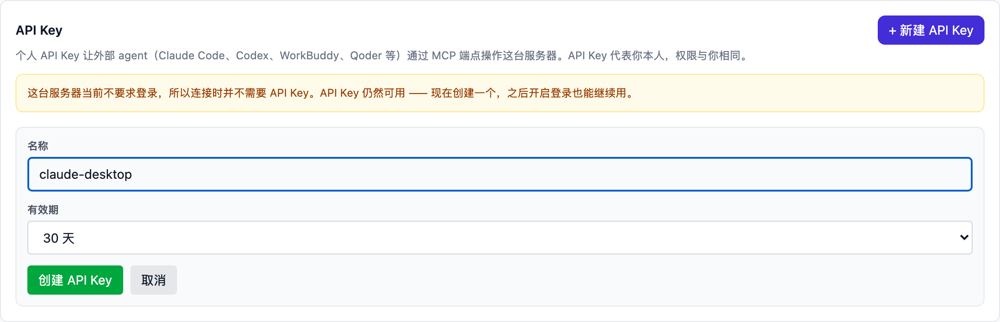
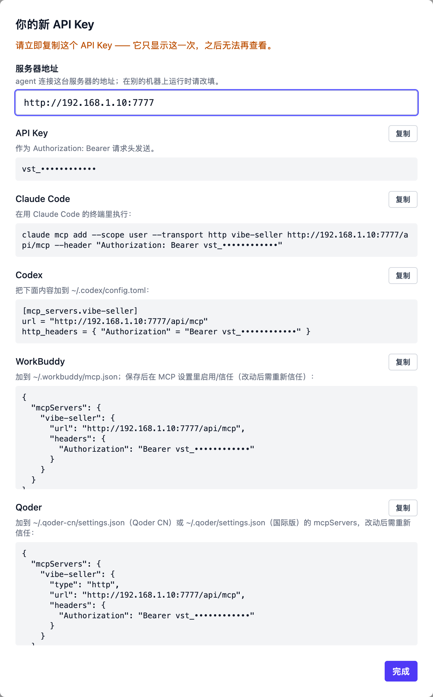
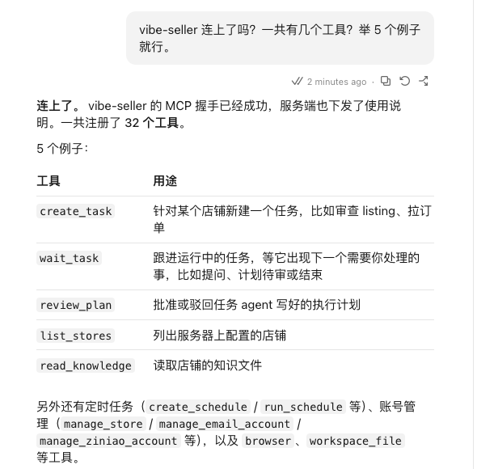
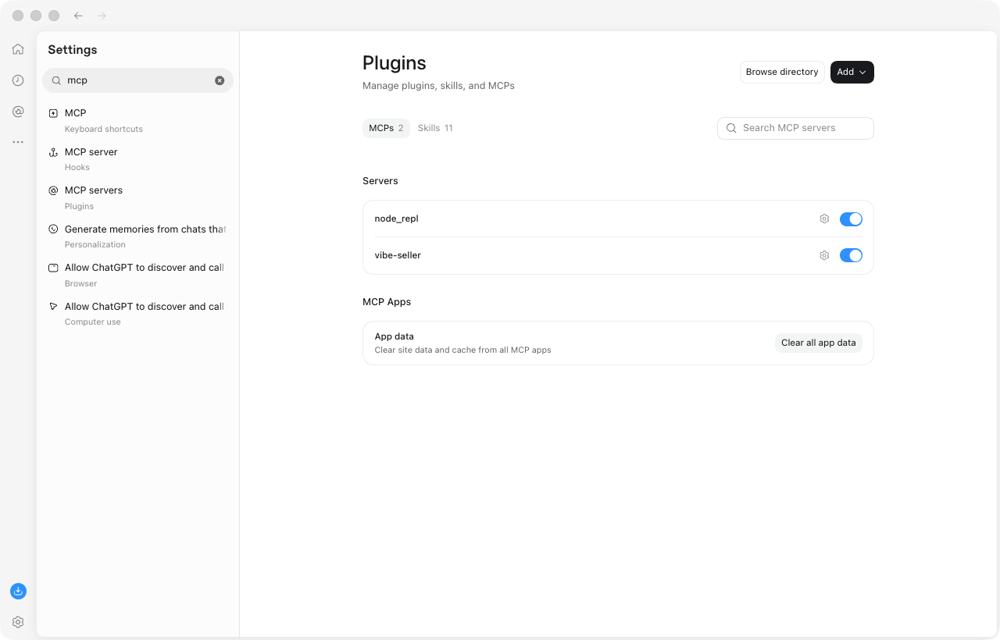
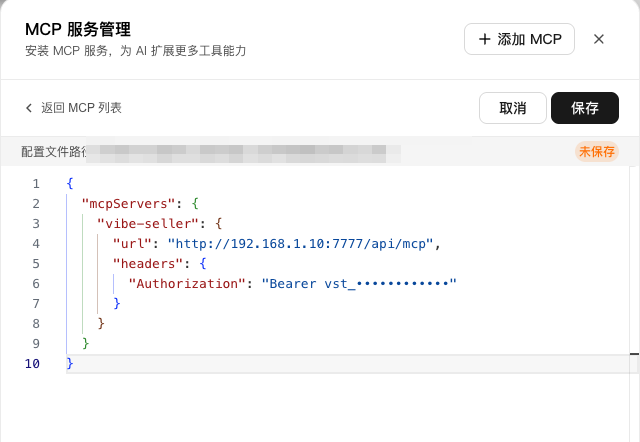
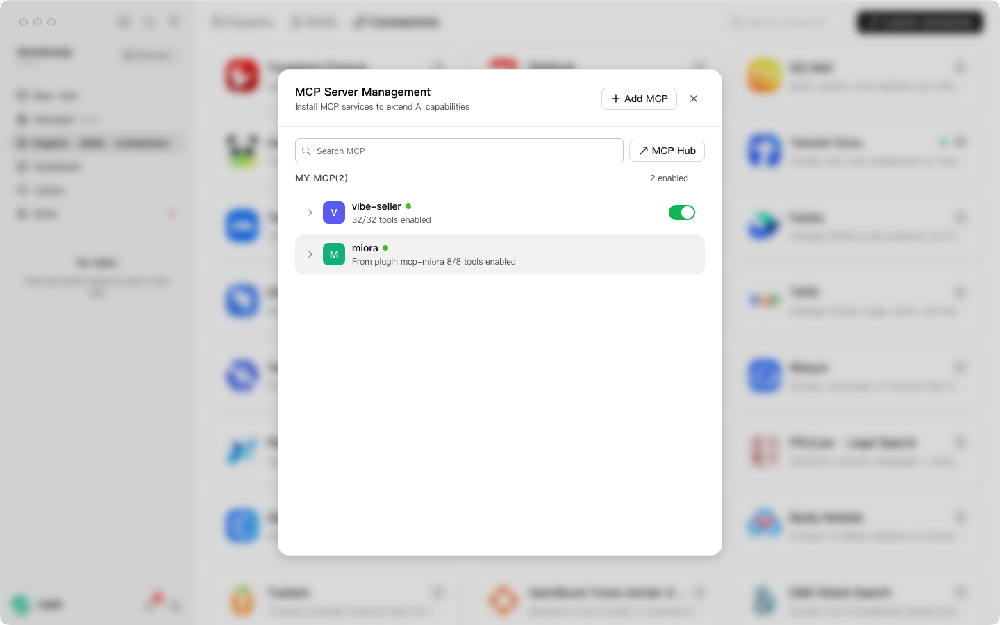
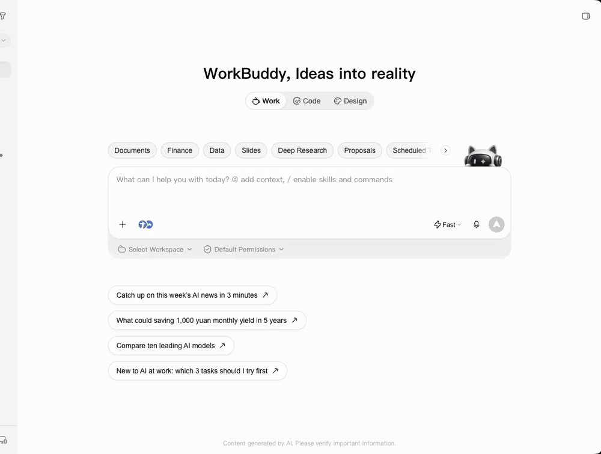
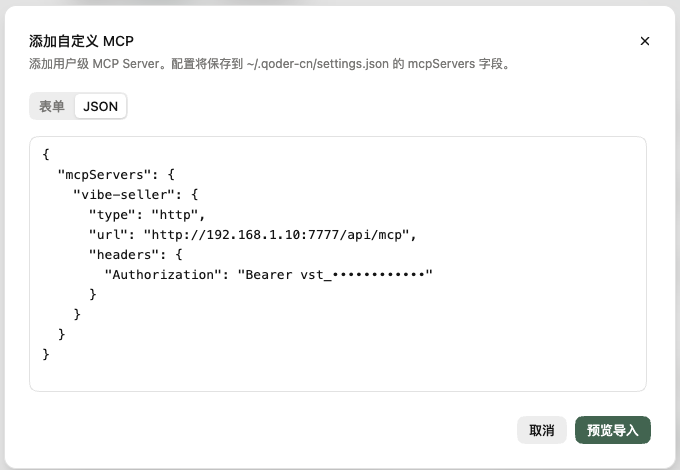
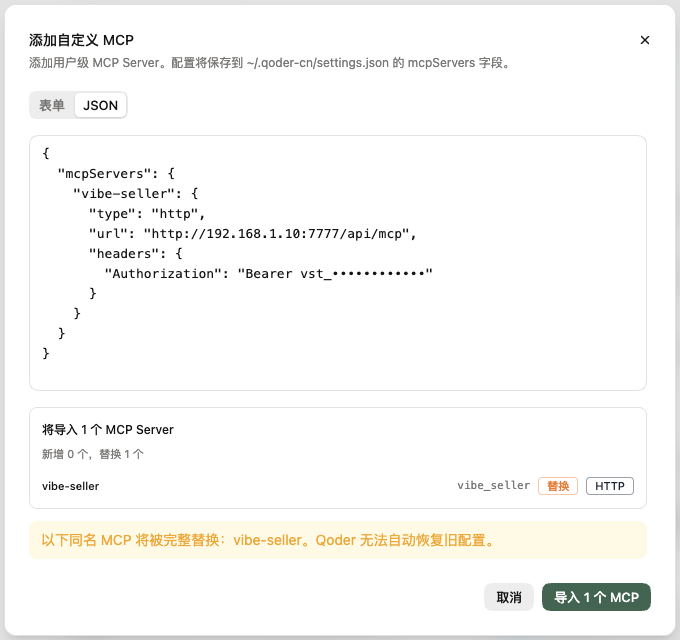
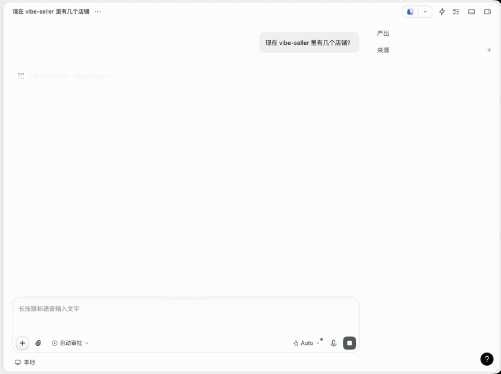

# MCP 接入

平时习惯用 Claude、Codex、WorkBuddy、Qoder、Hermes Agent 或 Pi 处理工作？
现在可以直接在这些 AI 工具里指挥 Vibe Seller 了。

接好之后，在对话框里说一句「帮我看看 acme 上周的广告」，它就会去 Vibe Seller
里建好任务、盯着进度，跑完把结论带回给你。任务中途有问题要问你、有计划要你
点头，也都在这段对话里搞定，不用再来回切换网页。

只要是支持 MCP 的 AI 工具都能接，准备好一个 API Key 就行。

> **安全方面不用担心**：AI 工具只能通过“建任务”让 Vibe Seller 干活，碰不到
> 你的浏览器，也没法直接改店铺。计划审批、广告改动范围检查这些把关，和你在
> 网页上操作时完全一样。

本文介绍四个桌面端，以及 Hermes Agent、Pi 这两个终端里的 Agent 怎么接。用其他
命令行工具（Claude Code CLI、Codex CLI 等），或者想看
技术细节（协议、全部 32 个工具、curl 示例）的，请看
[Connect an External Agent](agents.md)。

## 可以这样用

接好之后，像给同事交代工作一样说就行：

- 「现在 vibe-seller 里有几个店铺？」
- 「帮我看看 acme 过去一周的广告花费，给点优化建议，先别改任何东西。」
- 「这个任务现在在干什么，到哪一步了？」
- 「把这周的巡检安排成每周一早上跑，写完计划先给我看。」

不用记任何命令，AI 工具会自己判断该做什么。

## 能做什么、不能做什么

| | |
|---|---|
| ✅ 能做 | 建任务（可以带附件）、查看进度、回答任务的提问、通过或打回计划、确认生成的图片、给任务补充要求、停止 / 重试 / 删除任务、查看任务产出的文件、管理知识库、技能和定时任务 |
| ❌ 不能做 | 直接操作浏览器（点击、打开网页、截图），也不能直接改你的店铺。店铺上的操作都在 Vibe Seller 的任务里完成，照样要过所有检查。通过 Vibe Seller 来操作，能确保各店铺的数据互相隔离，也降低了让 AI 直接动手的风险 |

从 AI 工具里建的广告任务，和在网页上建的一样守规矩：开工前先说清楚要查哪些、
改哪些，漏查的站点会被拦下来补齐；只要报告的任务，不会动你的广告。

> 下文的截图和录屏都在 macOS 上完成，Windows、Linux 上的步骤也一样；各工具支持
> 哪些系统，以官网下载页为准。
> 文中的 `~` 指你的用户目录，Windows 上就是 `C:\Users\<你的用户名>`。

## 第一步：创建 API Key

打开 Vibe Seller 网页，进入 **设置 → 集成 → API Key**，点创建：

1. 起一个好认的名字，比如 `claude-desktop`，以后一眼就知道是给谁用的；
2. 选有效期：30 天、90 天、365 天或永不过期；
3. 创建后马上**复制 Key**。它只显示这一次，关掉弹窗就再也看不到了。



弹窗里还会给出下面每个工具现成的配置，复制粘贴就能用。先把「服务器地址」
改成 AI 工具能访问到的地址，下面的配置会跟着自动更新：



使用时请注意：

- Key 以 `vst_` 开头，**请像密码一样保管**。拿到它的工具能以你的身份、按你的
  权限操作 Vibe Seller；
- 不用了或者担心泄露，随时在同一个地方撤销；
- 即使你的 Vibe Seller 没开登录验证，也建议照样创建一个。以后开了验证，
  工具也不会突然连不上。

## Claude 桌面版

### 安装

到 [claude.com/download](https://claude.com/download) 下载对应系统的版本，装好即可。

### 接入

Claude 桌面版的 **Code 标签页**用的就是 Claude Code，所以只要在终端里跑一次
弹窗给的命令，桌面版就能用上：

```bash
# 默认连本机；Vibe Seller 在另一台电脑上时，把 localhost 换成那台电脑的地址
claude mcp add --scope user --transport http vibe-seller \
  http://localhost:7777/api/mcp --header "Authorization: Bearer vst_…"
```

弹窗里的服务器地址默认填的是你当前打开网页的地址。如果 AI 工具装在另一台
电脑上，记得改成那台电脑能访问到的地址。

想让 AI 用得更顺手，可以再装上 `vibe-seller` **插件**（安装方法见
[agents.md](agents.md)）。插件里带了一份使用说明，教 AI 什么时候先出计划、
怎么跟进任务、怎么回答任务的提问，以及只汇报任务真实跑出来的结果，绝不编造。

> 如果你的 Vibe Seller 能从公网访问，也可以在 Claude 的聊天页里接入：
> **设置 → 连接器（Connectors）→ 添加自定义连接器**，填上服务器地址和请求头
> `Authorization: Bearer vst_…`。这种方式由 Claude 的云端去连你的服务器，
> 所以 `localhost` 或公司内网地址连不上，本地部署请用上面的命令。

### 验证

新开一个 Code 会话，问一句「vibe-seller 里有几个店铺」。它能答出店铺列表，
或者工具列表里能看到 `list_stores`、`create_task`，就说明接好了。



### 试一试

依次发这几句，看看它怎么帮你跑完一个广告分析：

1. 「现在 vibe-seller 里有几个店铺？」
2. 「帮我看看 acme 过去一周的广告花费，给点优化建议，按常见标准来就行，
   不用问我，先别改任何东西。」
3. 「这个任务现在在干什么，到哪一步了？」
4. 「好，继续跟进，跑完了给我总结。」

## Codex 桌面版

### 安装

到 [chatgpt.com/codex](https://chatgpt.com/codex) 下载对应系统的桌面应用。Codex
已经并入 ChatGPT 桌面应用，装好后在应用里切到 Codex 即可。第一次打开需要
登录 ChatGPT 账号。

### 接入

Codex 桌面版的配置文件是 `~/.codex/config.toml`（和 Codex 命令行共用）。把弹窗
给的这段贴进去：

```toml
[mcp_servers.vibe-seller]
# 默认连本机；Vibe Seller 在另一台电脑上时，把 localhost 换成那台电脑的地址
url = "http://localhost:7777/api/mcp"
http_headers = { "Authorization" = "Bearer vst_…" }
```

保存后重启 Codex。

> 请把 Key 直接写在配置里，不要用 `bearer_token_env_var` 读环境变量：从桌面图标、
> 程序坞或开始菜单打开的桌面应用，读不到你在终端里设置的环境变量，会一直连不上。

想让 Codex 用你自己的模型、不占 ChatGPT 额度，可以在同一个文件里加一个
`[model_providers.…]`（支持 OpenAI 兼容接口或 Responses 接口的服务商都行），
再把 `model_provider` 指向它。

### 验证

在 Codex 里问一句「vibe-seller 里有几个店铺」，或者打开 **Settings → Plugins →
MCPs**（设置里搜 mcp 也能找到），看到 `vibe-seller` 已打开开关就说明接好了。



### 试一试

依次发这几句，看看它怎么帮你跑完一个广告分析：

1. 「现在 vibe-seller 里有几个店铺？」
2. 「帮我看看 acme 过去一周的广告花费，给点优化建议，按常见标准来就行，
   不用问我，先别改任何东西。」
3. 「这个任务现在在干什么，到哪一步了？」
4. 「好，继续跟进，跑完了给我总结。」

## WorkBuddy（腾讯）

### 安装

到 [workbuddy.cn](https://www.workbuddy.cn)（国内版）或
[workbuddy.ai](https://www.workbuddy.ai)（国际版）下载对应系统的版本。第一次打开
需要登录。

### 接入

弹窗里有 WorkBuddy 专用的配置，下面两种方式任选一种：

- **改文件**：把配置原样写进 `~/.workbuddy/mcp.json`；
- **在界面里加**：**连接器 → 自定义连接器 → MCP Server Management → + Add MCP**，
  粘贴同一段配置。

```json
{
  "mcpServers": {
    "vibe-seller": {
      "url": "http://localhost:7777/api/mcp",
      "headers": {
        "Authorization": "Bearer vst_…"
      }
    }
  }
}
```

默认连本机；Vibe Seller 在另一台电脑上时，把 `localhost` 换成那台电脑的地址。



保存后列表里会出现 `vibe-seller`。**还要点一下「Trust」（信任）并打开开关**，
它才会真正连上。以后每次改了配置文件，都需要重新点一次信任。

### 验证

MCP Server Management 里显示 `vibe-seller · 32/32 tools enabled`，就说明接好了。
再到对话里问一句「vibe-seller 里有几个店铺」试试：



### 试一试

依次发这几句，看看它怎么帮你跑完一个广告分析：

1. 「现在 vibe-seller 里有几个店铺？」
2. 「帮我看看 acme 过去一周的广告花费，给点优化建议，按常见标准来就行，
   不用问我，先别改任何东西。」
3. 「这个任务现在在干什么，到哪一步了？」
4. 「好，继续跟进，跑完了给我总结。」



## Qoder（阿里）

### 安装

到 [qoder.com/download](https://qoder.com/download) 下载对应系统的版本（国内版的应用名
是 **Qoder CN**）。第一次打开需要登录 Qoder 账号，可以用 Google、GitHub 或
邮箱注册。

### 接入

进入 **扩展（Extensions）→ 连接器（Connectors）**，点右上角 **Add Connector**，
切到 JSON 标签页，粘贴弹窗给的配置：

```json
{
  "mcpServers": {
    "vibe-seller": {
      "type": "http",
      "url": "http://localhost:7777/api/mcp",
      "headers": {
        "Authorization": "Bearer vst_…"
      }
    }
  }
}
```

默认连本机；Vibe Seller 在另一台电脑上时，把 `localhost` 换成那台电脑的地址。



点 **Preview import** 确认，再点 **Import** 就完成了。



如果之前已经加过 vibe-seller，这里会显示「替换 1 个」，确认导入即可覆盖旧配置。

配置会保存在 `~/.qoder-cn/settings.json`（国际版是 `~/.qoder/settings.json`）。
如果之后直接改这个文件，改完要在 Qoder 里重新信任一次。

### 验证

到 **设置 → 扩展管理 → 连接器** 里，看到 `vibe-seller · Ready · HTTP` 就说明接好了，
展开还能看到全部工具。再到对话里问一句「vibe-seller 里有几个店铺」试试。

### 试一试

依次发这几句，看看它怎么帮你跑完一个广告分析：

1. 「现在 vibe-seller 里有几个店铺？」
2. 「帮我看看 acme 过去一周的广告花费，给点优化建议，按常见标准来就行，
   不用问我，先别改任何东西。」
3. 「这个任务现在在干什么，到哪一步了？」
4. 「好，继续跟进，跑完了给我总结。」



## Hermes Agent（Nous Research）

### 安装

按 [Hermes Agent 官方安装说明](https://hermes-agent.nousresearch.com/docs/getting-started/installation)
装好，macOS、Linux、Windows 都支持。

### 接入

Hermes 的 MCP 配置在 `~/.hermes/config.yaml` 的 `mcp_servers` 下。把弹窗给的
这段加进去：

```yaml
mcp_servers:
  vibe-seller:
    # 默认连本机；Vibe Seller 在另一台电脑上时，把 localhost 换成那台电脑的地址
    url: "http://localhost:7777/api/mcp"
    headers:
      Authorization: "Bearer vst_…"
```

文件里已经有 `mcp_servers:` 的话，只把 `vibe-seller:` 这一段放到它下面，
不要再写一个 `mcp_servers:`。保存后在 Hermes 的会话里执行 `/reload-mcp`，
或者重开 Hermes。

### 验证

在终端里执行 `hermes mcp test vibe-seller`，看到 `✓ Connected` 和
`Tools discovered: 32` 就说明接好了。再到对话里问一句「vibe-seller 里有几个
店铺」试试。

### 试一试

依次发这几句，看看它怎么帮你跑完一个广告分析：

1. 「现在 vibe-seller 里有几个店铺？」
2. 「帮我看看 acme 过去一周的广告花费，给点优化建议，按常见标准来就行，
   不用问我，先别改任何东西。」
3. 「这个任务现在在干什么，到哪一步了？」
4. 「好，继续跟进，跑完了给我总结。」

## Pi

### 安装

按 [pi.dev](https://pi.dev) 的说明安装：

```bash
npm install -g --ignore-scripts @earendil-works/pi-coding-agent
```

Pi 自带 MCP 支持，不用另装扩展。

### 接入

在终端里执行弹窗给的这条命令：

```bash
# 默认连本机；Vibe Seller 在另一台电脑上时，把 localhost 换成那台电脑的地址
pi mcp add vibe-seller --url http://localhost:7777/api/mcp --header "Authorization=Bearer vst_…"
```

它会写进 `~/.pi/agent/mcp.json`。注意 `--header` 用的是 `名称=值` 的写法，
不是 `名称: 值`。已经开着的 Pi 会话里执行一次 `/reload` 就能用上。

### 验证

在终端里执行 `pi mcp list`，看到 `vibe-seller: connected, 32 tools` 就说明
接好了。再到对话里问一句「vibe-seller 里有几个店铺」试试。

Pi 默认让模型写一小段脚本来调用这些工具（Pi 叫它 codemode），所以对话里看到
的是脚本调用，而不是一个个工具名，这是正常的。

### 试一试

依次发这几句，看看它怎么帮你跑完一个广告分析：

1. 「现在 vibe-seller 里有几个店铺？」
2. 「帮我看看 acme 过去一周的广告花费，给点优化建议，按常见标准来就行，
   不用问我，先别改任何东西。」
3. 「这个任务现在在干什么，到哪一步了？」
4. 「好，继续跟进，跑完了给我总结。」

## 常见问题

**提示 401 Unauthorized**

Key 填错了、已经撤销或过期，也可能是这个 Key 的主人账号被停用了。到
**设置 → 集成 → API Key** 里看一下 Key 的状态。撤销或过期的 Key 一律不能用，
哪怕服务器没开登录验证也一样，撤销了就是真的作废了。

**提示 405**

说明地址不对，或者你的 Vibe Seller 版本太旧，还没有 MCP 接口。确认地址以
`/api/mcp` 结尾，必要时升级 Vibe Seller。

**连不上，或者报证书（TLS）错误**

先检查地址和端口，再确认 AI 工具所在的电脑能访问到 Vibe Seller。如果 Vibe Seller
只监听 `127.0.0.1`，就只有本机能连；要从别的电脑使用，建议在前面加一层
HTTPS 反向代理。

**能看到工具，但一用就报错**

多半是地址写错了。上面各工具的配置里，地址都要写到 `/api/mcp` 为止；只有
Claude **插件**例外，它只要服务器根地址（比如 `http://localhost:7777`），会自己补上
`/api/mcp`。另外检查一下结尾有没有多余的斜杠。

**AI 回答了，但没有真的去建任务**

说明它凭自己的知识直接回答了，没有让 Vibe Seller 去跑。装上 Claude 插件能
明显改善，插件会要求它只汇报任务真实跑出来的结果。也可以在对话里明确说
「用 vibe-seller 建个任务查一下」。

**截图分享时会不会泄露 Key？**

配置界面里的 Key 一般会打码显示。分享截图前，记得把 `vst_` 开头的内容遮住。
