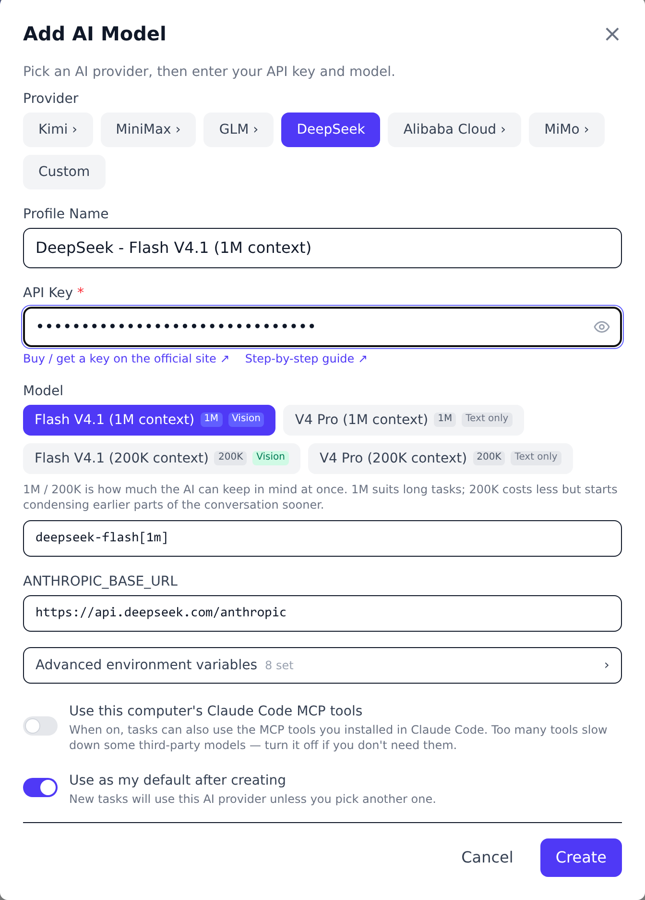
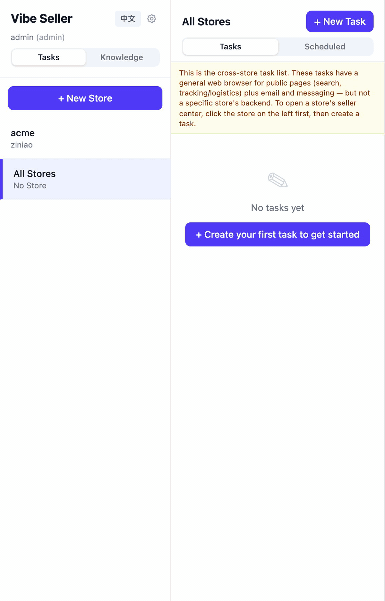

# Quickstart

Once it's installed, three steps get you going: set up AI, add a store, create a task. Not installed yet? Start at [Installation](install.md).

## Have two things ready

- **An API key for an AI model**: Vibe Seller's work is done by AI, so you need a key of your own. For a first try, [DeepSeek](llm-keys.md#deepseek) is easiest — sign up and top up a few dollars. For the other providers, see [Configure AI Models](llm-keys.md).
- **Your store's browser**: if your store uses Ziniao or Yuehulian, have the sub-account's username and password at hand. If not, use the Chrome browser that comes with Vibe Seller and sign in to your seller center yourself, once.

## 1. Open Vibe Seller

=== "Windows"

    It opens by itself after installing. To open it later, click Vibe Seller in the Start menu.

=== "macOS"

    Run `vibe-seller start` in a terminal, then open <http://localhost:7777> in your browser.

=== "Linux"

    Run `vibe-seller start` in a terminal, then open <http://localhost:7777> in your browser.

## 2. Set up AI

1. Click the gear at the top of the sidebar to open **Settings → AI**, then click **Add Model**;
2. Under **Provider**, pick the one your key is from, and paste the key into **API Key**;
3. Click **Create**.

Everything else fills itself in. Your key is stored only on your own computer.

??? note "Already using Claude Code? (click to expand)"
    If Claude Code is already signed in on this computer, you don't need a key: the built-in **Claude** entry in the **AI Models** list uses it, so you can go straight to creating a task.

    Using cc-switch or a similar Claude account switcher?

    - **Before v0.3.3**: cc-switch overrode Vibe Seller's AI settings, so the models you added in Vibe Seller didn't work; you had to pick the built-in **Claude** (the default model) and let cc-switch take over.
    - **v0.3.3 and later**: the models you add use only their own provider and key in Vibe Seller — cc-switch can't change them. Only the built-in **Claude** follows this computer's Claude Code, so it uses whichever account cc-switch has selected.

## 3. Add a store

1. In the sidebar click **+ New Store** and give it a **Store Name** you'll recognise;
2. Pick a browser: if your store uses Ziniao, pick **Ziniao (Browser Backend)**; if it uses Yuehulian, pick **Yuehulian (Browser Backend)** (Windows only); otherwise pick **Chrome**;
3. For Ziniao or Yuehulian: click the `+` next to the account field, enter its login, then pick this store from the list;
4. Click **Create**.

With Chrome, the first time the AI opens your seller center you may need to sign in once in the browser window that pops up; it stays signed in after that.

!!! warning "Using Ziniao? Turn on access first"
    Ziniao's main (BOSS) account has to grant two permissions on the Ziniao website first, or binding fails. How: [Ziniao: Prerequisites](ziniao.en.md#prerequisites-developer-mode-and-webdriver-login).

What each browser needs and how they differ: [Browsers](browsers.md).

## 4. Create your first task

1. Select the store on the left and click **+ New Task**;
2. Say what you want done in one sentence, for example:
    - “Export the past 7 days of sales reports.”
    - “Check ads and pause any keyword with ACOS over 30%.”
3. Click **Create & Run**.

The AI opens the browser and does the work itself, then hands you a report. Every step and screenshot stays visible in the task.

!!! tip "Want to see the AI's plan before it acts?"
    In **Settings → General**, set **Default Execution Mode** to **Review**. From then on, the AI writes a plan for each new task and only starts once you click **Confirm & Execute**. Worth doing for tasks that change store data, such as ads or prices.

## What's next

- [Examples](examples.md): walk through a complete scenario.
- [Schedules](schedules.md): daily checks, a weekly report every Monday, run on time by themselves.
- [Integrations overview](integrations.md): connect email, WeCom, DingTalk, Feishu and more.
- [Amazon Ads API](ads-api.md): faster Amazon ad tasks, with batch operations.
- [Core Concepts](concepts.md): how stores, tasks, schedules and knowledge fit together.
