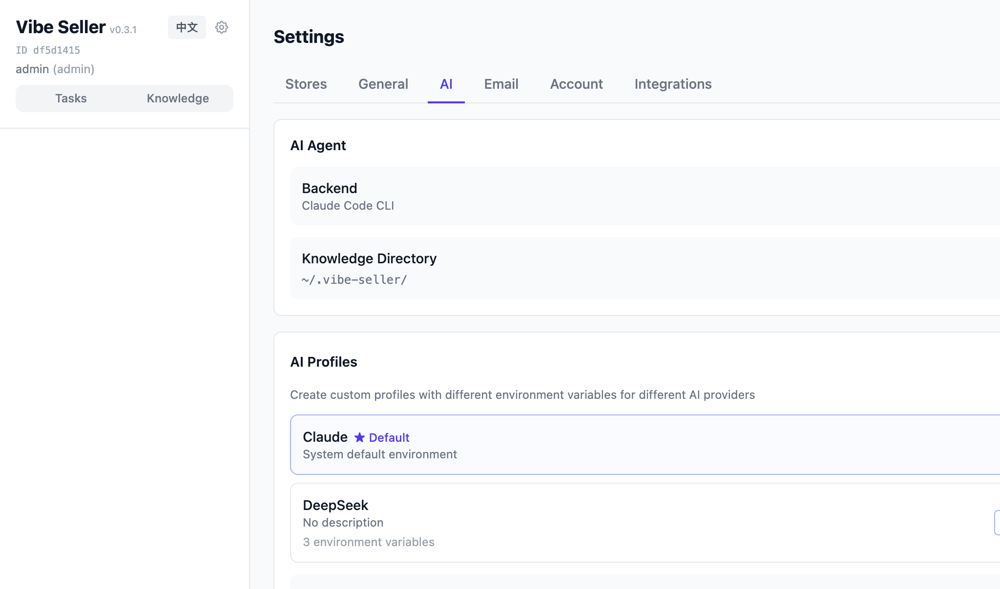
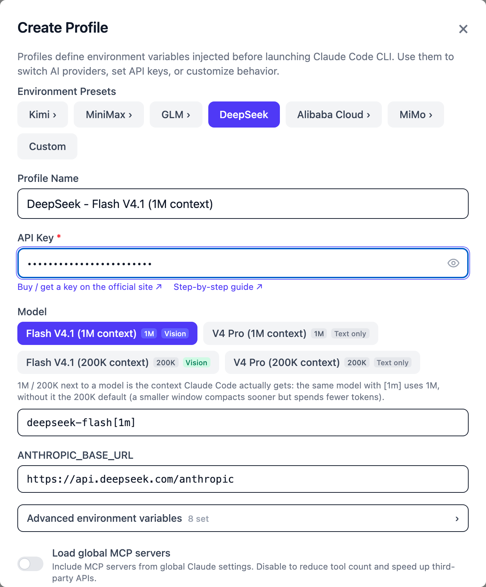
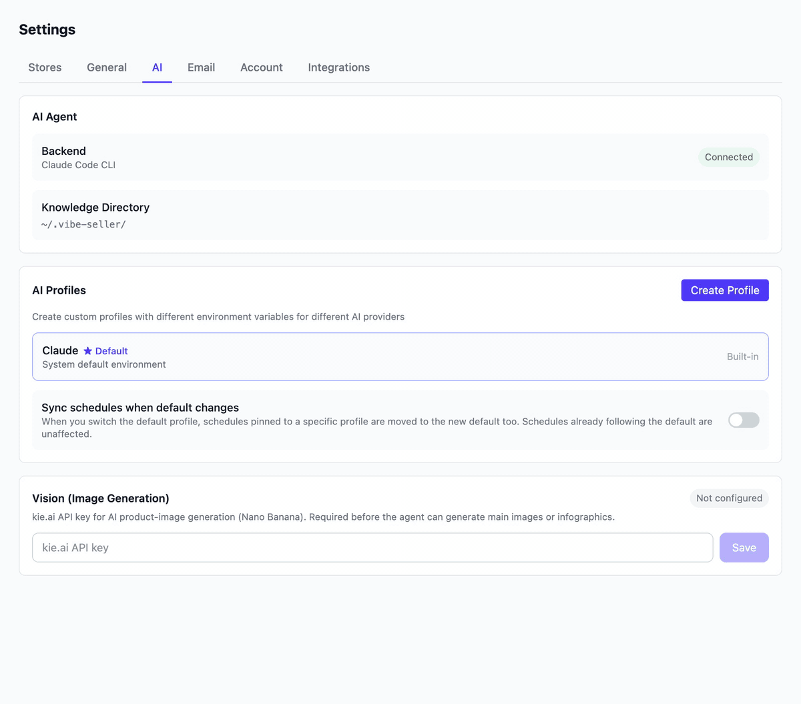
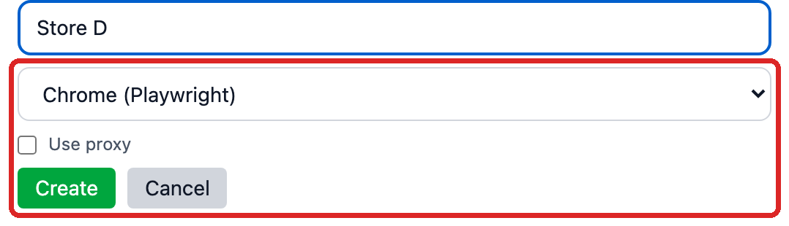
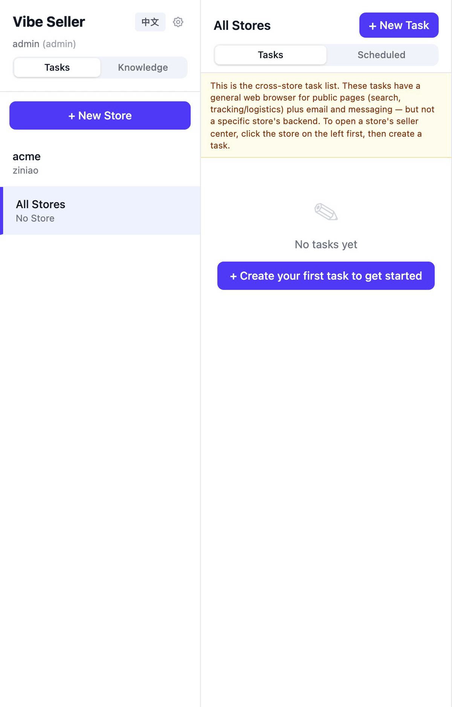
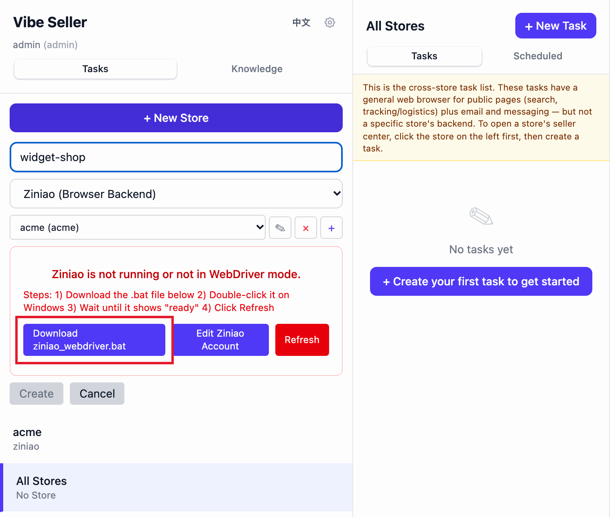

# Quickstart

Once it's installed, walk these five steps and the agent will be working in about ten minutes. Not installed yet? Start at [Installation](install.md).

The UI language follows your browser, and the sidebar has a switch at the top.

## 1. Open the web UI

In your browser:

```
http://localhost:7777
```

**There's no login by default** — you land straight in the app. If a login page shows up, someone on that machine turned login on; see [How do I set up or recover the login password?](faq-login.en.md#how-do-i-set-up-or-recover-the-login-password).

The only per-OS difference is how the server comes up:

- **Windows installer**: the last wizard page has **Open Vibe Seller now** checked, so Finish starts the server and opens the page for you.
- **macOS / Linux / WSL2**: run `vibe-seller start` in a terminal once. Closing the terminal afterwards doesn't stop the server.

If the home page loads, the install worked.

## 2. Configure an AI model

Go to **Settings → AI** (the gear at the top of the sidebar — only admins see Settings). In the **AI Profiles** card, click **Create Profile**:

1. Pick your provider under **Environment Presets** — [DeepSeek](llm-keys.md#deepseek) bills per token; [Claude](llm-keys.md#claude) / [Kimi](llm-keys.md#kimi) / [MiniMax](llm-keys.md#minimax) / [Zhipu GLM](llm-keys.md#zhipu-glm) / [Qwen](llm-keys.md#qwen-alibaba-cloud-model-studio) / [MiMo](llm-keys.md#xiaomi-mimo) all work;
2. paste your **API Key** — the rest (endpoint URL, model) fills itself in from the preset;
3. tick **Use as my default after creating**, then save.

A saved key is masked in the UI by default — an admin can click **Show** / **Copy** to see the real value (an API-token call is refused that endpoint). It's written to the database on this machine and sent only to the provider you picked.







!!! note "No key yet?"
    [DeepSeek](llm-keys.md#deepseek) is the easiest start: sign up on their site, top up a small amount, pay per token. The others sell both pay-as-you-go and monthly plans, which are cheaper under heavy use. Where to get each key, which preset to pick and which models are available: [Configure AI Models](llm-keys.md).

!!! tip "Already signed in to Claude Code on this machine?"
    The built-in **Default** profile uses this machine's Claude Code environment, so there's nothing to fill in — run a task first and only create a profile if you want a different provider.

!!! warning "Using cc-switch or a similar Claude account switcher? Pick the default here"
    Those tools switch AI providers by editing your global `~/.claude/settings.json`, which conflicts with Vibe Seller's own AI picker. Pick the default and let cc-switch keep managing which AI you use.

    If you'd rather Vibe Seller manage it: quit cc-switch, then **copy-paste this line into a terminal** and hit return — it edits your global Claude Code config (`~/.claude/settings.json`) and removes the `ANTHROPIC_*` environment variables cc-switch wrote there:

    ```bash
    python3 -c "import json,pathlib;p=pathlib.Path.home()/'.claude'/'settings.json';d=json.loads(p.read_text());env=d.get('env') or {};[env.pop(k,None) for k in list(env) if k.startswith('ANTHROPIC_')];d['env']=env;p.write_text(json.dumps(d,indent=2))"
    ```

## 3. Connect a store

In the sidebar (Tasks view) click **+ New Store**, give it a **Store Name**, choose the browser backend from the dropdown, then click **Create**:

- **Ziniao (Browser Backend)** — the anti-detect browser. Click the `+` next to the account field to add a Ziniao account with your **Company / Username / Password** (the same ones you use to log into Ziniao), save, then pick **Select Ziniao account...** and **Select store profile...**.
- **Chrome (Playwright)** — pick this if you don't use Ziniao. It runs the Chromium that came with Vibe Seller, as a separate browser instance reserved for this store.

!!! warning "Before you use Ziniao"
    The BOSS (admin) account must first enable developer mode on the [Ziniao Open Platform](https://open.ziniao.com/docSupport?docId=99) and tick the WebDriver-login option for the sub-account — without it, Ziniao refuses the binding. When an error shows up:

    - "无权限通过 webdriver 登录" — see ["无权限通过 webdriver 登录" when binding a store](ziniao.en.md#无权限通过-webdriver-登录-when-binding-a-store);
    - "检测到您在新终端登录" — see ["检测到您在新终端登录" when binding a store](ziniao.en.md#检测到您在新终端登录-when-binding-a-store);
    - on Windows through WSL there's one extra launcher step — see [getting Ziniao into developer mode (ziniao_webdriver.bat)](ziniao.en.md#windows-wsl-getting-ziniao-into-developer-mode-ziniao_webdriverbat).

    The setup steps, the fields to fill in and where credentials are stored: [Ziniao: Setup & Common Errors](ziniao.en.md).

The store name is just your own label. One store equals one logged-in browser plus one memory — stores never share data with each other. What each backend can and can't do: [Which browser backend](stores.en.md#which-browser-backend).





??? note "Windows through WSL2 needs one extra step for Ziniao (click to expand)"
    Ziniao lives on the Windows side while Vibe Seller runs inside WSL, and Ziniao only runs one mode at a time — Vibe Seller needs developer mode (WebDriver mode, the one that exposes CDP). WSL can't restart a Windows app across the VM boundary, so a small launcher does it:

    1. Once the account is selected you get a "Ziniao is not running or not in WebDriver mode" banner — click **Download ziniao_webdriver.bat** in it.
    2. Double-click the file on Windows and wait until it shows "ready".
    3. Back in Vibe Seller, click **Refresh** — your accounts appear automatically, no fields to fill.

    

    The full version of this step: [Windows (WSL): getting Ziniao into developer mode](ziniao.en.md#windows-wsl-getting-ziniao-into-developer-mode-ziniao_webdriverbat). Modes, credentials and storage: [Ziniao: Setup & Common Errors](ziniao.en.md). The two common errors: ["无权限通过 webdriver 登录"](ziniao.en.md#无权限通过-webdriver-登录-when-binding-a-store) and ["检测到您在新终端登录"](ziniao.en.md#检测到您在新终端登录-when-binding-a-store).

## 4. Create your first task

Select the store on the left, click **+ New Task**, and say what you want done in one sentence:

- “Check ads and pause any keyword with ACOS over 30%.”
- “Export the past 7 days of sales reports.”
- “Review inventory and estimate next month's restock SKUs.”

Click **Create & Run**. The agent plans the steps, drives the browser itself, and hands you a report; every step and screenshot stays visible in the task detail.

**Which mode?** There's a mode picker in the task footer:

- **Auto**: skip review, run immediately
- **Review**: draft a plan, run after approval

Switching it once also saves it as your default (you can set that up front in **Settings → General → Task Defaults → Default Execution Mode**). For your very first task, **Review** is the friendlier choice: read what the agent plans to do, then hit **Confirm & Execute**.

A task created under **All Stores** (the last row of the store list, subtitled "No Store") isn't bound to any one store. Those tasks always draft a plan for your approval first — that can't be switched off. They get a generic Chrome with no store logged into it for public web work, and anything that has to open a seller console is split into per-store sub-tasks. The two scopes are explained side by side in [Core Concepts](concepts.md).

## 5. What's next

Now that a task has run, add whatever fits your workflow:

- **Hook up more channels** — email, group chat bots (WeCom / DingTalk / Feishu / Slack), TickTick / Dida365, Google Workspace, all under **Settings → Integrations**, no code. What each one does and how to connect it: [Integrations overview](integrations.md).
- **Put it on a clock** — daily audits, a weekly report every Monday: [Schedules](schedules.md).
- **Run Amazon ad work over the Ads API** — the same ad task went from 147 minutes to 11 in our test, with batch operations and history: [Amazon Ads API](ads-api.md).
- **Drive Vibe Seller from the AI tool you already use** — Claude, Codex, WorkBuddy, Qoder: create tasks, follow progress, approve plans from that chat. [MCP setup](mcp.md).
- **Understand how the pieces fit** — stores, tasks, schedules, knowledge, integrations and AI profiles in one page: [Core Concepts](concepts.md).

For day-to-day task work, read [Tasks](using-tasks.md); the reason the agent gets better in your store is [Knowledge & Skills](knowledge.md).
