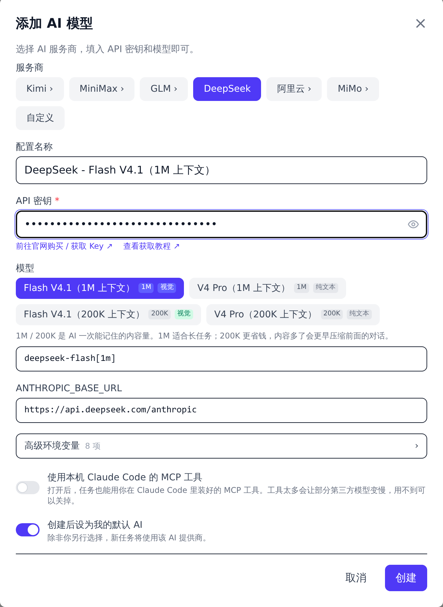
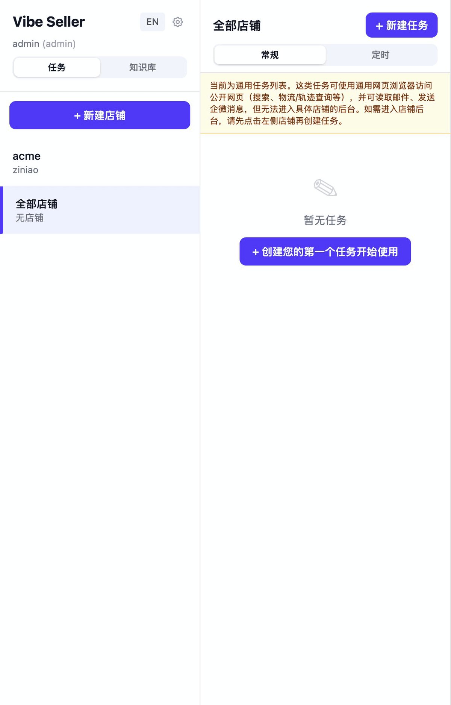

# 快速开始

装好之后三步就能用：配置 AI、新建店铺、创建任务。还没安装？先看 [安装](install.md)。

## 准备两样东西

- **一个 AI 的 API Key**：Vibe Seller 靠 AI 帮你干活，需要你自己申请一个 Key。第一次用推荐 [DeepSeek](llm-keys.md#deepseek)，注册后充值几块钱就能用；其他几家怎么申请，见 [配置 AI 模型](llm-keys.md)。
- **店铺用的浏览器**：店铺用的是紫鸟或悦互联，准备好它的账号密码；都没有的话，用 Vibe Seller 自带的 Chrome 浏览器，自己登录一次卖家后台就行。

## 1. 打开 Vibe Seller

Windows 装完会自动打开。以后想打开，点开始菜单里的 Vibe Seller；macOS / Linux 先在终端执行 `vibe-seller start`，再在浏览器打开 <http://localhost:7777>。

第一次打开会有一段新手引导，跟着点「下一步」就行。界面语言跟随浏览器，左侧栏顶部可以切换中英文。

## 2. 配置 AI

1. 点左侧栏顶部的齿轮，进入「设置 → AI」，点「添加模型」；
2. 在「服务商」里选你申请 Key 的那一家，把 Key 粘贴到「API 密钥」；
3. 点「创建」。

其他内容会自动填好，不用改。Key 只保存在你自己的电脑上。

??? note "已经在用 Claude Code？（点击展开）"
    这台电脑上的 Claude Code 已经登录过的话，不用再填 Key：「AI 模型」列表里内置的「Claude」用的就是它，可以直接去创建任务。

    装了 cc-switch 之类的 Claude 账号切换工具？

    - **v0.3.3 之前**：cc-switch 会改掉 Vibe Seller 的 AI 配置，你在 Vibe Seller 里添加的模型用不了，需要选内置的「Claude」（默认模型），由 cc-switch 接管。
    - **v0.3.3 及以后**：你添加的模型完全用 Vibe Seller 里自己的服务商和 Key，cc-switch 改不到。只有内置的「Claude」跟着这台电脑的 Claude Code 走，所以用的是 cc-switch 当前选的账号。

## 3. 新建店铺

1. 在左侧栏点「+ 新建店铺」，填一个自己认得出的「店铺名称」；
2. 选浏览器：店铺用的是紫鸟，就选「紫鸟 (浏览器后端)」；用的是悦互联，就选「悦互联 (浏览器后端)」（只有 Windows 上有）；都没有就选「Chrome」；
3. 选了紫鸟或悦互联：点账号旁边的「+」填上它的登录账号，再从下拉里选出这家店；
4. 点「创建」。

选 Chrome 的话，第一次进卖家后台时可能需要你在弹出的浏览器窗口里登录一次，之后会一直保持登录。

!!! warning "用紫鸟的话，先开通权限"
    紫鸟要先由主账号（BOSS 账号）在紫鸟官网开通两项权限，否则会绑定失败。怎么开通见 [紫鸟：开通前提](ziniao.md#开通前提开发者模式与-webdriver-登录)。

每种浏览器要填什么、有什么区别，见 [浏览器](browsers.md)。

## 4. 创建第一个任务

1. 在左侧选中店铺，点「+ 新建任务」；
2. 用一句话写清楚要做的事，比如：
    - “导出过去 7 天的销售报表”
    - “检查广告，把 ACOS 超过 30% 的关键词暂停掉”
3. 点「创建并运行」。

AI 会自己打开浏览器去做，做完给你一份结果报告。它做的每一步、每一张截图，都能在任务里看到。

!!! tip "想让 AI 先给你看方案，再动手？"
    到「设置 → 通用」，把「默认执行模式」改成「先审核」。之后新建的任务，AI 会先写好方案，你看过点「确认并执行」它才开始做。改动店铺数据（比如广告、价格）的任务，建议先这样试。

## 下一步

- [使用示例](examples.md)：跟着完整场景操作一遍。
- [定时任务](schedules.md)：每天巡检、每周一出周报，到点自动执行。
- [集成总览](integrations.md)：接入邮件、企业微信、钉钉、飞书等。
- [广告 API 绑定](ads-api.md)：亚马逊广告任务更快，还能批量操作。
- [核心概念](concepts.md)：店铺、任务、定时任务、知识库是什么关系。
