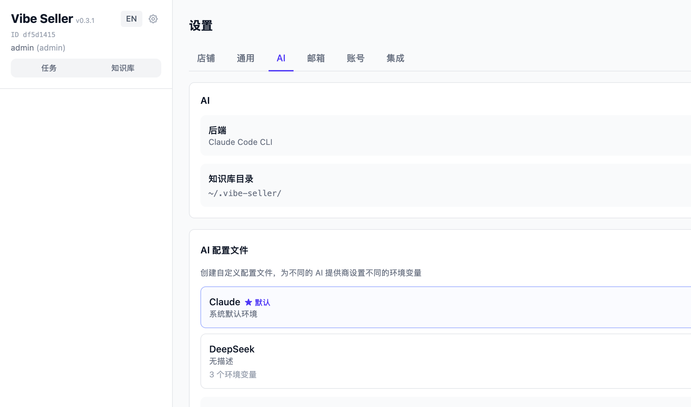
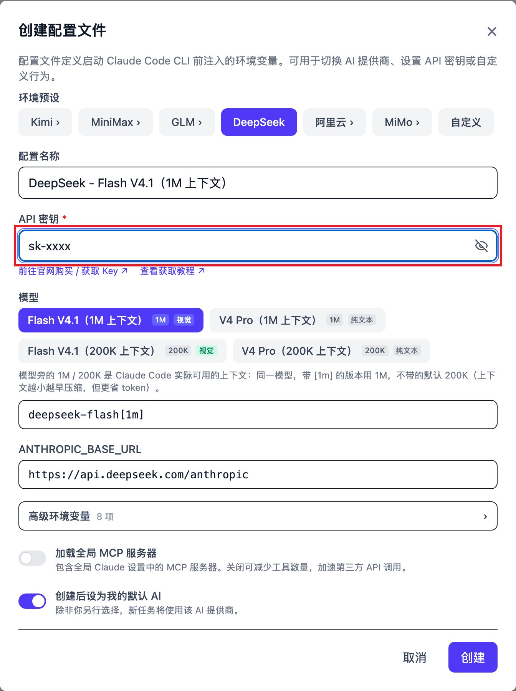
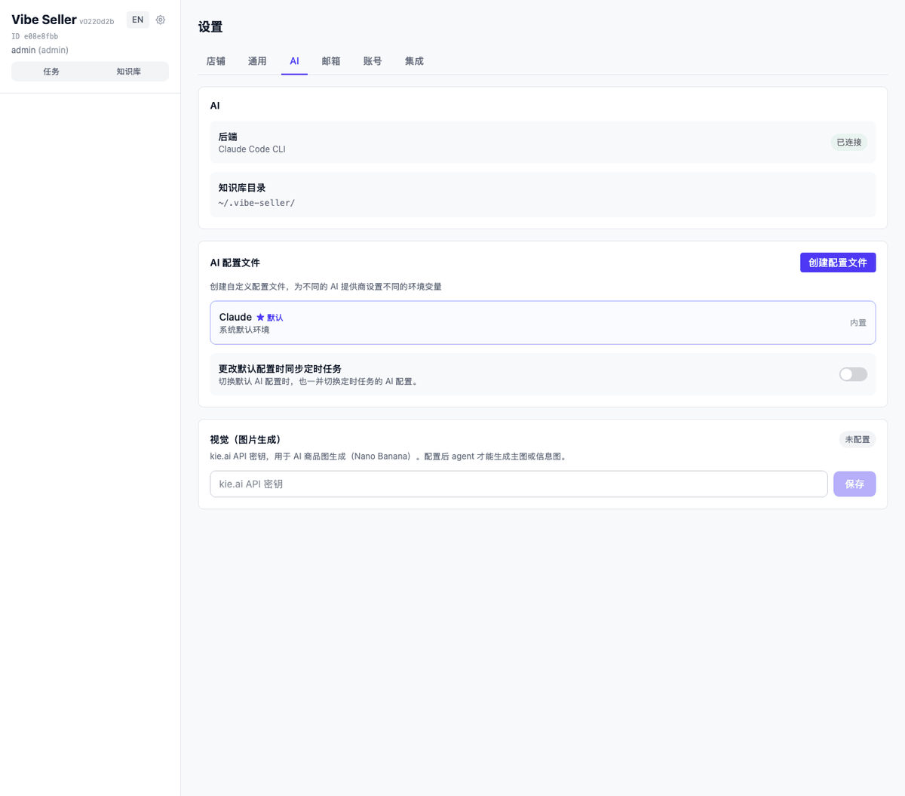
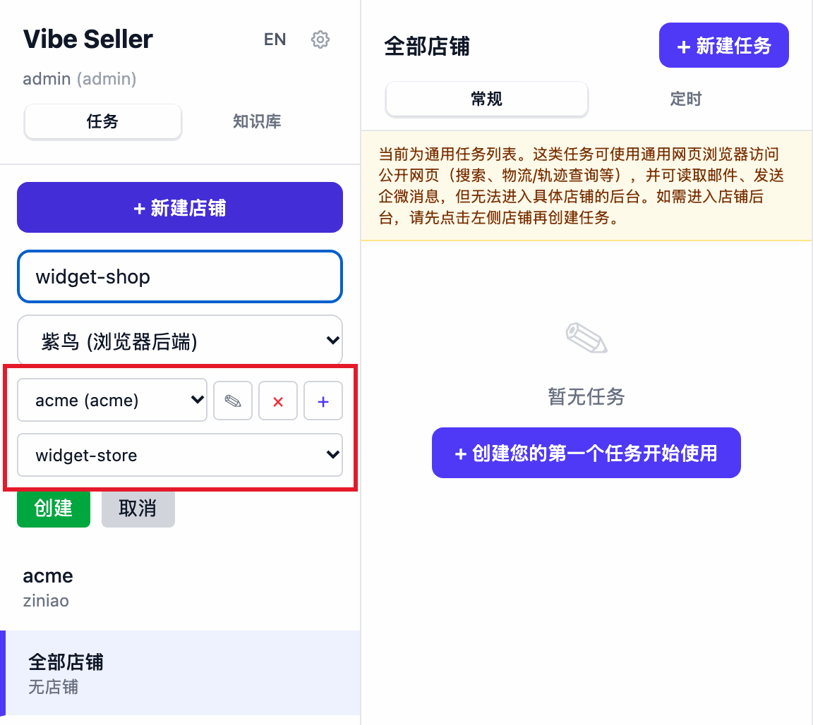
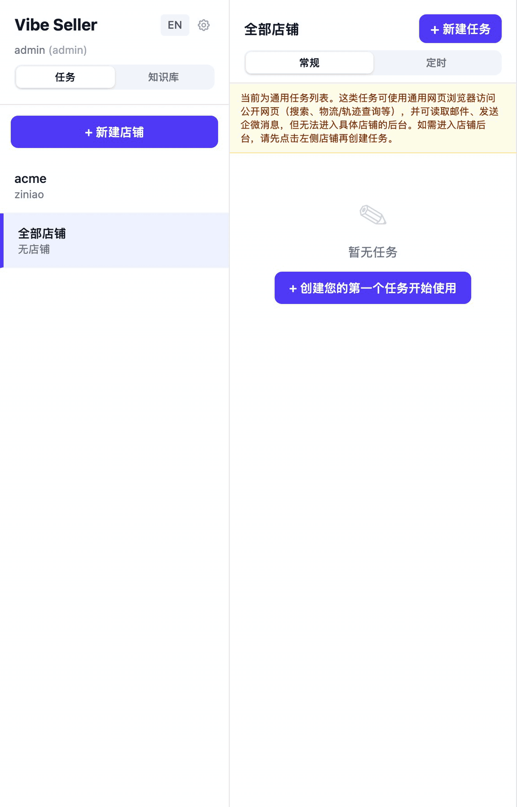
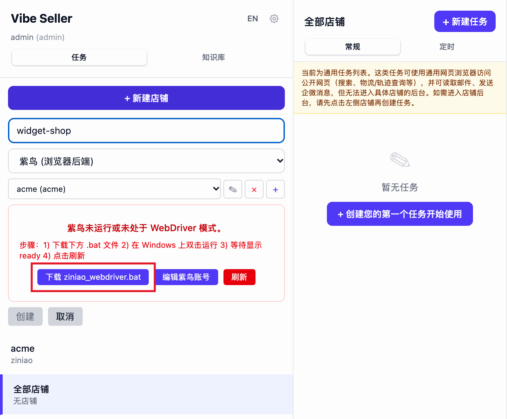

# 快速开始

装好之后按下面五步操作，十来分钟就能让 AI 开始处理店铺事务。还没安装？先看 [安装](install.md)。

界面语言会自动跟随浏览器，左侧栏顶部随时可以切换中英文。

## 1. 打开网页

在浏览器输入：

```
http://localhost:7777
```

**默认不需要登录**，打开直接进入主界面。如果看到登录页，说明这台机器上有人主动开启了登录，见 [登录密码怎么设置和找回](faq-login.md#登录密码怎么设置和找回)。

各系统的差别只在第一步：

- **Windows 安装包**：向导最后一步默认勾选「现在打开 Vibe Seller」，点击「完成」后自动启动服务并打开网页。
- **macOS / Linux / WSL2**：先在终端执行一次 `vibe-seller start`，之后关闭终端窗口服务也不会停止。

看到首页，就说明安装成功。

## 2. 配置 AI 模型

进入「设置 → AI」（左侧栏顶部的齿轮图标，只有管理员能看到设置），在「AI 配置文件」卡片里点击「创建配置文件」：

1. 在「环境预设」里选择你的供应商：[DeepSeek](llm-keys.md#deepseek) 按 token 付费，[Claude](llm-keys.md#claude)、[Kimi](llm-keys.md#kimi)、[MiniMax](llm-keys.md#minimax)、[智谱 GLM](llm-keys.md#智谱-glm)、[通义千问](llm-keys.md#通义千问阿里云百炼)、[MiMo](llm-keys.md#小米-mimo) 都可以接入；
2. 粘贴「API 密钥」，其余字段（接口地址、模型）会跟随所选预设自动填好；
3. 勾选「创建后设为我的默认 AI」，保存。

保存后的密钥默认显示为掩码，管理员在界面上点击「显示」或「复制」就能看到原值（通过 API Key 调用接口读不到它）。密钥保存在你本机的数据库里，除了发送给你所选的供应商，不会传给其他任何地方。







!!! note "一个 Key 都没有？"
    最省事的是 [DeepSeek](llm-keys.md#deepseek)：官网注册、按 token 付费，小额充值就能开始使用。其他几家既支持按量付费也有月度套餐，用量大时更划算。每家怎么获取 Key、该选哪个预设、能用哪些模型，都写在 [配置 AI 模型](llm-keys.md) 里。

!!! tip "这台机器上的 Claude Code 已经登录过 Anthropic 订阅？"
    内置的那个「默认」配置使用的就是本机 Claude Code 环境，不需要再填 Key，可以先创建一个任务试试。

!!! warning "装了 cc-switch 之类的 Claude 账号切换工具？这里请选择「默认」"
    这类工具直接修改你的全局配置文件 `~/.claude/settings.json` 来切换 AI 供应商，和 Vibe Seller 自己的 AI 选择器会冲突。直接选择「默认」即可，AI 供应商的切换交给 cc-switch 管理。

    如果想反过来让 Vibe Seller 管理供应商：先退出 cc-switch，然后在终端里**原样复制粘贴**下面这一行并回车。它会修改你的 Claude Code 全局配置（`~/.claude/settings.json`），清除 cc-switch 写入的 `ANTHROPIC_*` 环境变量：

    ```bash
    python3 -c "import json,pathlib;p=pathlib.Path.home()/'.claude'/'settings.json';d=json.loads(p.read_text());env=d.get('env') or {};[env.pop(k,None) for k in list(env) if k.startswith('ANTHROPIC_')];d['env']=env;p.write_text(json.dumps(d,indent=2))"
    ```

## 3. 绑定店铺

在左侧栏（任务视图）点击「+ 新建店铺」，填写「店铺名称」，从下拉框里选择浏览器后端，然后点击「创建」：

- 「紫鸟 (浏览器后端)」：防关联浏览器，店铺已经开在紫鸟档案里的选这个。点击账号右边的「+」添加一个紫鸟账号，填写「公司名称」「用户名」「密码」（就是你登录紫鸟用的那一套），保存后依次选择「选择紫鸟账号...」和「选择店铺配置...」，账号和档案会自动出现。
- 「Chrome (Playwright)」：不使用紫鸟时选这个，使用 Vibe Seller 自带的 Chromium。AI 会在这台机器上为该店铺单独打开一个浏览器实例。

!!! warning "用紫鸟之前"
    紫鸟需要先由主账号（BOSS 账号）在[紫鸟开放平台](https://open.ziniao.com/docSupport?docId=99)开通开发者模式，并给子账号勾选「WebDriver 登录」，否则绑定会被紫鸟拒绝。遇到报错：

    - 提示「无权限通过 webdriver 登录」，见 [报错：「无权限通过 webdriver 登录」](ziniao.md#报错无权限通过-webdriver-登录)；
    - 提示「检测到您在新终端登录」，见 [报错：「检测到您在新终端登录」](ziniao.md#报错检测到您在新终端登录)；
    - Windows 走 WSL 时多一步启动器，见 [让紫鸟进入开发者模式（ziniao_webdriver.bat）](ziniao.md#windowswsl让紫鸟进入开发者模式ziniao_webdriverbat)。

    开通步骤、要填的字段和凭据存储位置，都在 [紫鸟：开通与常见报错](ziniao.md) 这一页。

店铺名称只是给你自己看的标识。一个店铺对应一套登录状态和一份记忆，店铺之间互不影响。两个浏览器后端各自的能力和限制，见 [选哪个浏览器后端](stores.md#选哪个浏览器后端)。





??? note "Windows 走 WSL2 时，紫鸟多一步（点击展开）"
    紫鸟装在 Windows 一侧，Vibe Seller 运行在 WSL 里，而紫鸟同一时间只能运行一种模式，Vibe Seller 需要的是开发者模式（WebDriver 模式，只有这个模式会开放 CDP）。WSL 无法跨越虚拟机边界去重启 Windows 上的紫鸟，所以需要一个启动器：

    1. 选择紫鸟账号后，界面会出现「紫鸟未运行或未处于 WebDriver 模式」的提示框，点击里面的「下载 ziniao_webdriver.bat」；
    2. 在 Windows 上双击运行，等它显示 ready；
    3. 回到 WSL 里的 Vibe Seller，在紫鸟那一栏点击「刷新」，账号会自动出现，不需要手动填写字段。

    

    这一步的完整说明见 [Windows（WSL）：让紫鸟进入开发者模式（ziniao_webdriver.bat）](ziniao.md#windowswsl让紫鸟进入开发者模式ziniao_webdriverbat)；紫鸟的模式、要填的凭据和存储位置见 [紫鸟：开通与常见报错](ziniao.md)；两条常见报错的处理见 [「无权限通过 webdriver 登录」](ziniao.md#报错无权限通过-webdriver-登录) 和 [「检测到您在新终端登录」](ziniao.md#报错检测到您在新终端登录)。

## 4. 创建第一个任务

先在左侧选中店铺，然后点击「+ 新建任务」，把要做的事用一句话写清楚：

- “检查广告，把 ACOS 超过 30% 的关键词暂停掉”
- “导出过去 7 天的销售报表”
- “查看库存，估算下个月需要补哪些 SKU”

写完后点击「Create & Run」。AI 会自己规划步骤、打开浏览器操作，完成后交给你一份结果报告；过程中的每一步和每一张截图都能在任务详情里看到。

**先选哪种模式？** 任务底部有一个模式开关：

- 「自动」：跳过审核，立即执行
- 「先审核」：先生成方案，确认后执行

开关调整一次就会记住为你的默认设置（也可以在「设置 → 通用 → 任务默认设置 → 默认执行模式」里提前设好）。第一个任务建议使用「先审核」，看一眼 AI 准备怎么做，再点击「确认并执行」。

选择「全部店铺」（店铺列表最后一行，副标题「无店铺」）创建的任务不绑定某个店铺，这类任务固定先出方案给你审核，不能关闭。它会使用一台不带任何店铺登录状态的通用 Chrome 查询公开信息，需要进入卖家后台的部分会拆成各个店铺的子任务完成。两种任务的区别见 [核心概念](concepts.md)。

## 5. 下一步

第一个任务完成后，按你的需要往下接：

- **跟着完整场景操作一次**——从创建店铺到定时执行的分步演示，见 [使用示例](examples.md)。
- **接入更多渠道**——邮件、群机器人（企业微信、钉钉、飞书、Slack）、滴答清单 / TickTick、Google Workspace，都在「设置 → 集成」里添加，不需要写代码。哪个能做什么、怎么接入，见 [集成总览](integrations.md)。
- **让它按时自动执行**——每天巡检、每周一出周报，见 [定时任务](schedules.md)。
- **亚马逊广告直连 Ads API**——同一个广告任务实测从 147 分钟缩短到 11 分钟，还支持批量操作和历史数据，见 [广告 API 绑定](ads-api.md)。
- **在你常用的 AI 工具里使用它**——Claude、Codex、WorkBuddy、Qoder 等，用一句话创建任务、查看进度、回答审批，见 [MCP 接入](mcp.md)。
- **了解它的工作原理**——店铺、任务、定时任务、知识库、集成、AI 配置之间的关系，一页讲完：[核心概念](concepts.md)。

任务用得比较多时，先读 [任务](using-tasks.md)；AI 会越来越熟悉你的店铺，靠的是 [知识库与 Skill](knowledge.md)。
