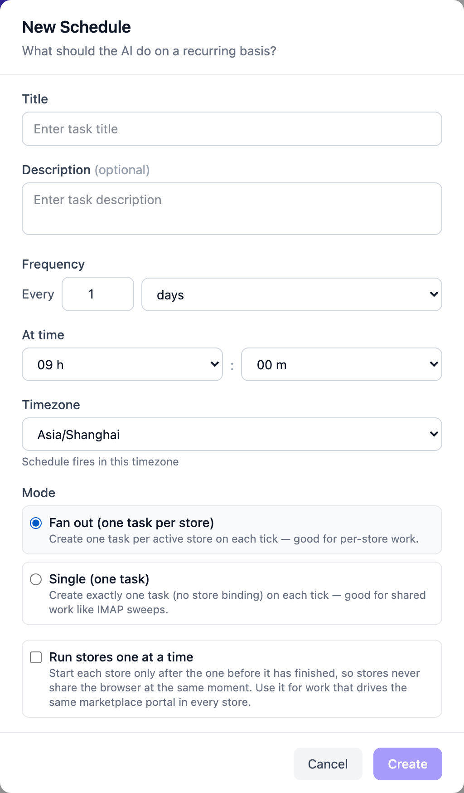
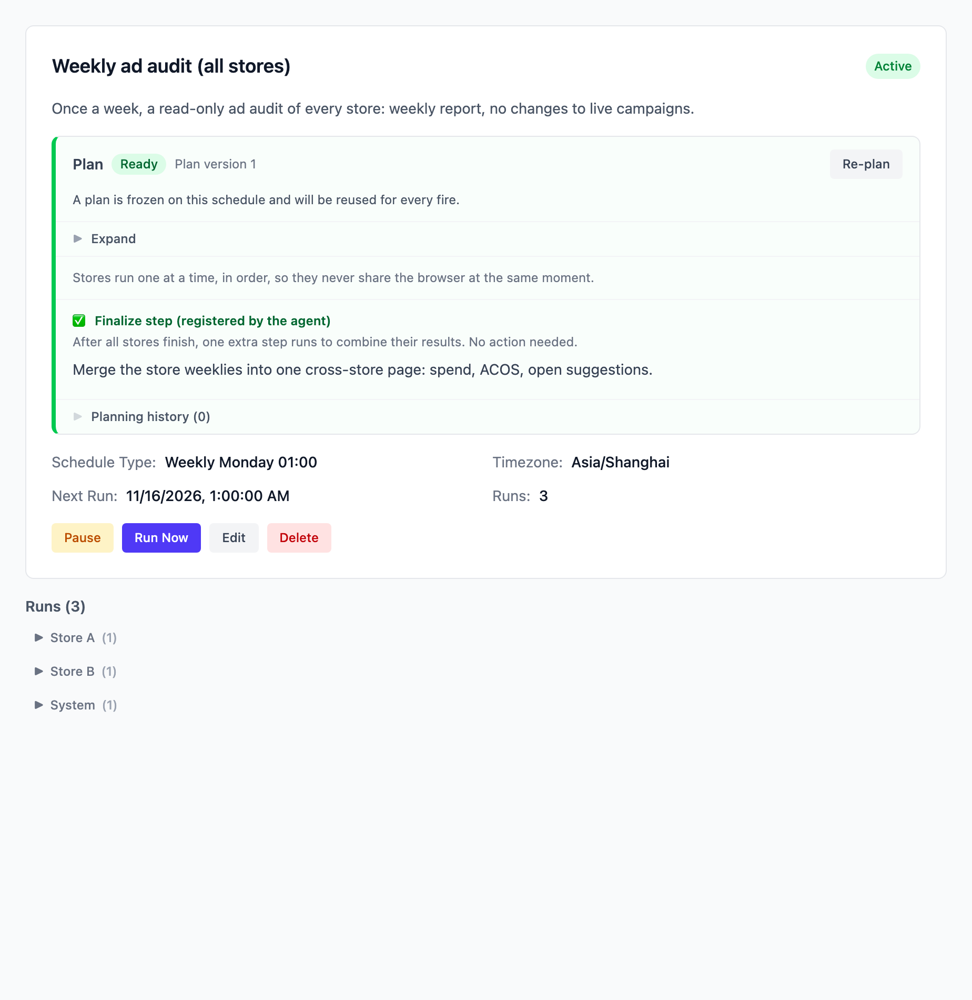

# Scheduled Tasks

A scheduled task is "create a task automatically when the time comes": you write
a recurring job (daily report export, weekly ad check, hourly inbox sweep) once,
pick a timetable, and it fires on its own from then on.

## Creating a schedule

The **Tasks** page in the sidebar has two sub-tabs, **Tasks** and **Scheduled**;
on the Scheduled tab, click **New Schedule**. As with one-off tasks, **where you
create it decides its scope** — [Tasks](using-tasks.md) explains the two scopes:

- Created **with a store selected** — the modal is titled "New Schedule for
  {store}"; each fire creates one task for that store, using that store's
  browser and memory;
- Created **with no store selected** (All Stores scope) — you get an extra
  **Mode** choice, covered in the next section.

Write what the AI should do on each recurring basis (the subtitle asks "What
should the AI do on a recurring basis?" — phrase it like a [task
description](using-tasks.md#creating-a-task)), pick the frequency and time,
submit.

## Two scopes and the execution modes

| | Store schedule | All Stores · **Fan out** | All Stores · **Single** |
|---|---|---|---|
| Per fire | **1 task** for that store | **one task per store**, fired in parallel | exactly **1 task**, bound to no store |
| Browser | That store's Ziniao / Chrome profile | Each store task uses its own store's browser | The generic web browser (public pages, email, chat messages); store-backend work is split into sub-tasks by the agent |
| Good for | One shop's reports or ad patrols | Every store doing the same job: weekly ad audit, listing patrol | Work that spans or sits outside stores: a shared mailbox, cross-store summaries |

Fan-out schedules have two optional behaviors:

- **Run stores one at a time** — the batch's store tasks line up and run one
  after another instead of sharing browsers at the same moment. Use it when
  every store logs into the same marketplace portal: on one machine the Ziniao
  profiles crowd into one client, and two stores driving the same portal at
  once starve each other. Unchecked, the stores run in parallel. One store
  failing does not block the rest of the line;
- **Finalize step** — when the job needs a single cross-store summary after
  every store finishes, the AI registers it while authoring the plan (the plan
  panel then shows "Finalize step (registered by the agent)"). Once the whole
  batch is done, the system automatically runs one extra store-less task that
  receives every store's results and merges them into the overall report.
  Nothing for you to do — just read it in the run history.

## The plan is authored once, at creation

**Every** schedule you create in the web app goes through a plan step: right
after creation the AI drafts the execution plan (the status badge reads
**Planning**). When the plan is written it is **frozen onto the schedule** —
every later fire executes that frozen plan directly, no re-planning — and the
status becomes **Ready**.

Two things to know:

- The plan takes effect as soon as it is authored; **there is no approve
  click**. You can read the frozen plan any time in the schedule's plan panel;
  if it's wrong, press **Re-plan** and the AI authors a new version;
- **Editing the schedule description voids the old plan** (status becomes
  **Plan stale**). Until you press **Re-plan**, the schedule **will not fire**
  on its timetable, and **Run Now** is disabled too. Changing the title,
  frequency or timezone does *not* void the plan.

A failed plan (**Plan failed**) blocks firing the same way — press Re-plan to
try again.

## Frequency and timezone

Frequencies are "every N minutes / hours / days", or a weekly (pick the
weekday) or monthly (pick the day of month) cycle; day/week/month runs also
take an **At time** (hour and minute). A one-day interval displays as "Daily
HH:MM" in the list.

Each schedule carries its own **timezone** — "the time it fires" is computed in
that zone, independent of the server or where you are. New schedules start from
your browser's timezone; the global default is set in **Settings → General →
Schedule Defaults → Default Schedule Timezone**.

## Defaults

**Settings → General → Schedule Defaults** controls two things: the default
timezone above, and **Default Mode** — whether a new *All Stores* schedule
starts with **Fan out (one task per store)** or **Single (one task)**
pre-selected. (The default Auto/Review choice for one-off tasks lives next door
under **Task Defaults → Default Execution Mode**.)

## Pause, resume, Run Now

The schedule detail page has **Pause / Resume** and **Run Now**:

- Run Now fires once regardless of whether the schedule is paused — for a
  manual pass before a vacation, or a trial run right after you re-plan. The
  only precondition is a Ready plan (with a stale plan the button is disabled
  until you Re-plan);
- While one of this schedule's runs is still in progress, Run Now is disabled
  with the tooltip "A task is already running";
- **Runs** lists the tasks each fire created (the planning task is excluded);
  All-Stores runs are grouped by store. Open any run for the normal task detail
  — follow it up or retry it there. The next fire time is shown as **Next Run**.

## AI profile

Schedules created in the web app **follow your default AI profile**: each fire
takes whatever your current default profile is at that moment. Switch your
default from model A to model B and every unpinned schedule uses B from the
next fire — no per-schedule edits.

Schedules created by external agents (over MCP) can **pin** a specific profile;
pinned schedules ignore your default. The toggle in Settings → AI profiles,
**"Sync scheduled tasks when changing the default profile"** (off by default),
exists for those: when on, changing the default also re-points your pinned
schedules to the new default.

## Memory across runs

Successive fires of one schedule don't start from amnesia: the agent keeps
cursors between runs — "last email read", "last order processed", "last report
date" — so each run handles only what's new. Nothing to configure; the agent
maintains this per task type on its own.

## Common recipes

| What you want | How to set it up |
|---|---|
| Export yesterday's sales report for this shop at 9:00 every morning | Schedule under the store, every 1 day at 09:00 |
| A weekly ad audit of every store, plus one merged summary | No store, **Fan out** + **Run stores one at a time**; the finalize step gets registered by the AI in the plan |
| Sweep the shared inbox hourly: reply where due, file what matters | No store, **Single**, every 1 hour |

## Limits and gotchas

- **Mode and store binding are fixed at creation.** You can't convert a store
  schedule into an All-Stores one later — delete it and create it again;
- A **Fan out** schedule creates a task for **every store on this server** per
  fire — with many stores, mind concurrency and token spend;
- A schedule whose plan isn't **Ready** (Planning / Plan stale / Plan failed /
  No plan) skips its fires and refuses Run Now;
- If a fired task is stuck in **Waiting** for your answer when the next fire
  arrives, the scheduler cancels the stale waiting run rather than blocking
  the timetable — the new fire proceeds normally.
