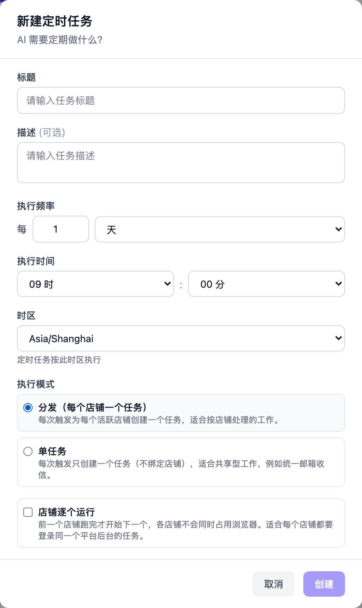
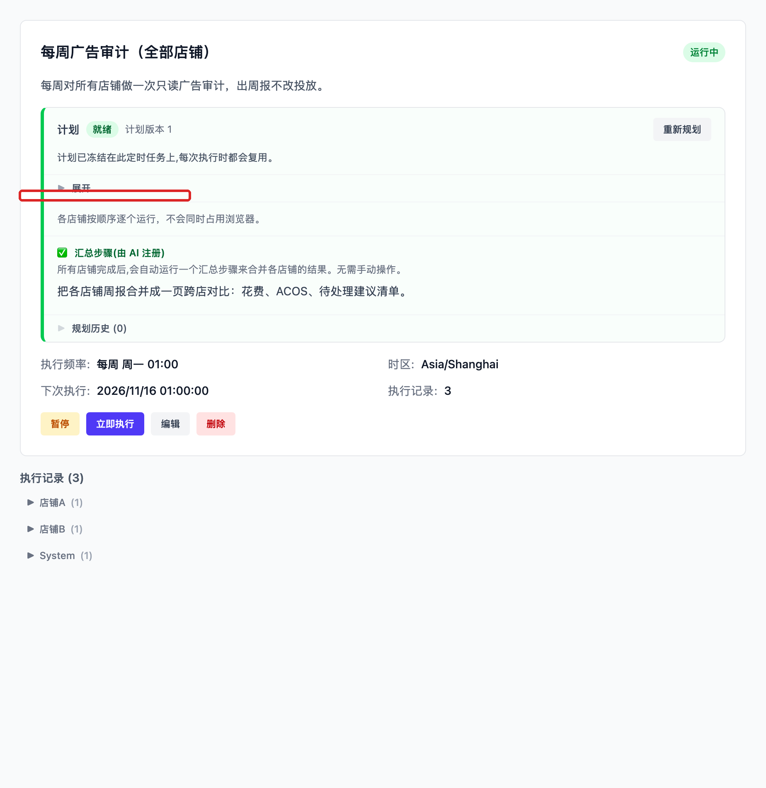

# 定时任务

定时任务到点自动创建一个任务。重复的工作——每天导报表、每周查广告、每小时收邮件——
写成一条带时间的指令，之后按你选的频率自动执行，不需要再手动发起。

## 创建定时任务

侧栏「任务」页有「常规」和「定时」两个子页，在「定时」子页点「新建定时任务」。
和一次性任务一样，在哪里创建决定了它的范围：

- 左侧选中某个店铺时创建，标题会写明「为 {店铺} 创建定时任务」。每次触发给这个
  店铺创建一个任务，用这个店铺的浏览器和记忆。
- 不选店铺（全部店铺范围）时创建，建的是跨店定时任务，表单多出「执行模式」二选一，
  见下一节。

在「AI 需要定期做什么？」里写清楚每次要做的事，写法同
[一次性任务的描述](using-tasks.md#创建任务)，选好频率和时间后提交。

## 选哪种范围与执行模式

| | 店铺定时任务 | 全部店铺 ·「分发」 | 全部店铺 ·「单任务」 |
|---|---|---|---|
| 每次触发 | 给该店铺建 1 个任务 | 每个店铺各建 1 个任务 | 建 1 个不绑定店铺的任务 |
| 同批任务 | — | 并行运行 | 只有一个 |
| 浏览器 | 该店铺的紫鸟或 Chrome 档案 | 各店铺用自己的档案 | 通用 Chrome |
| 适合 | 单店报表、单店广告巡检 | 所有店铺做同一件事 | 跨店或不绑定店铺的工作 |

「分发」同一批给每个店铺各建一个任务并行运行，适合周度广告审计、Listing 巡检这类
每家店都要执行的工作。「单任务」用一台通用 Chrome 处理公开网页、邮件和群消息，
需要进卖家后台的部分由它拆成子任务，适合共享邮箱收信、全店汇总这类本身就跨店的工作。

想让分发排队执行，或者要一份跨店总结，有两个可选项：

- **各店铺依次执行**：勾上「店铺逐个运行」，同批的店铺任务排队，一家完成后再开下一家，
  不会同时占用浏览器。每家店都要登录同一个平台后台时用这个：同一台机器上的紫鸟档案
  共用一个客户端，两家店同时登录同一个平台会互相冲突。不勾选时同批店铺并行。
  中间某家店失败，后面的店照常继续。
- **所有店铺完成后合一份总结**：需要汇总时，AI 在制定计划时会为这个定时任务注册一个
  汇总步骤，计划面板显示「汇总步骤(由 AI 注册)」。到点后系统自动追加一个不占用店铺
  浏览器的汇总任务，用各店铺的结果合并出总报告，不需要你手动操作，你在每次的
  执行记录里看结果即可。

## 计划只在创建时写一次

网页端创建的每一个定时任务都带计划环节：创建后 AI 立刻起草一份执行计划，
列表上的状态先是「规划中」，写完后状态变「就绪」。

- **这份计划不需要你批准**。写完即生效，之后每次触发直接照这份计划执行，
  不再重新规划，计划就冻结在这条定时任务上。
- **随时能查看和重写**。计划显示在定时任务详情的计划面板里，觉得不合适就点
  「重新规划」，AI 会重写一版。
- **改了定时任务的描述，旧计划立刻作废**，状态变「计划需更新」。在你点「重新规划」
  之前，这条定时任务到点不会执行，「立即执行」按钮同样禁用。只改标题、频率或时区
  不会作废计划。

规划失败时状态显示「规划失败」，同样不会触发，点「重新规划」重试即可。

## 频率与时区

频率可以设为每 N 分钟、每 N 小时、每 N 天，也可以按「周」（选星期几）或「月」
（选几号）循环。按天、周、月执行时再选一个「执行时间」（几时几分）。间隔为 1 天时，
列表里直接显示成「每天 HH:MM」。

每个定时任务都有自己的时区，到点时间按这个时区计算，和服务器所在时区、和你此刻
在哪个时区都无关。新建时默认使用你浏览器的时区；想改全局默认，在
「设置 → 通用 → 定时任务默认设置 → 默认定时任务时区」里设置。

## 默认值设置

「设置 → 通用 → 定时任务默认设置」管两件事：上面说的默认时区，以及「默认模式」——
新建全部店铺定时任务时，默认勾选「分发（每个店铺一个任务）」还是「单任务」。

一次性任务的默认「自动 / 先审核」不在这里，在旁边的
「设置 → 通用 → 任务默认设置 → 默认执行模式」。

## 暂停、恢复与立即执行

定时任务详情页有「暂停 / 恢复」和「立即执行」两个操作：

- **想提前执行一次**：点击「立即执行」，暂停状态也能触发。前提是计划处于就绪状态——
  刚修改完描述、还没有重新规划时，按钮是禁用的。休假前手动执行一次，或重新规划后
  先验证一轮，都用它。
- **上一次触发还没执行完**：「立即执行」会禁用，并提示「已有任务正在运行中」。
- **想回看历史或改结果**：「执行记录」列出每次触发创建的任务（不含起草计划的规划任务），
  跨店分发的任务还按店铺分组。点进去就是普通的任务详情，可以继续追问，也可以重试。
  下一次什么时候运行，详情页写着「下次执行」。

## AI 配置

**我想让已经创建的定时任务，继续用创建时的模型**

通过网页创建的定时任务，每次执行时都会使用你当前的默认 AI 配置，网页上暂时不能
单独指定。如果某个定时任务需要固定使用一个模型，请通过 MCP 创建它
（见 [MCP 接入](mcp.md)），并在创建时指定 AI 配置；指定过配置的定时任务不会随
默认配置变化。

**我想把所有已创建的定时任务都换成新的模型**

在「设置 → AI」中把新模型设为默认即可：没有单独指定过 AI 配置的定时任务，
下次执行时自动使用新的默认配置，不需要逐个编辑。已经通过 MCP 指定过配置的
定时任务，要先打开「设置 → AI」里的「更改默认配置时同步定时任务」（默认关闭），
再切换默认配置，这些定时任务会一并换成新的默认配置。

## 跨次运行的记忆

同一个定时任务的各次执行之间会保留进度。AI 在两次运行之间记下上次读到哪封邮件、
上次处理到哪个订单、上次报表做到哪天，这一轮从上次的位置继续，只处理新增的部分。
这不需要你配置，AI 按任务类型自己维护。

## 常见配法

| 想让它做的事 | 怎么创建 |
|---|---|
| 每天早上 9 点导出这家店昨天的销售报表 | 选中店铺创建，每 1 天 09:00 |
| 每周一上午给所有店铺做广告审计，合一份总结 | 不选店铺，「分发」+「店铺逐个运行」 |
| 每小时检查共享邮箱，该回复的回复、该建档的建档 | 不选店铺，「单任务」，每 1 小时 |
| 每天早上 9 点检查邮箱，把需要关注的邮件发到企业微信群 | 不选店铺，「单任务」，每 1 天 09:00 |

第二种配法里的汇总步骤不需要你手动添加，AI 会在计划里注册（见上面「所有店铺完成后合一份总结」）。

完整场景的分步演示见 [使用示例](examples.md)。

## 限制与注意

- **范围和执行模式在创建时确定，之后不能修改**。建错了范围只能删除后重建。
- 「分发」每次触发会给这台服务器上的每一个店铺各创建一个任务，店铺数量多时注意
  并发量和模型费用。
- 计划不是就绪状态（规划中、计划需更新、规划失败、未规划）的定时任务，到点会跳过，
  手动也无法触发。
- 定时触发的任务如果停在「等待中」等你回答，下一轮触发到达时会自动取消上一个未完成
  的等待任务，不会阻塞后续执行。
