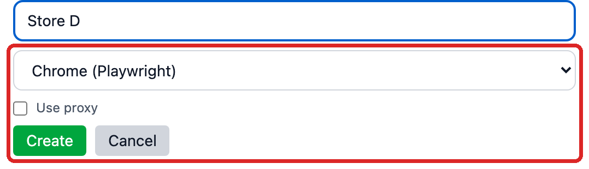
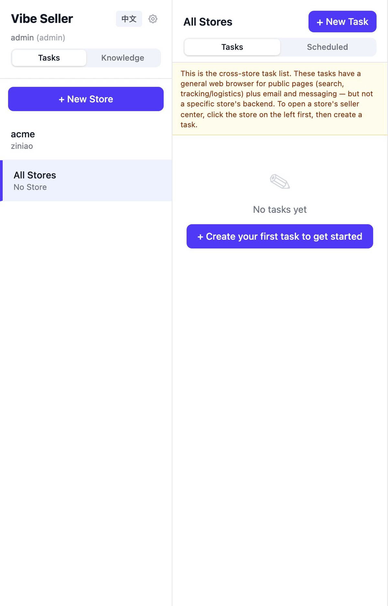

# Stores & Browsers

A store is Vibe Seller's smallest unit of work: **one shop on one platform**. Each store brings its own browser, its own memory and its own mailbox links — the AI working in store A can't see anything belonging to store B, and it can never share a login across them.

Using Ziniao? Read [Ziniao: Setup & Common Errors](ziniao.en.md) first.

## What belongs to a store

| What belongs to the store | Notes |
|---|---|
| Browser | A backend (Ziniao or Chrome) plus a browser profile of its own; logins survive across tasks |
| Store memory | Files that belong to this store alone — operation notes, logistics, product catalog and so on — visible and editable on the **Knowledge** page |
| Linked emails | Mailboxes you've already added, bound to this store under `Settings → Stores → Linked Emails` |
| Ads authorization | Amazon Ads is authorized store by store; one store's authorization is never reused by another |
| Platform / country | You don't fill these in when creating the store. The system learns them from this store's tasks and shows them — until then the card reads "No platforms learned yet" |

## Creating a store

Click "**+ New Store**" in the left sidebar of the home page. Type a "**Store Name**" first — nothing checks for duplicates when you create one, but this name is how the sidebar, the store cards and the task lists identify the store, so pick one you can tell apart at a glance. Then choose one of the two options under "**Browser Backend**":

- "**Chrome (Playwright)**" — no extra software needed. To route it through a proxy, tick "**Use proxy**" and fill "**Proxy Server**" (e.g. `http://127.0.0.1:7890`) and "**Proxy Bypass**" (e.g. `.amazon.com,.google.com`); the hint reads "Route browser traffic through a proxy".
- "**Ziniao (Browser Backend)**" — bind the Ziniao side in the same form: click "**+**" to open "**Add Ziniao Account**", fill "**Company**", "**Username**" and "**Password**" and save. Then select the account under "**Select Ziniao account...**" — the profiles under that account load on their own ("Loading store profiles...") — and pick the one this store should use under "**Select store profile...**". First time with Ziniao? The admin side has to enable it once — see [Ziniao: Setup & Common Errors](ziniao.en.md).

The Ziniao password is encrypted before it's saved, and only an admin can get it back out through "**Edit Ziniao Account**". Where credentials live, who can see them, and what to do about "The stored password can't be decrypted on this machine…": [Where the credentials are stored](ziniao.en.md#where-the-credentials-are-stored).

Then hit "**Create**". From here on, the store's browser opens by itself when the AI runs a task for it — you never have to start it.

## Editing and deleting a store

`Settings → Stores` shows one card per store, each with **Edit** and **Delete**.

- **Edit** changes the store name (and the proxy on a Chrome store) and nothing else. The browser backend and the bound Ziniao profile are marked "cannot be changed" — to switch backends, create the store again. Renaming to a name another store already holds is refused (the backend's English text: "A store with this name already exists"), and renaming is blocked while the store has a live browser session.
- **Delete** warns: "This will permanently delete store *<your store's name>*. Tasks and events will be preserved but unlinked from this store." The "**Also delete local files**" checkbox is off by default: tick it and the store's knowledge files and its browser profile directory go too, which is where its logins live.
- While the store still has tasks running, rename and delete are both refused — the error bar shows the backend's English text ("Cannot rename store with active tasks" / "Cannot delete store with active tasks"), which isn't localized. Let the tasks finish or stop them first.

## Which browser backend?

| | Ziniao (Browser Backend) | Chrome (Playwright) |
|---|---|---|
| What it is | A third-party anti-detect fingerprint browser; Vibe Seller drives it over CDP through its developer (WebDriver) mode | The system's own Chrome / Chromium, launched by Playwright with a profile dedicated to this store |
| Good for | One team managing many accounts that must not share fingerprints; stores on marketplaces with strict risk control | Running a single store yourself, no extra software, no handing the system your Ziniao password; public-web work |
| What you need | A Ziniao enterprise account whose BOSS account has enabled developer mode on the Ziniao Open Platform (see [Ziniao: Setup & Common Errors](ziniao.en.md)) | Nothing extra; on a headless Linux box you need a virtual display such as Xvfb |
| Where logins live | Inside Ziniao's own profile — Vibe Seller only opens and drives it | In this store's own Chrome profile directory, kept across tasks |
| Several stores at once | A machine can be connected to only one Ziniao account at a time | No such limit |
| Platforms | macOS / Linux / Windows; Windows via WSL needs a one-line `.bat` launcher (see [Ziniao: Setup & Common Errors](ziniao.en.md)) | macOS / Linux / WSLg; under a Windows service, use native Windows Chrome instead (next paragraph) |

**Windows has a third backend, `winchrome`.** A Vibe Seller running as a systemd service inside WSL2 can't put a Chrome window on screen, so it can drive **native Windows Chrome** instead — launched through Task Scheduler, window visible, so a human can finish a login. It isn't a choice in the store form; you set it up at deployment time. See the "Browser automation — native Windows Chrome (`winchrome` backend)" section of the [Windows setup guide](windows-setup.md).

## Logins stick around

A store's browser isn't a fresh incognito window every task:

- **Chrome stores** each have a persistent profile: cookies, localStorage and sessions carry across tasks. The first time the AI reaches a seller center that throws a slider or SMS check at you, you log in once by hand in that browser window; after that the AI works with the session already in place.
- **Ziniao stores** keep their logins in the Ziniao profile itself — Vibe Seller asks Ziniao to open that profile, so the one-time manual login happens in Ziniao.
- A Ziniao store also gets a lightweight Chrome **auxiliary browser** for everything that isn't the seller center (tracking sites, Google, and so on). The AI decides which URL goes to which browser; you can override that with rules in the `browser-routing.md` file in the store's folder.

## Running several stores at once

Tasks for different stores run in parallel by default, each in its own browser session; several tasks on one store open side by side in separate tabs. Two cases queue instead: tasks on the **same platform but different countries** (Ziniao has to reopen the session to switch country), and schedules you set to "one store after another". Ziniao adds one hard limit: a machine can be connected to only one Ziniao account at a time — starting a store bound to a second account fails with an error telling you to stop the first store's browser session first. Different Ziniao profiles *under the same account* run in parallel fine. The mechanics and troubleshooting are in [Ziniao concurrency](ziniao-concurrency.md).

---

## Ziniao: setup and common errors

Ziniao needs one-time admin setup — the BOSS account enables developer mode and ticks WebDriver login for the sub-account. What to fill in when binding, the two common errors ("无权限通过 webdriver 登录", "检测到您在新终端登录"), the WSL `ziniao_webdriver.bat` step and where the credentials are stored all have their own page:

**[Ziniao: Setup & Common Errors →](ziniao.en.md)**
