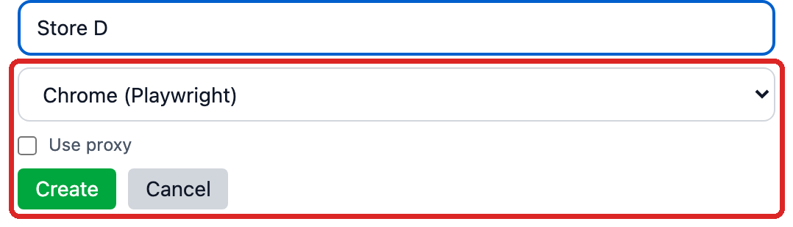
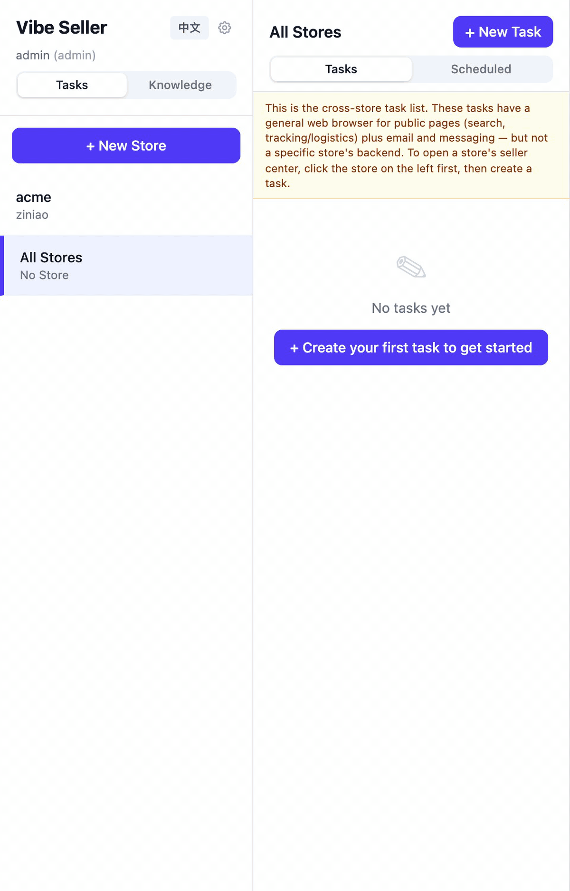

# Stores & Browsers

A store is Vibe Seller's smallest unit of work: **one shop on one platform**. Each store brings its own browser, its own memory and its own mailbox links — the AI working in store A can't see anything belonging to store B, and it can never share a login across them.

Using Ziniao? Read [Ziniao: Setup & Common Errors](ziniao.en.md) first. Using Yuehulian? Read [Yuehulian: Setup Guide](yuehulian.en.md) first.

## What belongs to a store

| What belongs to the store | Notes |
|---|---|
| Browser | A backend (Ziniao, Yuehulian or Chrome) plus a browser profile of its own; logins survive across tasks. A Ziniao / Yuehulian store also gets a Chrome auxiliary browser |
| Store memory | Files that belong to this store alone — operation notes, logistics, product catalog and so on — visible and editable on the **Knowledge** page |
| Linked emails | Mailboxes you've already added, bound to this store under `Settings → Stores → Linked Emails` |
| Ads authorization | Amazon Ads is authorized store by store; one store's authorization is never reused by another |
| Platform / country | You don't fill these in when creating the store. The system learns them from this store's tasks and shows them — until then the card reads "No platforms learned yet" |

## Creating a store

Click "**+ New Store**" in the left sidebar of the home page. Type a "**Store Name**" first — nothing checks for duplicates when you create one, but this name is how the sidebar, the store cards and the task lists identify the store, so pick one you can tell apart at a glance. Then choose one of the two options under "**Browser Backend**":

- "**Chrome**" — no extra software needed. To route it through a proxy, tick "**Use proxy**" and fill "**Proxy Server**" (e.g. `http://127.0.0.1:7890`) and "**Proxy Bypass**" (e.g. `.amazon.com,.google.com`); the hint reads "Route browser traffic through a proxy".
- "**Ziniao (Browser Backend)**" — bind the Ziniao side in the same form: click "**+**" to open "**Add Ziniao Account**", fill "**Company**", "**Username**" and "**Password**" and save. Then select the account under "**Select Ziniao account...**" — the profiles under that account load on their own ("Loading store profiles...") — and pick the one this store should use under "**Select store profile...**". First time with Ziniao? The admin side has to enable it once — see [Ziniao: Setup & Common Errors](ziniao.en.md).
- "**Yuehulian (Browser Backend)**" — Windows only. Bind it in the same form: click "**+**", fill "**Team name**", "**Sub-account login**" and "**Password**" and save; Vibe Seller signs the client in with it and auto-loads the stores, then pick this store under "**Select a store...**". Yuehulian keeps only one account per machine (the account row has a single "+"; filling it again overwrites). Download, team-account creation, switching accounts and errors: [Yuehulian: Setup Guide](yuehulian.en.md).

The Ziniao password is encrypted before it's saved, and only an admin can get it back out through "**Edit Ziniao Account**". Where credentials live, who can see them, and what to do about "The stored password can't be decrypted on this machine…": [Where the credentials are stored](ziniao.en.md#where-the-credentials-are-stored).

Then hit "**Create**". From here on, the store's browser opens by itself when the AI runs a task for it — you never have to start it.

## Editing and deleting a store

`Settings → Stores` shows one card per store, each with **Edit** and **Delete**.

- **Edit** changes the store name (and the proxy on a Chrome store) and nothing else. The browser backend and the bound Ziniao profile are marked "cannot be changed" — to switch backends, create the store again. Renaming to a name another store already holds is refused (the backend's English text: "A store with this name already exists"), and renaming is blocked while the store has a live browser session.
- **Delete** warns: "This will permanently delete store *<your store's name>*. Tasks and events will be preserved but unlinked from this store." The "**Also delete local files**" checkbox is off by default: tick it and the store's knowledge files and its browser profile directory go too, which is where its logins live.
- While the store still has tasks running, rename and delete are both refused — the error bar shows the backend's English text ("Cannot rename store with active tasks" / "Cannot delete store with active tasks"), which isn't localized. Let the tasks finish or stop them first.

## Supported browsers

Three browser backends are supported (plus a Windows-native Chrome set up
only at deployment). Download and team-account registration go through each
vendor's own site:

| Backend | What it is | Good for | Platforms | Site / download | Create a team account | Setup guide |
|---|---|---|---|---|---|---|
| Chrome | The system's own Chrome / Chromium (launched by Playwright) | Running a single store yourself; public-web work | macOS / Linux / WSLg | Built in, no install | — | "Creating a store" above |
| Ziniao | Third-party anti-detect browser (developer / WebDriver mode, driven over CDP) | One team managing many accounts; strict risk control | macOS / Linux / Windows | [ziniao.com](https://www.ziniao.com) · [download](https://www.ziniao.com/download) | Register an enterprise account → BOSS enables developer mode on the [Open Platform](https://open.ziniao.com/docSupport?docId=99) and ticks WebDriver login for the sub-account | [Ziniao setup](ziniao.en.md) |
| Yuehulian | Chinese anti-detect e-commerce browser (Node inspector + CDP) | One team managing many accounts (Windows) | Windows only (incl. WSL-on-Windows) | [kj.chinafic.com](https://kj.chinafic.com/) · client download on the site | Register an enterprise account → create sub-accounts and grant store permissions in the console (team login = team name + sub-account + password) | [Yuehulian setup](yuehulian.en.md) |

> Windows also has a fourth backend, `winchrome` (set at deployment, not a
> choice in the store form) — see the end of "Which browser backend?".

## Which browser backend?

| | Ziniao (Browser Backend) | Yuehulian (Browser Backend) | Chrome |
|---|---|---|---|
| What it is | A third-party anti-detect fingerprint browser; driven over CDP through its developer (WebDriver) mode | A Chinese anti-detect e-commerce browser; no local API, driven via a Node inspector + CDP | The system's own Chrome / Chromium, launched by Playwright with a profile dedicated to this store |
| Good for | One team managing many accounts that must not share fingerprints; strict risk control | One team managing many accounts (Windows) | Running a single store yourself, no extra software; public-web work |
| What you need | A Ziniao enterprise account whose BOSS enabled developer mode | A Yuehulian team account (team + sub-account + password) | Nothing extra; on a headless Linux box you need a virtual display such as Xvfb |
| Where logins live | Inside Ziniao's own profile — Vibe Seller only opens and drives it | Inside the Yuehulian client (Vibe Seller auto-signs-in) | In this store's own Chrome profile directory, kept across tasks |
| Several stores at once | A machine can connect to only one Ziniao account at a time | One Yuehulian account per machine (stricter: a second account can't even be added) | No such limit |
| Platforms | macOS / Linux / Windows; Windows via WSL needs a one-line `.bat` launcher (see [Ziniao: Setup & Common Errors](ziniao.en.md)) | Windows only (incl. WSL-on-Windows) | macOS / Linux / WSLg; under a Windows service, use native Windows Chrome instead (next paragraph) |

Yuehulian is an anti-detect browser like Ziniao, but it ships no local
API, so Vibe Seller drives it via a Node inspector + CDP, and it is
**Windows-only**; a machine keeps a single Yuehulian account and
auto-signs-in when the session expires. Download, team-account creation,
binding and errors: [Yuehulian: Setup Guide](yuehulian.en.md).

**Windows has another backend, `winchrome`.** A Vibe Seller running as a systemd service inside WSL2 can't put a Chrome window on screen, so it can drive **native Windows Chrome** instead — launched through Task Scheduler, window visible, so a human can finish a login. It isn't a choice in the store form; you set it up at deployment time. See the "Browser automation — native Windows Chrome (`winchrome` backend)" section of the [Windows setup guide](windows-setup.md).

## Ziniao stores: two browsers working together

A Ziniao store's tasks have two browsers, each with its own job:

| | Ziniao browser (main) | Chrome auxiliary browser |
|---|---|---|
| Used for | The seller center: listings, inventory, reports, ads | Everything outside the seller center: carrier tracking, overseas sites, search engines, supplier sites, public product pages |
| Strength | Fingerprint and IP isolation, holds the store's login — the safest way into the seller center | No restrictions; opens any site |
| Limits | Only some sites open; many overseas and logistics sites are blocked | Not signed in to the seller account, and **never** used for seller-center work |

Ziniao protects the store account but blocks a lot; Chrome covers exactly the
sites Ziniao can't open, so the two complement each other. For example, a task
that "checks the delivery status of recent orders" reads the orders from the
seller center in Ziniao and looks up the tracking on the carrier's site in
Chrome, then puts both into one report.

All of this is automatic: the auxiliary browser starts the first time it's
needed, there's one per store (never shared between stores), and cookies for
public sites survive across tasks. The AI decides which URL goes to which
browser; you don't choose. To pin certain URLs to one browser, write rules in
`browser-routing.md` in the store's folder — they take precedence over the
defaults.

A Chrome store is plain Chrome with none of these limits, so it uses a single
browser. A Yuehulian store works exactly like a Ziniao one here — it also
gets a Chrome auxiliary browser.

## Logins stick around

A store's browser isn't a fresh incognito window every task:

- **Chrome stores** each have a persistent profile: cookies, localStorage and sessions carry across tasks. The first time the AI reaches a seller center that throws a slider or SMS check at you, you log in once by hand in that browser window; after that the AI works with the session already in place.
- **Ziniao stores** keep their logins in the Ziniao profile itself — Vibe Seller asks Ziniao to open that profile, so the one-time manual login happens in Ziniao.
- A Ziniao store's Chrome auxiliary browser keeps its own persistent profile too — see the previous section.

## Running several stores at once

Tasks for different stores run in parallel by default, each in its own browser session; several tasks on one store open side by side in separate tabs. Two cases queue instead: tasks on the **same platform but different countries** (Ziniao has to reopen the session to switch country), and schedules you set to "one store after another". Ziniao adds one hard limit: a machine can be connected to only one Ziniao account at a time — starting a store bound to a second account fails with an error telling you to stop the first store's browser session first. Different Ziniao profiles *under the same account* run in parallel fine. The mechanics and troubleshooting are in [Ziniao concurrency](ziniao-concurrency.md).

Yuehulian is stricter: a machine supports only one Yuehulian account — a second account can't even be added. To switch accounts, delete every Yuehulian store under `Settings → Stores` first, then add the new one. All Yuehulian stores share this single login, so there's no runtime account conflict. See [Yuehulian: one account per machine](yuehulian.en.md#one-account-per-machine).

---

## Ziniao: setup and common errors

Ziniao needs one-time admin setup — the BOSS account enables developer mode and ticks WebDriver login for the sub-account. What to fill in when binding, the two common errors ("无权限通过 webdriver 登录", "检测到您在新终端登录"), the WSL `ziniao_webdriver.bat` step and where the credentials are stored all have their own page:

**[Ziniao: Setup & Common Errors →](ziniao.en.md)**
