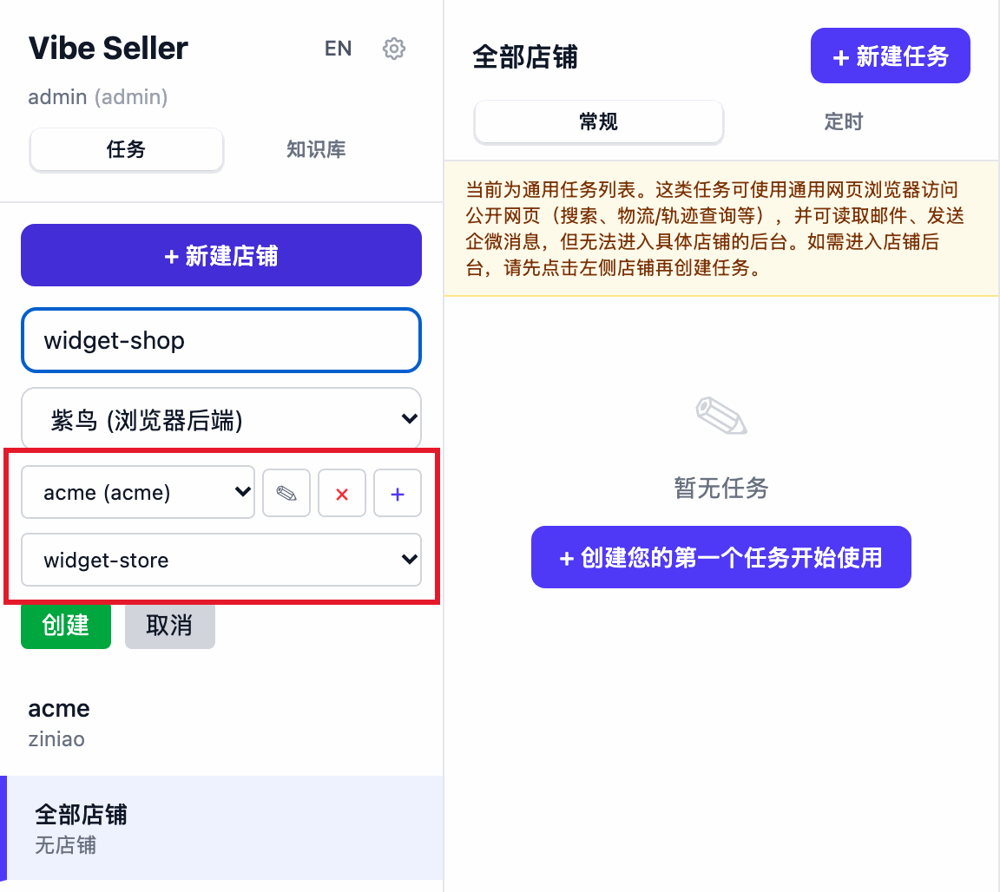
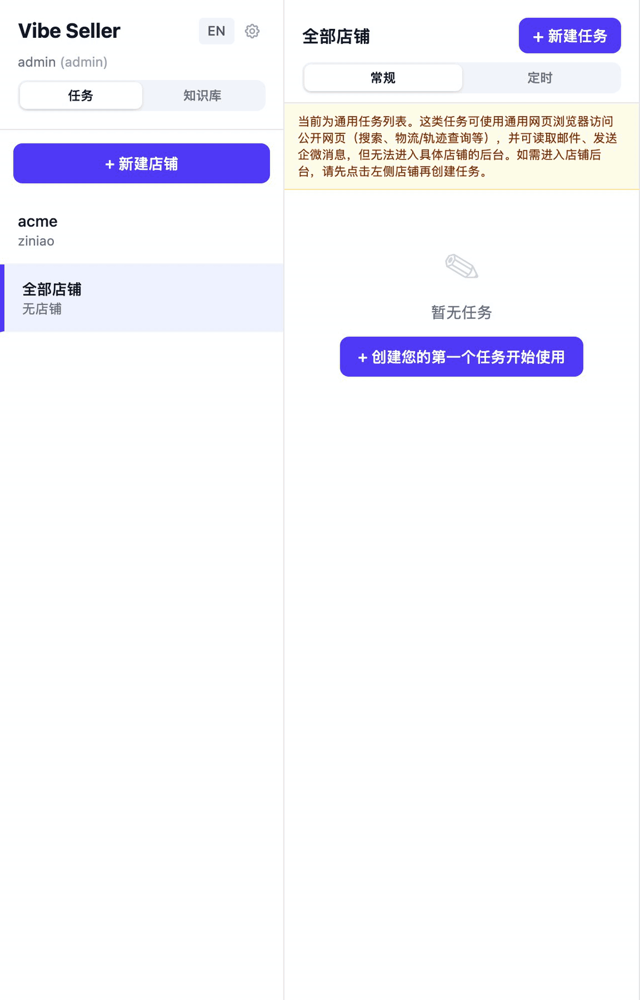

# 店铺与浏览器

店铺是 Vibe Seller 里最小的工作单位：**一个平台上的一个店**。每个店铺有自己的浏览器、自己的记忆、自己的邮箱关联：A 店的 AI 看不到 B 店的任何内容，也不会把登录状态用到其他店铺上。

用紫鸟？先看 [紫鸟：开通与常见报错](ziniao.md)。

## 一个店铺有什么

| 属于店铺的东西 | 说明 |
|---|---|
| 浏览器 | 一个后端，加一份自己的浏览器档案 |
| 店铺记忆 | 这家店专属的 markdown 文件 |
| 关联邮箱 | 已添加的邮箱绑到这家店 |
| 广告授权 | 按店铺逐个授权，互不通用 |
| 平台和国家 | 不用填，AI 从任务里学到 |

具体说明：

- **浏览器**：后端是紫鸟或 Chrome 之一，登录状态在任务之间保留，见下面「登录状态会保留」。
- **店铺记忆**：运营笔记、物流、商品目录等文件，在「知识库」页面可以查看和编辑。
- **关联邮箱**：在「设置 → 店铺 → 关联邮箱」里把邮箱绑到这家店。
- **广告授权**：亚马逊广告 API 每个店铺单独授权一次。
- **平台和国家**：卡片上的「平台」和「国家/地区」两栏不需要手动录入，系统从这家店的任务里学习后显示出来；还没学到之前显示「尚未学习到平台信息」。

## 新建店铺

在首页左侧栏点击「+ 新建店铺」，先填写「店铺名称」，再在「浏览器后端」下拉里二选一，最后点「创建」。

创建店铺时不校验名称是否重复，但店铺卡片、侧栏和任务列表都靠这个名字识别店铺，起一个一眼能分辨的名称更省事。填好之后，AI 在这个店铺执行任务时会自动打开浏览器，不需要你手动打开。

- 「Chrome (Playwright)」：不需要额外软件。需要走代理时勾选「使用代理」，填写「代理服务器」（例如 `http://127.0.0.1:7890`）和「代理绕过」（例如 `.amazon.com,.google.com`），界面上的提示语是「通过代理转发浏览器流量」。
- 「紫鸟 (浏览器后端)」：需要在同一个表单里先绑定紫鸟账号。点击「+」展开「添加紫鸟账号」，填写「公司名称」「用户名」「密码」并保存；然后在「选择紫鸟账号...」里选中它，系统会自动读取这个账号下的紫鸟档案（「正在加载店铺列表...」），你在「选择店铺配置...」里挑出这家店对应的那一个。第一次用紫鸟要先在主账号一侧开通，见 [紫鸟：开通与常见报错](ziniao.md)。

紫鸟账号的密码加密保存在本机，只有管理员能在「编辑紫鸟账号」里取回。存在哪里、谁能看到、看到「无法解密已保存的密码…」怎么办，见 [凭据存在哪里](ziniao.md#凭据存在哪里)。

## 修改名称与删除店铺

在「设置 → 店铺」里，每个店铺一张卡片，可以「编辑」或「删除」。

- **编辑**能改的只有店铺名称（以及 Chrome 店铺的代理设置）。「浏览器后端」和已绑定的紫鸟档案标着「不可更改」，需要更换后端就重新建一个店铺。把名称改成其他店铺已占用的名称会被拒绝（后端返回的英文提示是「A store with this name already exists」）；店铺有活跃的浏览器会话时也不能改名。
- **删除**会提示「将永久删除店铺「〈店铺名〉」。任务和事件将保留但取消关联。」。对话框里有一个默认不勾选的「同时删除本地文件」：勾选后会连同店铺知识文件和浏览器配置目录一起删除，登录状态也就没有了。
- 店铺还有未完成的任务时，改名和删除都会被阻止，错误条上显示后端的英文提示「Cannot rename store with active tasks」或「Cannot delete store with active tasks」。请等任务完成或先停止任务，再操作。

## 选哪个浏览器后端

| | 紫鸟（浏览器后端） | Chrome (Playwright) |
|---|---|---|
| 是什么 | 第三方防关联浏览器 | 系统自带的 Chrome / Chromium |
| 适合 | 一个团队管多个账号 | 单店自用、公开网页任务 |
| 需要准备 | 紫鸟企业账号并开通开发者模式 | 无额外要求 |
| 登录状态 | 存在紫鸟自己的档案里 | 存在店铺专属的 Chrome 档案目录 |
| 多店铺并发 | 一台机器同时只能登一个紫鸟账号 | 没有这个限制 |
| 支持平台 | macOS / Linux / Windows | macOS / Linux / WSLg |

紫鸟是第三方防关联浏览器，Vibe Seller 通过它的开发者模式（WebDriver）以 CDP 直接控制它。
不同紫鸟账号之间的浏览器指纹互相隔离，适合平台风控严格的店铺。要开通什么、报错怎么处理，见 [紫鸟：开通与常见报错](ziniao.md)。

Chrome 后端由 Playwright 为这个店铺拉起一个独立档案，不需要额外软件，也不需要把紫鸟密码交给系统；Linux 无图形界面时需要 Xvfb 之类的虚拟显示。

Windows 上还有第三种后端 `winchrome`：以 systemd 服务方式运行在 WSL2 里的 Vibe Seller 弹不出 Chrome 窗口，这时可以改用 Windows 原生 Chrome（由任务计划程序拉起，窗口可见，人工登录时可以操作）。它不在店铺表单里选择，而是在部署时设置，步骤见 [Windows 部署指南](windows-setup.md) 的「Browser automation — native Windows Chrome」一节。

## 登录状态会保留

店铺浏览器不会每次任务都换一个全新的，第一次登录之后可以一直复用：

- **Chrome 店铺**每家店一份持久档案，Cookie、localStorage 和登录状态在任务之间保留。第一次让 AI 进入卖家后台时，如果平台弹出滑块、短信验证这类人机检查，需要你在浏览器窗口里手动登录一次；之后 AI 接着使用这个登录状态操作。
- **紫鸟店铺**的登录状态由紫鸟档案自己保存，Vibe Seller 每次都是「让紫鸟打开这个档案」，所以手动登录也是在紫鸟里完成一次。
- 紫鸟店铺还会另外打开一个轻量的 Chrome **辅助浏览器**，用于卖家后台之外的网页（物流查询、Google 之类）。具体哪个网址走哪个浏览器由 AI 判断；你也可以在店铺目录里的 `browser-routing.md` 写入规则来覆盖它。

## 多个店铺同时运行

不同店铺的任务默认各自运行，可以同时执行：每家店有自己的浏览器会话，同一家店的多个任务也能分别开在不同标签页里并行。两种情况会排队：任务属于**同一个平台的不同国家**时（紫鸟切换国家需要重开会话），以及你把定时任务设置成「一家店完成后再执行下一家」的串行安排时。

使用紫鸟还有一条硬性限制：一台机器同一时间只能连接一个紫鸟账号。连接第二个账号时会直接报错，提示你先停止前一家店的浏览器会话。同一个账号下的不同紫鸟档案并行没有问题。原理和排查方法见 [紫鸟并发说明](ziniao-concurrency.md)。

---

## 紫鸟的开通与报错

紫鸟要先由主账号（BOSS 账号）开通开发者模式、再给子账号勾选 WebDriver 登录；绑定时要填哪些字段、「无权限通过 webdriver 登录」「检测到您在新终端登录」两条报错怎么处理、Windows（WSL）多出的 ziniao_webdriver.bat 一步、凭据存在哪里，都写在单独一页：

**[紫鸟：开通与常见报错 →](ziniao.md)**
