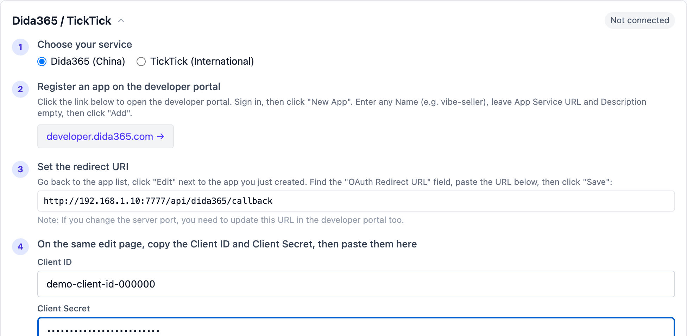

# TickTick / Dida365

Connect TickTick (or its Chinese sibling Dida365) to Vibe Seller and the
AI can create tasks in your lists, update progress and look up projects
while it works — turning inspection findings into to-dos, for example,
or scheduling the follow-ups from a weekly review.

The connection uses TickTick's official Open API (OAuth2). All you need
is to register an **app** on its developer portal and copy back a
Client ID and Client Secret — think of it as issuing Vibe Seller a key
card. Five minutes, no code.

> The screenshots were taken on macOS; the steps look the same on
> Windows and Linux.

## What you need

- A [Dida365](https://www.dida365.com/) (China) or
  [TickTick](https://ticktick.com/) (international) account;
- Access to sign in to it once during the authorization popup.

The two services have separate accounts: register the app on the
developer portal of the version you actually use.

## Step 1: Register an app on the developer portal

1. Open the portal and sign in:
   - Dida365 (China): [developer.dida365.com](https://developer.dida365.com/manage);
   - TickTick (international): [developer.ticktick.com](https://developer.ticktick.com/manage).
2. Click **New App**. Any Name works (e.g. `vibe-seller`); leave App
   Service URL and Description empty, then click **Add**.

## Step 2: Set the redirect URI

1. Back in the app list, click **Edit** next to the app you just made;
2. Find the **OAuth Redirect URL** field and paste the address shown
   in Vibe Seller (the code box in the next screenshot). It is
   whatever address you use to reach Vibe Seller plus
   `/api/dida365/callback` — e.g.
   `http://localhost:7777/api/dida365/callback`; just copy what the
   page shows;
3. Click **Save**.

!!! note "Changed the port?"
    The port in the redirect address must match the one you actually
    use to reach Vibe Seller. If you change it later, update this
    field on the developer portal too.

## Step 3: Copy the credentials and connect

1. On the same Edit page, copy the **Client ID** and
   **Client Secret**;
2. Open **Settings → Integrations → TickTick / Dida365** in Vibe
   Seller, pick your service (China / International) and paste both
   values into the step-4 fields;
3. Click **Authorize** — a TickTick authorization popup opens; sign in
   and approve. The popup closes by itself and the card's status
   changes to "Connected".

The redirect address in the screenshot is **your own Vibe Seller
address** (generated from the address you open the app at) — copy it
straight from the page.

!!! note "Pop-up blocked?"
    The authorization page opens as a pop-up. If your browser blocks
    it, click the pop-up blocker icon in the address bar, choose
    "Always allow pop-ups from this site", then click **Authorize**
    again.

## Step 4 (optional): Pick a default project

Once connected you can choose a **default project** — automatically
created tasks (from event sync, for example) land there. Leave it
empty and the AI can reach every project. Click **Save** to keep the
choice.

## Verify

1. The card's status pill in Settings reads **Connected**;
2. Try a task: "Add a TickTick task: reconcile last month's bills by
   Friday";
3. Open the TickTick app or web site — if the task is there, you are
   done.

## What the AI can do with it

- **Create tasks**: turn your spoken to-dos into entries in the right
  list, with due dates and priorities;
- **Read tasks**: summarise open items in a list, check progress,
  report what changed;
- **Update tasks**: tick things off, move dates, add notes.

Task data only travels between your deployment and TickTick's official
API; the credentials stay encrypted on your machine.

## FAQ

<b>"Authorize" fails with a redirect_uri mismatch?</b>

The OAuth Redirect URL on the developer portal doesn't match what
Vibe Seller shows. Re-check the Edit page: scheme (http/https), host
(localhost or your domain), port and path must be identical. Save and
click **Authorize** again.

<b>Remote access warns that a bare hostname is rejected?</b>

The TickTick developer portal only accepts `localhost` or a full
domain (e.g. `host.example.com`) — bare hostnames like
`http://myserver:7777` are refused. Fix: open a browser on the server
machine itself, finish the authorization once at
`http://localhost:7777`, then keep using the remote page; or reach
the page through a full domain (e.g. a Tailscale `*.ts.net` name).

<b>It stopped working after a while?</b>

Check the card in Settings. If it says "Not connected", click
**Authorize** once more — your Client ID / Secret are still stored,
so there is nothing to re-enter.

<b>Can I connect China and international at once?</b>

Only one service at a time (they share one connection slot). To
switch, **Disconnect** first and connect the other version.

<b>How do I disconnect?</b>

Click **Disconnect** on the card in Settings and confirm. The AI
loses access immediately. The app registered on the developer portal
can stay — you can authorize again later.

