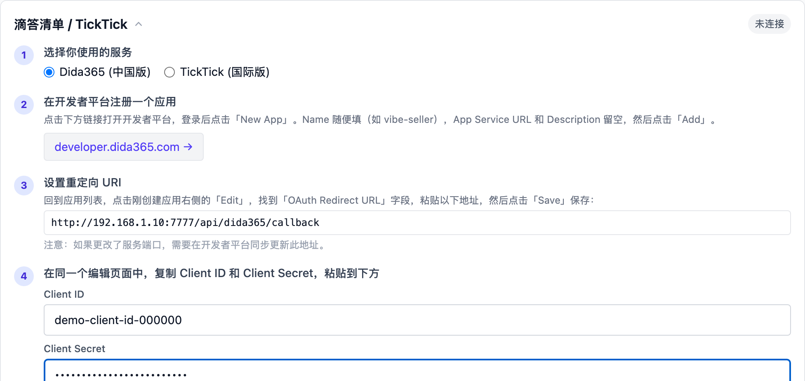

# 滴答清单 / TickTick

接入滴答清单（或国际版 TickTick）后，AI 执行任务时可以直接在你的清单里
创建任务、更新进度、查询项目——例如把巡检发现的问题逐条记为待办，
或者把每周复盘的结论安排进日程。

接入使用滴答清单官方的开放接口（OAuth2 授权）。你需要在其开发者平台注册
一个**应用**，获取 Client ID 和 Client Secret——相当于给 Vibe Seller 办一张
门禁卡。全程约 5 分钟，不需要写代码。

各集成分别配在哪里、彼此怎么分工，见[集成总览](integrations.md)。

> 下文的截图在 macOS 上完成，Windows、Linux 上的界面和步骤一样。

## 接入前准备

- 一个滴答清单（[dida365.com](https://www.dida365.com/)）或
  TickTick（[ticktick.com](https://ticktick.com/)）账号；
- 该账号的登录权限（授权时要在弹窗里登录一次）。

国内版和国际版的账号体系是分开的：使用哪个版本的服务，就在哪个版本的
开发者平台注册应用。

## 第一步：在开发者平台注册应用

1. 打开开发者平台并登录：
    - 滴答清单（中国版）：[developer.dida365.com](https://developer.dida365.com/manage)；
    - TickTick（国际版）：[developer.ticktick.com](https://developer.ticktick.com/manage)。
2. 点击 **New App**，Name 可随意填写（如 `vibe-seller`），App Service URL
   和 Description 留空，点击 **Add**。

## 第二步：设置重定向 URI

1. 回到应用列表，点击刚创建应用右侧的 **Edit**；
2. 找到 **OAuth Redirect URL** 字段，粘贴 Vibe Seller 页面上给出的
   地址（见下一步截图里的代码框）。这个地址由你访问 Vibe Seller 时使用的
   地址加上 `/api/dida365/callback` 组成，例如
   `http://localhost:7777/api/dida365/callback`，直接复制页面上的即可；
3. 点击 **Save**。

!!! note "端口换了怎么办"
    重定向地址里的端口要和你实际访问 Vibe Seller 的端口一致。
    以后如果更换端口，记得回来同步更新这个地址。

## 第三步：复制凭据并连接

1. 在同一个 Edit 页面，复制 **Client ID** 和 **Client Secret**；
2. 打开 Vibe Seller 的「设置 → 集成 → 滴答清单 / TickTick」，
   选择你使用的服务（中国版或国际版），把两个值粘贴进第 4 步的输入框；
3. 点击「授权连接」——浏览器会弹出滴答清单的授权页，登录并点击允许。
   授权完成后弹窗自动关闭，页面上的状态会变为「已连接」。

图中的重定向地址就是**你自己的 Vibe Seller 地址**（按你实际打开的
地址生成），直接从页面上复制即可。

!!! note "弹窗被拦截了？"
    授权页以弹窗形式打开。如果浏览器拦截了弹窗，点击地址栏右侧的
    弹窗拦截图标，选择「始终允许来自此网站的弹出式窗口」，再点一次
    「授权连接」即可。

## 第四步（可选）：指定默认项目

如果你希望自动创建的待办固定落在某个项目里，可以在连接成功后选择一个
**默认项目**：事件同步等自动创建的任务会归入该项目。不选择时，AI 可以
访问你的全部项目。选好后点击**保存**。

## 验证

1. 设置页里滴答清单卡片右上角显示「**已连接**」；
2. 创建一个任务试试：「在滴答清单里加一条任务：周五前核对上月账单」；
3. 打开滴答清单 App 或网页版，能看到这条任务就说明接入成功了。

## 接入后 AI 能做什么

- **建任务**：按你的描述把待办写入指定清单，可带截止时间、优先级；
- **读任务**：汇总某个清单里的未完成任务、检查进度、汇报变化；
- **改任务**：更新完成状态、调整日期、补充备注。

任务数据只与滴答清单官方接口往来，凭据加密保存在你的本地部署里。

## 常见问题

<b>点「授权连接」后提示 redirect_uri 不匹配？</b>

开发者平台里填写的 OAuth Redirect URL 和 Vibe Seller 给出的地址
不一致。回到开发者平台的 Edit 页面核对：协议（http/https）、域名
（localhost 或你的域名）、端口、路径四段都要完全一致。修改并
保存后，重新点击「授权连接」。

<b>远程访问时提示裸主机名不被接受？</b>

滴答清单开发者平台只接受 `localhost` 或完整域名（如
`host.example.com`），`http://myserver:7777` 这类裸主机名
会被拒绝。解决办法：在服务器本机打开浏览器访问
`http://localhost:7777` 完成一次授权，之后回到远程页面即可正常
使用；或者通过完整域名（如 Tailscale 的 `*.ts.net`）访问。

<b>连接一段时间后失效了？</b>

先回设置页查看状态：显示「未连接」的话，重新点击一次「授权连接」
完成授权即可；凭据还在，不需要重新填写 Client ID / Secret。

<b>中国版和国际版能同时接吗？</b>

不能，一次只能连接一个服务（连接配置是共享的）。要切换时先
点击「断开连接」，再按上面的步骤连接另一个版本。

<b>怎么断开？</b>

在设置页滴答清单卡片里点击**断开连接**并确认。断开后 AI 立即
无法访问滴答清单；开发者平台里注册的应用不需要删除，以后想
再使用时重新授权即可。

