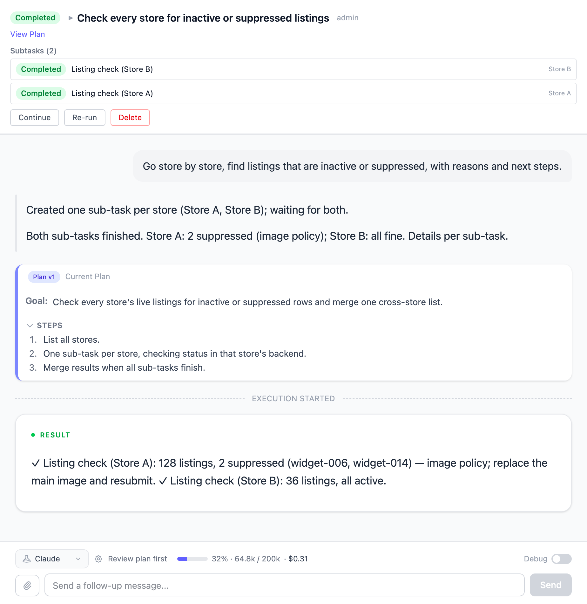
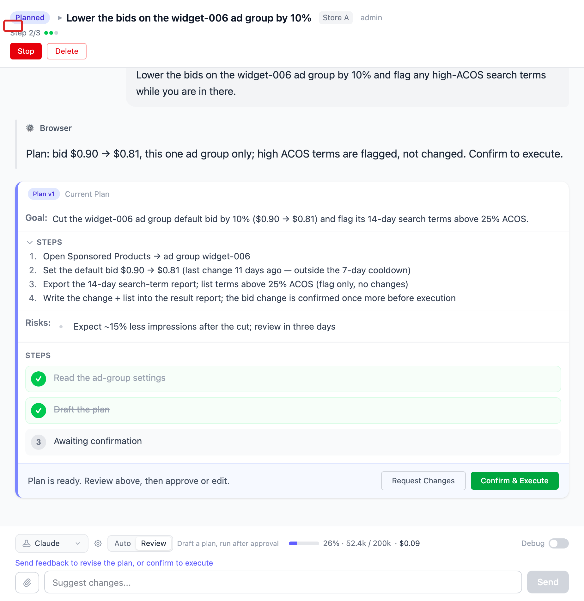
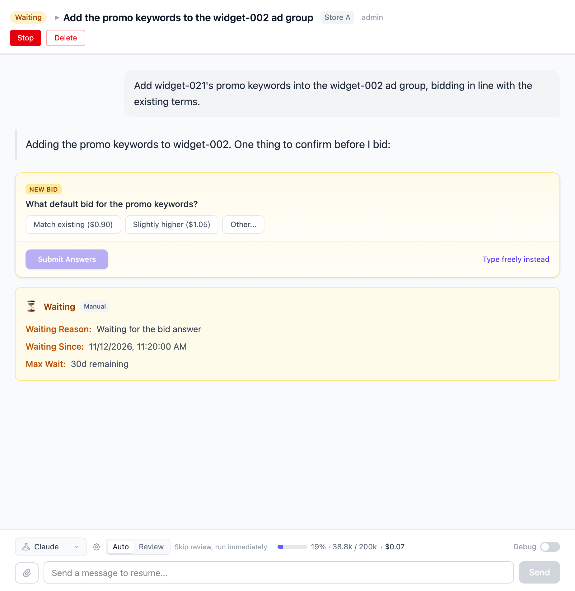
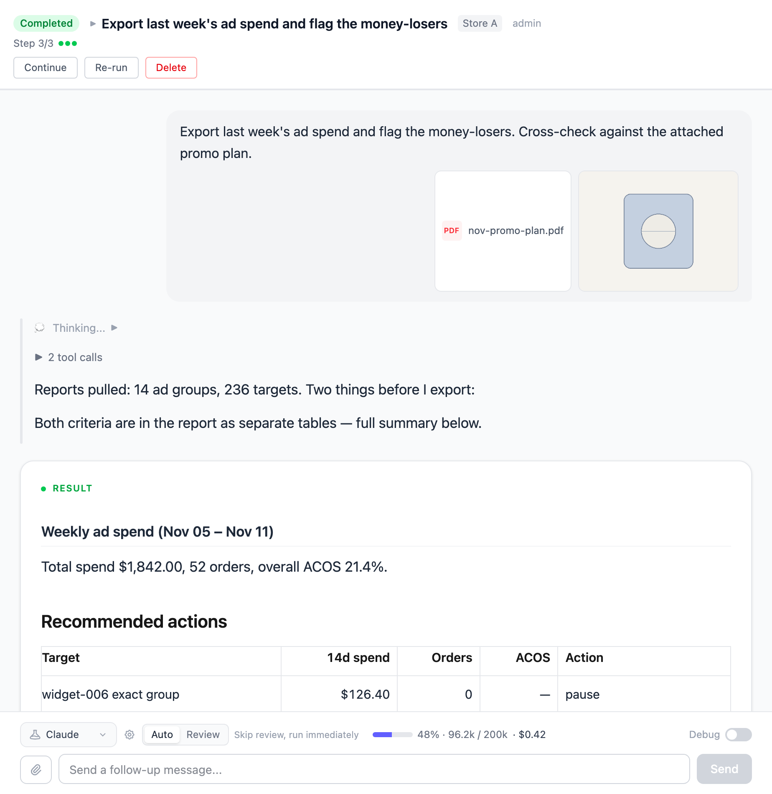

# Tasks

A task is the unit of work in Vibe Seller: you tell the AI what you want in one
sentence, it plans the steps, drives the browser, and hands you a result report.
The single most important thing to know first: **where you create a task decides
which browser it gets, what it remembers, and whether it may run without
asking you.** That comes first below; everything else follows.

## Creating a task

The entry point is the **Tasks** page in the sidebar:

1. **Pick the scope** — click a store in the left store list to create the task
   under that store; stay on **[All Stores](#two-scopes-where-you-create-a-task-decides-what-it-can-do)**
   (no store selected) to create a cross-store task;
2. Click **New Task**, fill in a title and a description — the description is
   just you telling the AI what to do, the way you'd brief a colleague, e.g.
   “review the ads and pause every keyword above 30% ACOS” or “export the sales
   report for the past 7 days”;
3. Attach images or files if needed — drag files into the input, paste a
   screenshot with Ctrl+V, or click to browse (PNG, JPEG, GIF, WebP and PDF, up
   to 100 MB each). Attachments land in the task's workspace where the agent can
   read them directly;
4. Submit. By default the task **starts executing right away** — there is no
   separate run button.

Which AI profile (model/provider) the task uses is switched in the task-detail
footer; it follows your default profile unless you pick another one.

## Two scopes: where you create a task decides what it can do

| | Task under a store | Task under **All Stores** |
|---|---|---|
| **Browser** | That store's Ziniao / Chrome profile — already logged in, straight into the seller center | A generic Chrome that can **only reach public web pages** (search, tracking/logistics sites); it cannot open any store's seller center |
| **Memory** | Only that store's accumulated knowledge — never mixed with other stores | Cross-store shared knowledge |
| **Execution mode** | **Auto** by default, switchable to **Review** | Always **Review** — it can never run on its own |
| **Typical use** | Ad tuning, report exports, listings for one shop | "Check every store for inactive listings", cross-store summaries, looking things up on the public web |

The app says the same thing: while you're in the All Stores list, it states that
these tasks "have a general web browser for public pages (search,
tracking/logistics) plus email and messaging — but not a specific store's
backend", and tells you to click the store on the left first if you need the
seller center. Cross-store tasks **can** read email and send messages to your
group chat — neither needs a browser.

### How an All Stores task still gets into your stores: parent and sub-tasks

A cross-store task isn't shut out of the stores — it acts as the **dispatcher**.
It browses public pages itself, and anything that must happen inside a store
becomes a **sub-task**: one per store, each using that store's logged-in browser
session. You see them under **Subtasks** in the parent task's detail, each with
its own status.

The parent parks itself in **Waiting** after creating its sub-tasks and
**completes automatically once every sub-task is done**, with an aggregated
summary — one line per sub-task, ✓ or ✗ plus its result. Afterwards you can
open any single sub-task and keep talking to it; if a finished sub-task is
resumed, the completed parent reopens and re-aggregates when it finishes again.

So: **for one store's work, create the task under that store** — one hop less,
and it shares that store's memory. Use **All Stores** tasks for patrols and
summaries that span the shops and let the AI split the work and merge the
results. Schedules have the same two scopes — see
[Scheduled Tasks](schedules.md).

## Auto mode vs Review mode

- **Auto** — "Skip review, run immediately": the AI plans and executes on its
  own; watch and stop any time. Good for routine operations you trust.
- **Review** ("Review plan first") — the AI first writes an **Execution Plan**
  and the task waits at **Planned**. Click **Confirm & Execute** to let it
  start; if the plan isn't right, type your feedback and send — sending
  feedback *is* the rejection: the agent rewrites the plan (v2, v3 …) until you
  approve.

The **Auto / Review** switch sits in the **task-detail footer**, with a helper
line ("Skip review, run immediately" / "Draft a plan, run after approval").
Your default for new tasks is set in **Settings → General → Task Defaults →
Default Execution Mode**. You can flip the switch after creating a task too;
the change takes effect from the next run (follow-ups included). An All Stores
task has no switch — the footer just reads "Review plan first": this kind of
task always shows you the plan before executing.

## The statuses you'll see

Task list and detail show one of these badges:

| Status | Meaning |
|---|---|
| **Pending** | Created, not launched yet |
| **Queued** | Waiting on a browser conflict or a concurrency slot (see [Concurrency](#concurrency-and-queueing)) — nothing is running yet |
| **Planning** | Review mode: the AI is writing the plan |
| **Planned** | Plan ready, waiting for your **Confirm & Execute** |
| **Running** | Working now |
| **Waiting** | The AI waits for *you* or for a condition: an unanswered question, an email reply to arrive, sub-tasks to finish |
| **Completed** | It delivered a result report |
| **Failed** | Something went wrong — read the reason, then follow up, retry, or stop and recreate |

**Completed doesn't mean "everything got done"**: when the AI couldn't finish
part of the work, it says so in the result report as caveats and the status is
still Completed. Tasks that wait on a condition give up after 30 days and turn
Failed.

## Answering the AI when it asks

While a task waits for you, the conversation shows a question card: option
chips the AI offered — click one, or choose **Other...** and type. With all
questions answered, click **Submit Answers**. You can also ignore the options
(**Type freely instead**) or simply send a normal message: the card is then
marked "You replied instead — not answered", and the agent reads your message
and continues — it doesn't stay stuck.

## Messaging a running task

You can send a message at any time. While the agent is mid-step the message is
delivered when the current step finishes ("The agent is working — your message
will be sent when the current step finishes"); while it's waiting for you, the
message redirects it immediately ("The agent is waiting for you — your message
will redirect it right away").

## When the task is done

- **Result** — the task ends with a result report: what it did, what it found,
  and what it couldn't do;
- **Files** — files produced during the run live in the task's workspace on the
  server (`~/.vibe-seller/tasks/<task id>/`; the report usually names the
  paths). Store tasks' important outputs (reports, exports) are filed into that
  store's **Run Data**, which you can browse and download on the
  [Knowledge](knowledge.md) page;
- **Chat** — the conversation stays open: see the next section.

The task-detail footer also shows a **Usage** chip: how much context is used
(the percentage turns red near the limit), input/output tokens, turns, and an
estimated cost from public model prices (subscription-covered runs show
"Included in plan").

## Continue, retry, stop, delete

- **Follow-up message** — sending a message to a completed or failed task
  continues the *same* task: same session, same workspace, so downloaded
  reports and half-finished work are still there;
- **Continue** — the **Continue** button in the header says it for you:
  “resume now, reuse the progress and data already on disk, and do not restart
  from scratch.” Perfect for "it stopped last night, pick it up today";
- **Retry** — ⚠️ **Retry wipes the task.** It clears the conversation *and*
  the on-disk workspace and starts from scratch (the confirm dialog: "This
  clears the task's history and restarts it from scratch. Are you sure?").
  Files the task produced — downloaded reports, scraped data — **are lost**
  and would have to be collected again; your own attachments survive. To build
  on the last run, send a follow-up or press **Continue** — not Retry;
- **Stop** — anytime. The task is marked Failed with "Task was stopped by
  user"; history and files stay, and you can still follow up or retry;
- **Delete** — removes the task together with its **whole sub-task tree** and
  the files on disk; the UI warns you when children exist. A running task
  can't be deleted — stop it first.

Completed/failed tasks aren't hidden from the list, but they *are* cleaned up:
by default the server deletes finished tasks older than **30 days** (the
summary parents of cross-store runs are kept so run history stays readable).
Change the window or disable it in **Settings → General → Task Defaults →
Auto-delete old tasks** (0 = never).

## Concurrency and queueing

Tasks for different stores run in parallel — each store has its own browser.
Within one store, several tasks also run side by side as separate browser tabs.
A task queues (status **Queued**) in exactly two situations: it needs the same
Ziniao profile switched to a different country site (one profile, one country
at a time), or a [schedule](schedules.md) runs with "Run stores one at a time"
ticked. Separately, there's a machine-wide cap on how many agents work at once
— **Settings → General → Max Concurrency** (default 2, up to 10).
