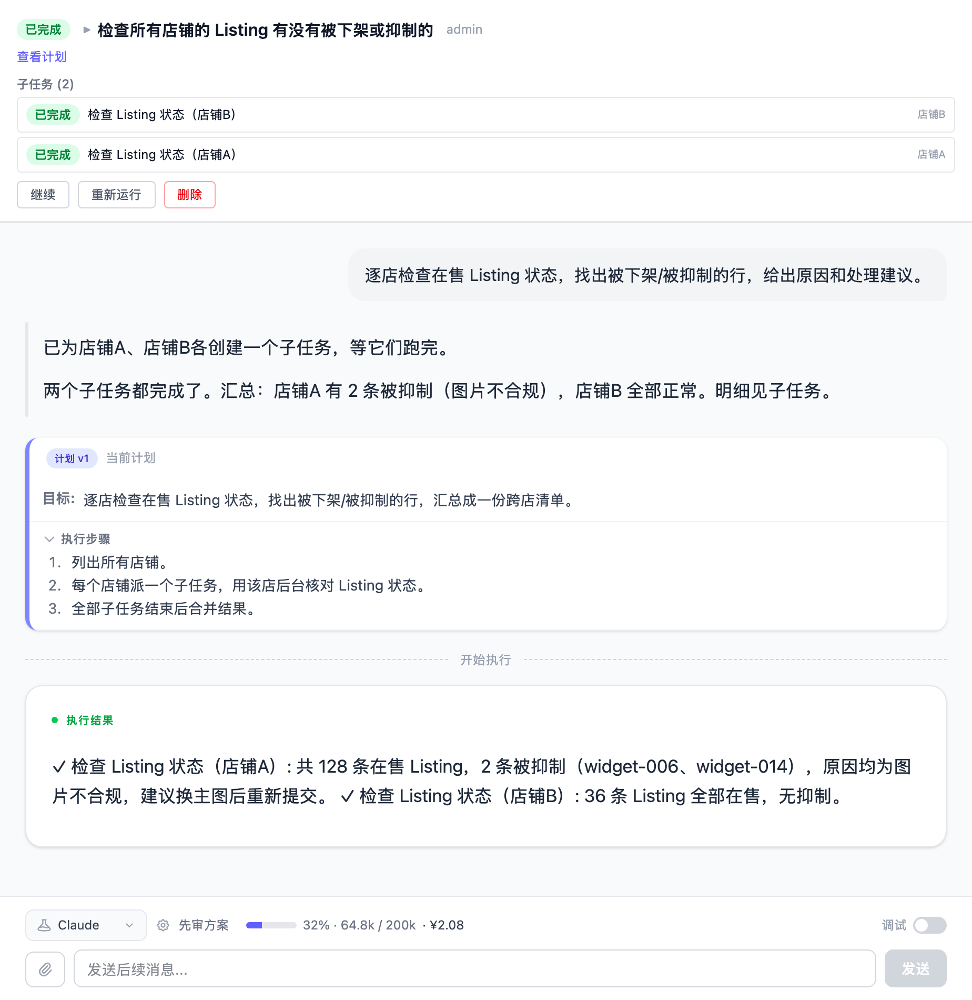
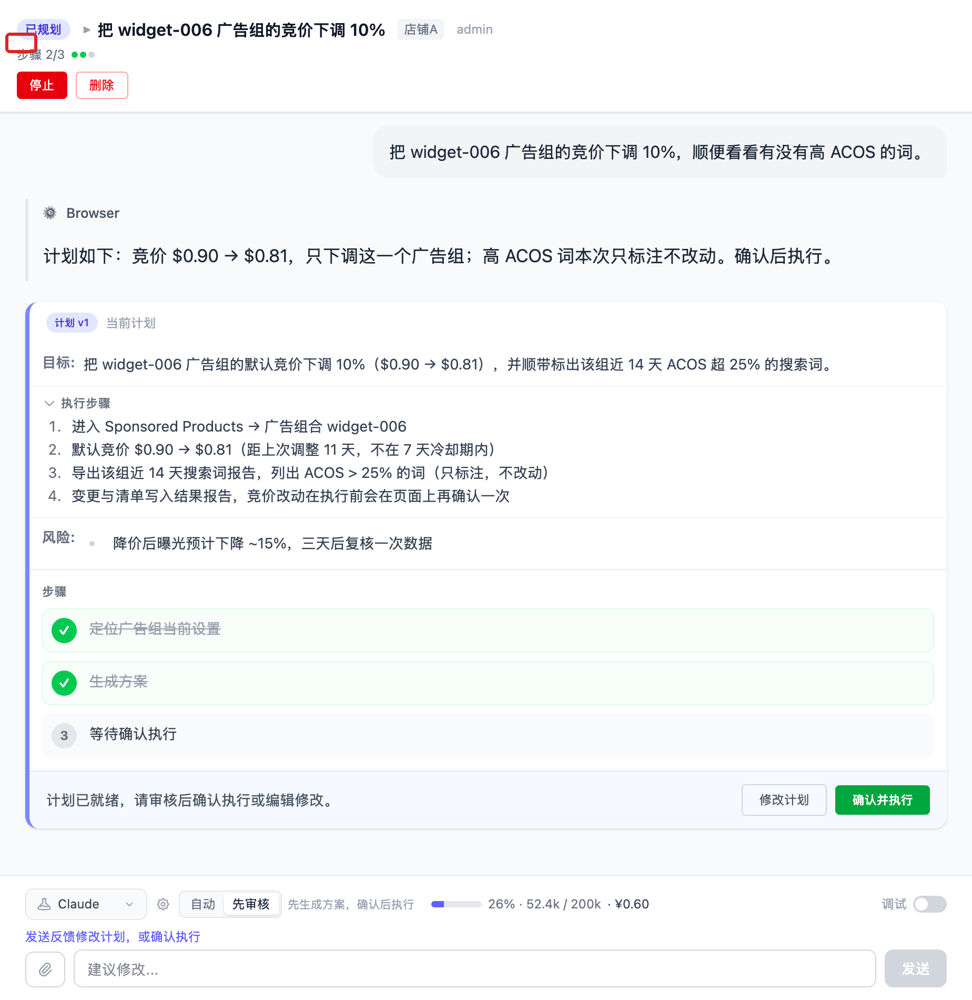
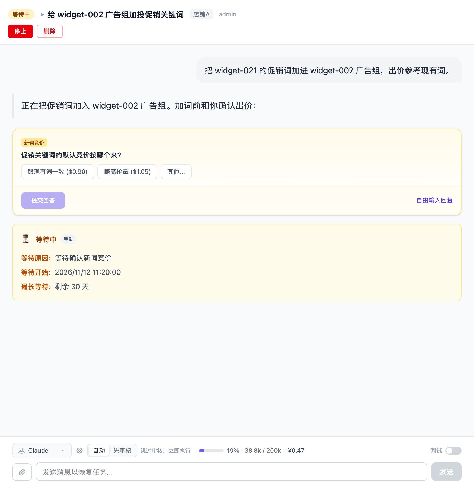
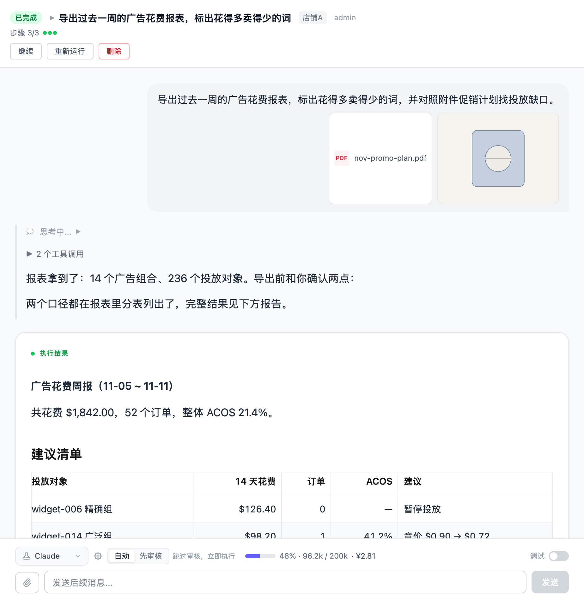

# 任务

任务是 Vibe Seller 里一切工作的载体：你用一句话告诉 AI 要做什么，它自己规划步骤、
打开浏览器操作，最后交给你一份结果报告。

先说最要紧的一件事：**任务在哪里创建，决定了它能使用什么浏览器、能记住什么、
能不能自动执行。** 下面先讲这一点，再讲其余。

## 创建任务

入口在侧栏「任务」页：

1. **选择范围**——在左侧店铺列表里点击某个店铺，任务就建在这个店铺下；不选择店铺、
   停留在「[全部店铺](#任务的两种范围在哪里创建决定了它能做什么)」，建的是跨店任务；
2. 点击「新建任务」，填写标题和描述。描述就是你要 AI 做什么，像给同事交代工作
   一样写清楚，例如“检查广告，把 ACOS 超过 30% 的关键词暂停掉”“导出过去 7 天的
   销售报表”；
3. 需要时附上图片或文件：把文件拖进输入框、按 Ctrl+V 粘贴截图，或点击选择文件
   （支持 PNG、JPEG、GIF、WebP、PDF，单个最大 100 MB）。附件会放进任务的工作目录，
   AI 可以直接看到；
4. 提交。默认情况下任务**立即开始执行**，不需要再点运行按钮。

AI 使用哪个模型（配置文件）在任务详情底部切换，默认跟随你在设置里选定的默认配置。

## 任务的两种范围，在哪里创建决定了它能做什么

| | 店铺下的任务 | 「全部店铺」的任务 |
|---|---|---|
| **浏览器** | 该店铺绑定的紫鸟或 Chrome 档案 | 通用 Chrome，只能访问公开网页 |
| **记忆** | 只看该店铺积累的知识 | 跨店铺共享的知识 |
| **执行方式** | 默认「自动」，可切「先审核」 | 固定「先审核」，不能关闭 |
| **典型用途** | 广告调优、报表导出、单店 Listing 上架 | 跨店巡检、跨店汇总、查公开信息 |

店铺下的任务使用这个店铺绑定的浏览器，登录状态现成，可以直接进店后台操作，记忆也只
看这家店积累的知识，不会读取到其他店铺的内容。「全部店铺」的任务使用一台通用 Chrome，
**只能访问公开网页**（搜索、物流轨迹查询等），进不了任何店铺后台，记忆使用跨店铺共享
的知识。

界面上也有同样的提示：在全部店铺列表新建任务时，页面会写明这类任务
「可使用通用网页浏览器访问公开网页（搜索、物流/轨迹查询等），并可读取邮件、
发送企微消息，但无法进入具体店铺的后台」。想进店后台，先在左边点击那个店铺。
跨店任务**可以**读写邮件、向企微群发消息，这些操作不占用浏览器。

需要处理的典型工作包括「每家店都查一下有没有被下架的 Listing」这类跨店巡检，
以及跨店汇总、查询公开信息。

### 全部店铺任务怎么进入店铺：父任务与子任务

跨店任务并非什么都不能做，而是承担**调度**：它自己用通用浏览器查公开网页，
需要进入店铺后台的部分由 AI 拆成**子任务**——每个店铺一个，子任务使用各自店铺的
登录状态去操作。你在任务详情里可以看到「子任务」列表和每个子任务的状态。

父任务创建完子任务后会转入「等待中」，**所有子任务结束后自动完成**，结果是一份
各子任务成败与摘要的汇总（每个子任务一行，成功 ✓ / 失败 ✗）。之后你可以单独点开
任何一个子任务继续追问；某个子任务被重新唤起时，已完成的父任务会自动重新打开，
等它执行完再重新汇总。

因此：**单个店铺的工作，直接在店铺下创建任务**（少一层转发，还共用同一份店铺记忆）；
**跨店铺的巡检、汇总类工作，才使用全部店铺任务**，让 AI 分头执行、最后合并结果。
定时任务里也有同样的两种范围，见[定时任务](schedules.md)。完整场景的分步演示见
[使用示例](examples.md)。

## 自动模式与先审核模式

- **自动**：AI 自己规划、直接执行，全程可以查看、可以停止。适合你已经信任的常规操作。
- **先审核**：AI 先把「执行计划」写出来给你看（状态「已规划」），你点击
  「确认并执行」才开始操作；不满意就在输入框里提交修改意见——发送反馈等于驳回，
  AI 会按你的意见重写计划（v2、v3……），直到你确认为止。

两种模式在**任务详情底部**用「自动 / 先审核」开关切换（鼠标悬停有说明：
自动＝跳过审核，立即执行；先审核＝先生成方案，确认后执行）。新任务的默认值在
「设置 → 通用 → 任务默认设置 → 默认执行模式」里修改。任务创建之后也可以切换，
切换从下一次开始执行时生效。全部店铺的任务没有这个开关，界面固定显示
「先审方案」——这类任务执行前一定会把方案交给你过目。

## 任务状态怎么看

想知道任务进行到哪一步，看列表和详情里的状态标签：

| 状态 | 含义 |
|---|---|
| 待处理 | 刚创建，还没有启动 |
| 排队中 | 在等浏览器或并发额度 |
| 规划中 | 先审核模式，AI 正在写执行计划 |
| 已规划 | 计划已生成，等你「确认并执行」 |
| 运行中 | 正在操作 |
| 等待中 | AI 在等你，或在等某个条件成立 |
| 已完成 | 已交出结果报告 |
| 失败 | 出了错，具体原因见详情 |

「排队中」表示任务在等浏览器条件或并发额度，原因见[并行与排队](#并行与排队)。「等待中」有
三种情况：有问题等你回答、在等邮件回复之类的条件成立、或者在等子任务完成。失败的
任务可以查看原因后再追问、重试，或者停止后修改描述重新创建。

「已完成」不等于每件事都办妥：AI 没有完成的部分会在结果报告里如实列出注意事项，
状态仍然是已完成。等待条件的任务最长等待 30 天，超时会转为失败。

## AI 提问时怎么回答

任务在等你时，对话里会出现一张问题卡片：AI 给出几个候选选项，点选其中一个，
或点击「其他...」自己填写；几个问题都回答完才能「提交回答」。你也可以放弃选项、
使用「自由输入回复」，或者直接发送一条消息——问题卡片会标记为
「你改为发送了消息（未作答）」，AI 会按你的新消息继续，不会停在原地。

## 给正在运行的任务发消息

随时可以在对话输入框追加指令。AI 正在执行时，消息会在当前步骤结束后送达
（「智能体正在工作——你的消息将在当前步骤完成后发送」）；它正在等你时，
消息立刻生效（「智能体正在等你——你的消息会立即调整它的下一步」）。

## 任务完成后

- **执行结果**：任务结束后会有一份结果报告，说明做了什么、结论是什么、
  哪些没有做到；
- **文件**：任务过程中产出的文件放在任务的工作目录里（服务器本机
  `~/.vibe-seller/tasks/<任务 id>/`，结果报告通常会写明路径）。店铺任务的重要
  产物（报表、导出）由 AI 归档进该店铺的「运行数据」，在[知识库](knowledge.md)
  页面可以直接浏览下载；
- **对话**：完成后仍然可以继续发消息，见下一节。

任务详情底部还有一个「用量」标签：当前上下文使用了多少（百分比，接近上限会变红）、
输入和输出 token、轮数，以及按公开模型价格估算的费用（订阅套餐内的会标注「套餐内」）。

## 继续、重试、停止和删除

- **追问**：给已完成或失败的任务发消息，是在**同一个任务**里继续——同一个会话、
  同一份工作目录，之前下载好的文件、做了一半的成果都还在；
- **继续**：详情页头部的「继续」按钮相当于替你说“接着上次的进度做，不要从头重写”，
  它会复用已保存的中间成果，适合昨天中断、今天接着做的场景；
- **重试**：⚠️ 重试是**推倒重来**——清空这个任务的对话历史和工作目录，从头再执行一次
  （确认框原文：「这将清空该任务的历史记录并从头重新开始，确定吗？」）。
  任务执行产生的文件（下载的报表、抓取的数据）会**一起删除**；你上传的附件会保留。
  想在上次的成果基础上继续，请使用**追问**或「继续」，不要用重试；
- **停止**：随时可以停止。停止后任务记为失败（原因「任务已被用户停止」），
  历史与文件都保留，之后可以追问也可以重试；
- **删除**：删除会把任务连同它的**子任务整棵树**和磁盘上的工作文件一起清除，
  删除前会明确警告。任务正在执行时无法删除，请先停止。

已完成和失败的任务不会被界面隐藏，但会被**自动清理**：默认每天删除 30 天前的
已完成和失败任务（跨店任务的汇总父任务会保留，方便你回看每次运行）。想保留更久
或关闭这个行为，在「设置 → 通用 → 任务默认设置 → 自动删除旧任务」里修改天数，
0 表示不删除。

## 并行与排队

不同店铺的任务各用各的浏览器，天然并行。同一个店铺里的多个任务通常也并行——
在同一个浏览器里各开各的标签页。只有两种情况会排队（状态「排队中」）：一是任务
需要把同一个紫鸟档案切换到不同国家站点（一个档案一次只能登录一个国家），二是
[定时任务](schedules.md)勾选了「店铺逐个运行」。另外，同一台机器上同时工作的 AI
数量有上限，在「设置 → 通用 → 最大并发数」调整（默认 2，最高 10）。
