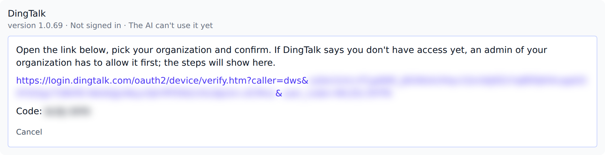
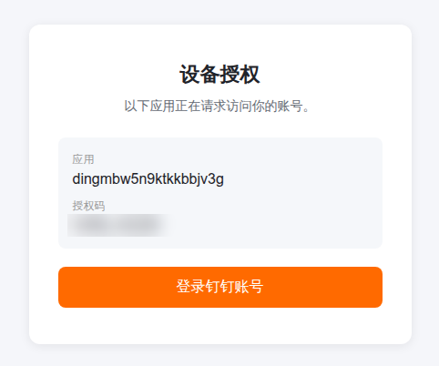
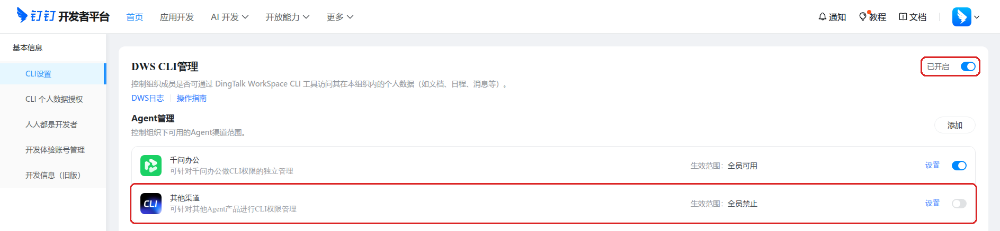

# DingTalk (钉钉)

Once connected, the AI uses DingTalk as the account that authorized:
direct and group chats, AI tables, docs, drive, wiki, calendar, to-dos,
mail, minutes, contacts, DING. The overview is at
[WeCom / Feishu / DingTalk](workplace-cli.en.md).

DingTalk needs **an admin of your organization to allow it first**,
otherwise authorizing fails. Before connecting the first time, go
through [Admin: allow it in the DingTalk console](#admin).

## Steps

1. Open Vibe Seller **Settings → Integrations** and, under **Let the AI
   use WeCom / Feishu / DingTalk**, click **Connect** on the DingTalk
   row. The first time it downloads DingTalk's official program (about
   20 MB).
2. A link and a code appear:

    

3. Open the link, click 「登录钉钉账号」 (sign in to DingTalk), sign in by
   scanning with DingTalk, pick your organization and confirm. The code
   on the page matches the one Vibe Seller shows:

    

4. Back in Settings, the DingTalk row shows "Signed in. Finishing the
   setup…", then "The AI can use it" a few seconds later. Done.

## Admin: allow it in the DingTalk console {#admin}

Per DingTalk's
[permission guide](https://open.dingtalk.com/document/development/dws-permission-management-guide)
(in Chinese), its command-line program is controlled at three levels:
the organization switch, the agent channel, and each permission. All
three must allow it. Vibe Seller counts as 「**其他渠道**」 (Other
channels), which DingTalk keeps off by default.

Ask an admin of your DingTalk organization to:

1. Open the [「CLI设置」 (CLI settings) page of the DingTalk developer console](https://open-dev.dingtalk.com/fe/old#/developerSettings)
   and sign in by scanning with DingTalk (in the console: 「更多」 (More)
   → 「基本信息」 (Basic info) → 「CLI设置」 on the left);
2. Check that the switch at the top right of 「DWS CLI管理」 (DWS CLI
   management) says 「已开启」 (On) — it is on by default;
3. Under 「Agent管理」 (Agent management), turn on the 「**其他渠道**」
   (Other channels) row;
4. If that row's 「生效范围」 (Scope) is not 「全员可用」 (Everyone),
   click 「设置」 (Settings) and add the DingTalk account used to sign in;
5. 「CLI管控配置」 (CLI permissions) below lists each capability (such as
   「以个人身份发消息」, sending messages as yourself) and who may use it;
   tighten it per business area if you like.

DingTalk takes a few minutes to apply it. Then click **Connect** on the
DingTalk row in Vibe Seller again and authorize once more.

## FAQ

<b>"You do not have CLI data access" (「您暂无 CLI 数据访问权限」)?</b>

Your organization hasn't allowed it yet; clicking **Connect** again
won't fix it. The Settings page lists the organization's primary admins
and the steps; ask an admin to turn on 「其他渠道」 as
[above](#admin), wait a few minutes, then click **Connect**.

<b>Does 「立即申请」 (Apply now) on DingTalk's authorization page work?</b>

Not by default. An admin first has to turn on member applications
(「组织成员权限申请」) in the channel's 「设置」 before members can apply
and admins can approve. Until then, applying says the organization
doesn't accept applications. Asking an admin to follow the
[steps above](#admin) is quicker.

<b>Who can the AI message on DingTalk?</b>

It sends as the account that authorized and finds people by name in
your organization's contacts. People not in the contacts (for example,
outside your organization) can't be messaged.

<b>The AI says it sent the message, but I don't see it in DingTalk?</b>

If the recipient is the account DingTalk was authorized with, the
message is from you to yourself: it lands in your chat with yourself,
with no notification and without moving to the top of your chat list.
Search your own name in DingTalk and open the chat with yourself. For
the AI to message you like a colleague would, authorize DingTalk with a
dedicated work account.

