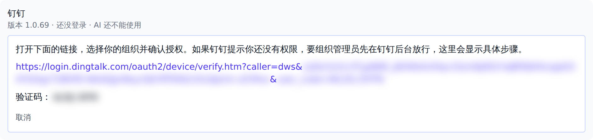
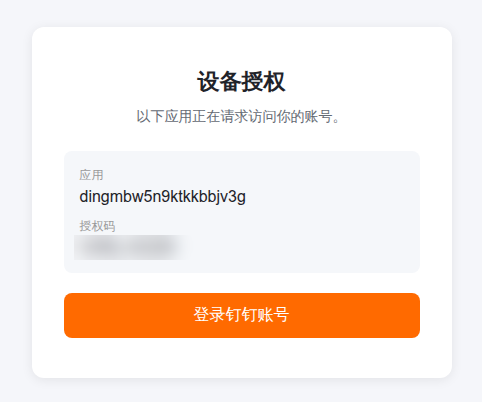
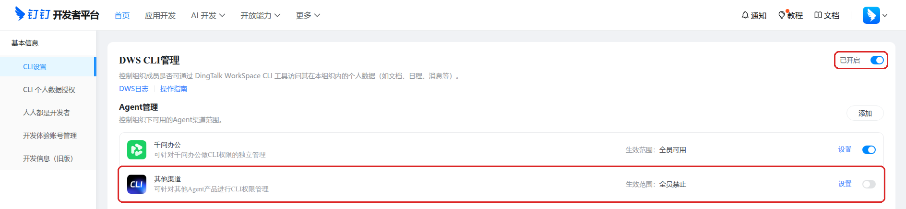

# 钉钉

开通后，AI 以授权的钉钉账号使用钉钉：单聊和群聊、AI 表格、文档、
钉盘、知识库、日程、待办、邮箱、听记、通讯录、DING。总体说明见
[企业微信 / 飞书 / 钉钉](workplace-cli.md)。

钉钉要**组织管理员先放行**，否则授权会失败。第一次开通前，先按
[管理员：在钉钉后台放行](#admin)做一遍。

## 开通步骤

1. 打开 Vibe Seller「设置 → 集成」，在「企业微信 / 飞书 / 钉钉」里，钉钉那一行点「开通」。第一次会先下载钉钉的官方程序
   （约 20 MB）。
2. 页面上出现一个链接和一个验证码：

    

3. 打开链接，点「登录钉钉账号」，用钉钉扫码登录，选择你的组织并确认
   授权。页面上的授权码和 Vibe Seller 显示的验证码一致：

    

4. 回到设置页，钉钉那一行先显示「登录成功，正在开通，请稍候…」，几秒
   后变成「AI 可以使用」，就开通好了。

## 管理员：在钉钉后台放行 {#admin}

按钉钉官方的[权限说明](https://open.dingtalk.com/document/development/dws-permission-management-guide)，
钉钉的命令行程序分三层控制：组织总开关、Agent 渠道、具体权限项。三层
都放行才能用。Vibe Seller 属于「**其他渠道**」，这个渠道钉钉默认是关的。

请钉钉组织的管理员：

1. 用钉钉扫码登录，打开[钉钉开发者后台的「CLI设置」页面](https://open-dev.dingtalk.com/fe/old#/developerSettings)
   （在后台里的位置：导航栏「更多」→「基本信息」→ 左侧「CLI设置」）；
2. 确认「DWS CLI管理」右上角的开关是「已开启」（默认就是开着的）；
3. 在「Agent管理」里，打开「**其他渠道**」这一行的开关；
4. 如果这一行的「生效范围」不是「全员可用」，点「设置」，把用来授权
   的钉钉账号加进去；
5. 下面「CLI管控配置」里列出了每一项能力（如「以个人身份发消息」）
   和可用范围，需要的话可以按业务收紧。

钉钉的设置要几分钟才生效。之后回到 Vibe Seller，在钉钉那一行再点
「开通」，重新授权。

## 常见问题

<b>授权时提示「您暂无 CLI 数据访问权限」？</b>

组织还没放行，再点「开通」解决不了。设置页会列出组织主管理员和放行
步骤，请管理员按[上面的步骤](#admin)打开「其他渠道」，等几分钟再点
「开通」。

<b>钉钉授权页上的「立即申请」能用吗？</b>

默认用不了。要管理员先在渠道的「设置」里打开「组织成员权限申请」，
成员才能申请、管理员才能审批。没打开时，申请会提示「当前组织不支持
用户主动发起 DWS CLI 使用申请」。直接请管理员按[上面的步骤](#admin)
放行更快。

<b>AI 能把钉钉消息发给谁？</b>

以授权的钉钉账号发，按姓名在组织通讯录里找人。通讯录里找不到的人
（比如组织外的人）发不了。

<b>AI 说已经发了，我在钉钉里却没看到？</b>

如果收件人就是授权钉钉的那个账号本人，消息是「你发给你自己」：落在你
和自己的单聊里，钉钉不会提醒，也不会顶到会话列表最上面。在钉钉里搜索
自己的名字，打开和自己的单聊就能看到。想让 AI 像同事一样给你发消息，
请用一个专门的工作账号授权钉钉。

