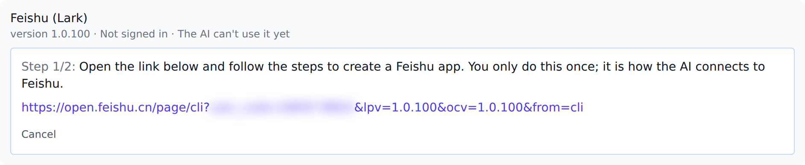
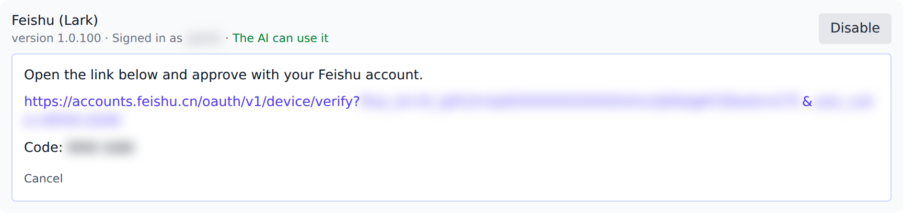

# Feishu / Lark (飞书)

Once connected, the AI can use Feishu: messages and chats, docs, sheets,
Base, drive, wiki, calendar, meetings and minutes, tasks, mail,
approvals, contacts. The overview is at
[WeCom / Feishu / DingTalk](workplace-cli.en.md).

## Steps

Two steps; the first is needed only once.

1. Open Vibe Seller **Settings → Integrations** and, under **Let the AI
   use WeCom / Feishu / DingTalk**, click **Connect** on the Feishu row.
   The first time it downloads Feishu's official program (about 14 MB).
2. **Step 1 of 2: create a Feishu app.** A link appears; open it, sign
   in to Feishu and follow the prompts to create the app. The AI
   connects to Feishu through it:

    

3. **Step 2 of 2: authorize with your Feishu account.** Once the app
   exists, the page shows a second link and a code. Open the link,
   check the code matches, and approve:

    

4. Back in Settings, the Feishu row shows "Signed in. Finishing the
   setup…", then "The AI can use it" a few seconds later. Done.

## Two identities

- **User identity**: acts as the Feishu account that authorized. Your
  own calendar, mail and documents need it.
- **App identity**: acts as the Feishu app (bot) created in step 1.

The AI picks the identity as the official skills describe; you don't
choose.

**Messages**: messaging someone as you needs the app's "send messages
as user" permission (`im:message.send_as_user`). In our test it was not
granted, so the AI sent the message as the Feishu app, into the app's
chat with you.

## FAQ

<b>"Your Feishu admin has restricted these permissions"?</b>

The sign-in worked and Feishu is enabled. Only the permissions listed
were restricted by your Feishu organization's admin, so the features
that need them won't work yet; nothing else is affected. If you need
them, ask your Feishu admin to allow them, then click **Sign in again**.

<b>"This sign-in can't renew itself"?</b>

The sign-in worked, but Feishu did not issue the credential used to
renew it: what the AI does as your Feishu account stops working at the
time shown (about 2 hours after signing in), and you have to sign in
again; what it does as the Feishu app is not affected. The reason is
that the Feishu app has not turned on "Refresh user_access_token" under
its security settings in the developer console, or has not published a
version since.

To fix it, ask the admin of the Feishu app to open the link in the
notice, turn on "Refresh user_access_token", create and publish a new
version, then click **Sign in again**.

<b>The link asks me to sign in to Feishu?</b>

That's expected. Both steps happen on Feishu's web pages: sign in by
scanning or with your password first, then follow the prompts.

