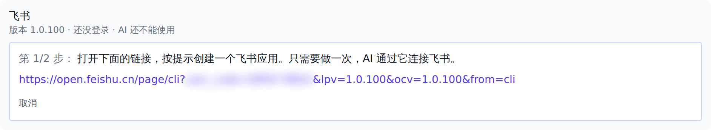
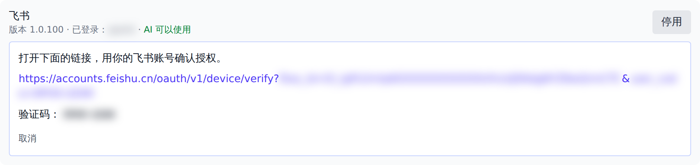

# 飞书

开通后，AI 可以用飞书做事：消息与群聊、云文档、电子表格、多维表格、
云空间、知识库、日历、会议与妙记、任务、邮箱、审批、通讯录。总体说明
见[企业微信 / 飞书 / 钉钉](workplace-cli.md)。

## 开通步骤

一共两步，第一步只需要做一次。

1. 打开 Vibe Seller「设置 → 集成」，在「企业微信 / 飞书 / 钉钉」里，飞书那一行点「开通」。第一次会先下载飞书的官方程序
   （约 14 MB）。
2. **第 1/2 步：建一个飞书应用。** 页面上出现一个链接，打开它，用飞书
   登录，按提示创建应用。AI 通过这个应用连接飞书：

    

3. **第 2/2 步：用飞书账号授权。** 应用建好后，页面换成第二个链接和
   一个验证码。打开链接，确认验证码一致，同意授权：

    

4. 回到设置页，飞书那一行先显示「登录成功，正在开通，请稍候…」，几秒
   后变成「AI 可以使用」，就开通好了。

## 两种身份

- **用户身份**：以授权的飞书账号做事。读你自己的日历、邮箱、云文档，
  要用这个身份。
- **应用身份**：以第一步建的飞书应用（机器人）做事。

AI 会按官方技能的说明选择身份，不用你指定。

**发消息**：以你的名义私信别人，需要飞书应用有「以用户身份发送消息」
权限（`im:message.send_as_user`）。我们测试时这一项没有授权到，AI 就以
飞书应用的名义，把消息发到应用和你的单聊里。

## 常见问题

<b>开通后提示「飞书管理员限制了下面这些权限」？</b>

授权已经成功，飞书也已经开通。只是提示里列出的那几项权限被飞书组织
的管理员限制了，用到它们的功能暂时不能用，其他功能不受影响。需要的话，
请飞书管理员放开这些权限，再在设置页点「重新登录」。

<b>开通后提示「这次登录不能自动续期」？</b>

授权已经成功，但飞书这次没有发放用于续期的凭证：用你的飞书账号做的
操作，到提示里写的时间（登录后约 2 小时）就会失效，之后要重新登录；
以飞书应用身份做的操作不受影响。原因是这个飞书应用没有在开发者后台的
「安全设置」里开启「刷新 user_access_token」，或者开启后还没发布新版本。

解决：请飞书应用的管理员点提示里的链接，开启「刷新
user_access_token」，创建并发布新版本，然后回到设置页点「重新登录」。

<b>链接打开后要我登录飞书？</b>

正常。两步都是在飞书的网页上完成，先用飞书扫码或账号密码登录，再按
提示操作。

