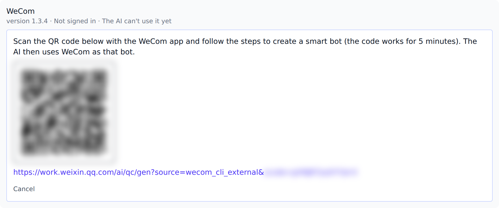
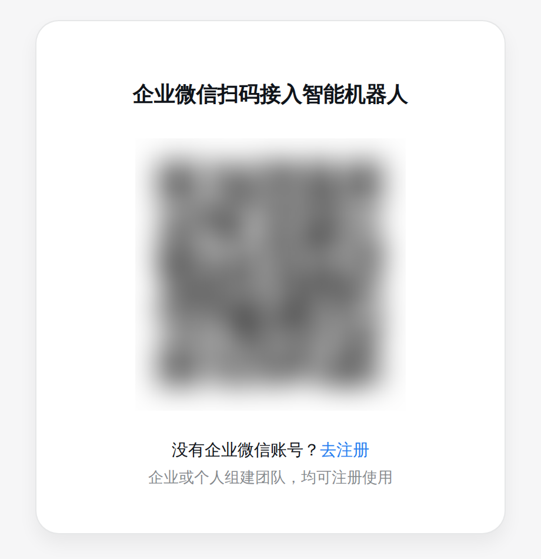
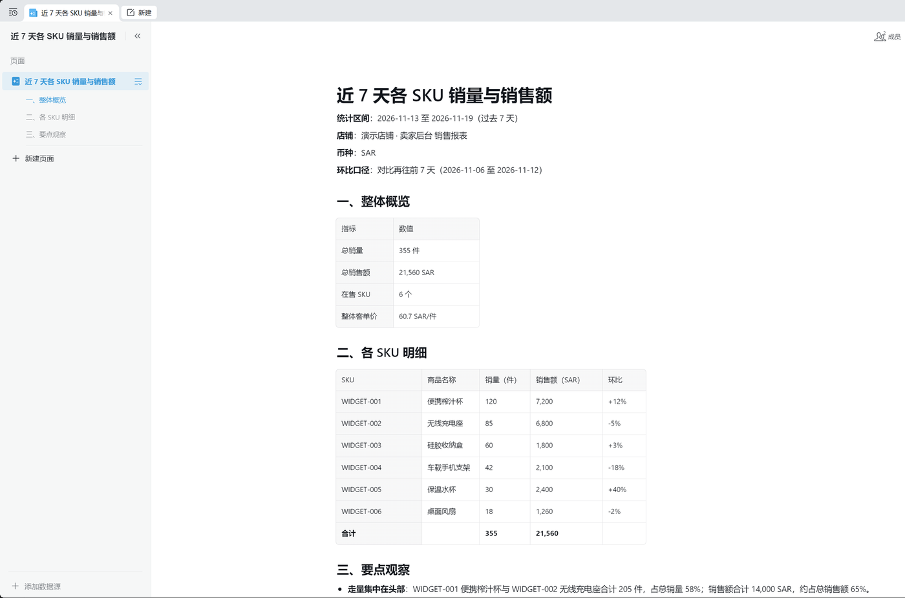

# WeCom (企业微信)

Once connected, the AI uses WeCom through a **smart bot**: it writes
docs, sheets and smart sheets, reads mail, schedules events and
meetings, creates to-dos and sends you messages. The overview is at
[WeCom / Feishu / DingTalk](workplace-cli.en.md).

## Steps

You need a WeCom account (a company or a team you set up yourself can
both register) and a Vibe Seller admin account.

1. Open Vibe Seller **Settings → Integrations** and, under **WeCom / Feishu / DingTalk**, click **Connect** on the WeCom row.
   The first time it downloads WeCom's official program (about 5 MB),
   usually in a few seconds.
2. A QR code appears. Scan it with the WeCom app (it is valid for 5
   minutes):

    

    If scanning a computer screen is awkward, click the link under the
    QR code to open WeCom's scan page in a browser:

    

3. On your phone, follow the prompts to create a smart bot and confirm.
4. Back in Settings, the WeCom row shows "Signed in. Finishing the
   setup…", then "The AI can use it" a few seconds later. Done.

## Try it

In any store, create a task such as "Check the store's units and revenue per SKU for the last 7 days, put them in a table in a new WeCom document, and send me the link on WeCom." When the AI is done, the link arrives in your WeCom; open it to see the document it made:

## What the bot can do

Every action the AI takes is done by this bot, on behalf of the person
who scanned — not as that person. Messages arrive as sent by the bot.
As WeCom's official program itself states:

- **Messages** can go only to the person who scanned, and to single or
  group chats the bot has talked in recently. For the AI to post in a
  group, add the bot to the group and @-mention it once.
- **Reading**: data the scanner created or owns can be read, searched
  and downloaded by the bot. Every teammate's tasks can use that access,
  so **scan with a dedicated work account**.
- **Changing**: the scanner's docs, sheets, smart sheets and smart pages
  can be edited; calendars, meetings, to-dos, drive files, mail and
  everything else can only be changed where the bot created them.

## FAQ

<b>The QR code expired?</b>

It is valid for 5 minutes. Click **Connect** on the WeCom row again, or
**Sign in again** on a platform that is already enabled.

<b>The WeCom row says "Some permissions expired"?</b>

WeCom grants the bot each permission (docs, contacts, messages, mail,
drive…) for 7 days, each on its own clock; once one expires, the AI
can't use it. That is WeCom's rule, and using a permission does not
extend it.

The WeCom row in Settings lists every permission's state. Click
**Re-authorize** and scan with WeCom to renew, or click **Renew** next to
one permission to renew just that one. Only the person who scanned to
connect WeCom can renew. The row refreshes when you come back to the
Settings page.

When a WeCom authorization expires, a bar at the top of the app also
tells admins to re-authorize.

<b>The AI can't message a colleague directly?</b>

The bot can message only the person who scanned, and people who talked
with it recently. For anyone else WeCom refuses, saying the chat is not
one of the bot's recent chats and that the member has to talk to the
bot first. Ask the colleague to send the bot one message in WeCom; the
AI can message them after that.

<b>The AI says it can't post in a group?</b>

The bot can only post in groups it has talked in recently. Add the bot
to the group, @-mention it once, then ask the AI again.

<b>On Windows: "This computer can't run WeCom's official program"?</b>

WeCom's official program needs the Microsoft VC++ runtime, which most
computers already have. If yours doesn't, install the
[Microsoft Visual C++ Redistributable (x64)](https://aka.ms/vs/17/release/vc_redist.x64.exe),
then click **Connect** again.

