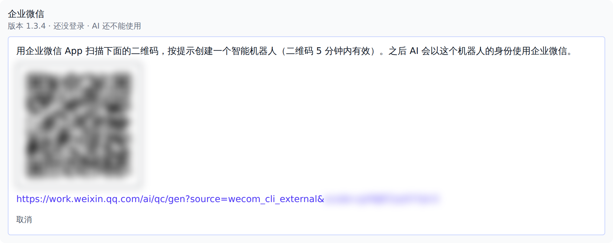
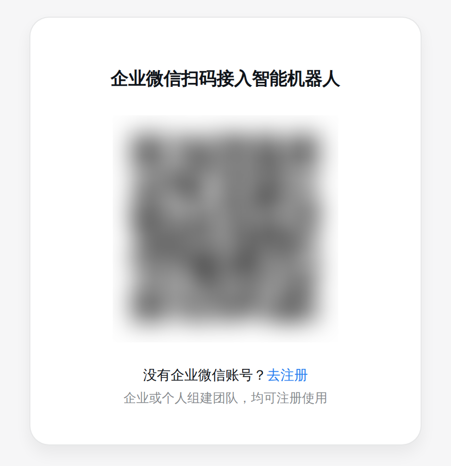
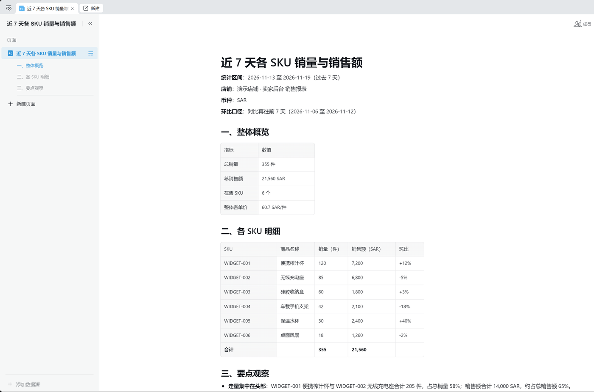

# 企业微信

开通后，AI 通过一个**智能机器人**使用企业微信：写文档、在线表格和
智能表格，查邮件、排日程和会议、建待办，给你发消息。总体说明见
[企业微信 / 飞书 / 钉钉](workplace-cli.md)。

## 开通步骤

需要：一个企业微信账号（企业或个人组建的团队都可以注册），以及
Vibe Seller 的管理员账号。

1. 打开 Vibe Seller「设置 → 集成」，在「企业微信 / 飞书 / 钉钉」里，企业微信那一行点「开通」。第一次会先下载企业微信的官方
   程序（约 5 MB），一般几秒钟。
2. 页面上出现一个二维码。用企业微信 App 扫码（二维码 5 分钟内有效）：

    

    手机不方便扫电脑屏幕的话，也可以点二维码下面的链接，在浏览器里
    打开企业微信的扫码页：

    

3. 在手机上按提示创建一个智能机器人，并确认授权。
4. 回到设置页，企业微信那一行先显示「登录成功，正在开通，请稍候…」，
   几秒后变成「AI 可以使用」，就开通好了。

## 开通后试一下

在任意店铺里新建任务，比如「看一下店铺过去 7 天各 SKU 的销量和销售额，整理成表格，写进一个新的企业微信文档，再用企业微信把文档链接发给我」。AI 做完会把链接发到你的企业微信，打开就是它建好的文档：

## 机器人能做什么

AI 的每一个操作都由这个机器人完成，代扫码的人做事，不是以扫码人
本人的身份。别人收到的消息显示是这个机器人发的。按企业微信官方程序
自己的说明：

- **发消息**：只能发给扫码人本人，以及机器人最近对话过的单聊或群聊。
  要让 AI 往某个群发消息，先把机器人拉进这个群，在群里 @ 它说一句话。
- **读取**：扫码人自己创建或拥有的数据，机器人都能读取、搜索和下载。
  团队里所有人的任务都能用到这份读取权限，所以**请用专门的工作账号
  扫码**。
- **修改**：扫码人的文档、在线表格、智能表格、智能文档可以修改；日程、
  会议、待办、微盘、邮件等其他内容，只能修改机器人自己创建的。

## 常见问题

<b>二维码过期了？</b>

二维码 5 分钟内有效。过期后在企业微信那一行再点一次「开通」；已经
开通的平台点「重新登录」。

<b>企业微信那一行显示「部分权限已过期」？</b>

企业微信给机器人的每项权限（文档、通讯录、消息、邮件、微盘……）都只有
7 天有效期，各自计时，到期后 AI 就用不了这一项。这是企业微信的规则，
用得再多也不会自动续期。

设置页企业微信那一行会列出每项权限的状态。点「重新授权」，用企业微信
扫码，就能续期；也可以点某一项旁边的「单独续期」，只续这一项。只有当初
扫码开通企业微信的人能续期。续期后回到设置页，状态会自动刷新。

企业微信授权过期时，页面顶部也会提醒管理员去重新授权。

<b>想让 AI 私信同事，但发不出去？</b>

机器人只能私信扫码人本人，以及最近和它对话过的人。给别人发时，企业
微信会拒绝并提示「当前会话不是机器人的最近会话，暂不支持发送消息。
需要成员向机器人对话过，机器人即可发送」。请这位同事先在企业微信里给
机器人发一条消息，之后 AI 就能私信他。

<b>想让 AI 往群里发消息，但它说发不了？</b>

机器人只能往它最近对话过的群里发。把机器人拉进这个群，在群里 @ 它
说一句话，再让 AI 发。

<b>Windows 上提示「这台电脑运行不了企业微信的官方程序」？</b>

企业微信的官方程序要用微软 VC++ 运行库，大多数电脑已经装了。没有的话，
请安装
[Microsoft Visual C++ 可再发行程序包（x64）](https://aka.ms/vs/17/release/vc_redist.x64.exe)，
然后再点一次「开通」。

