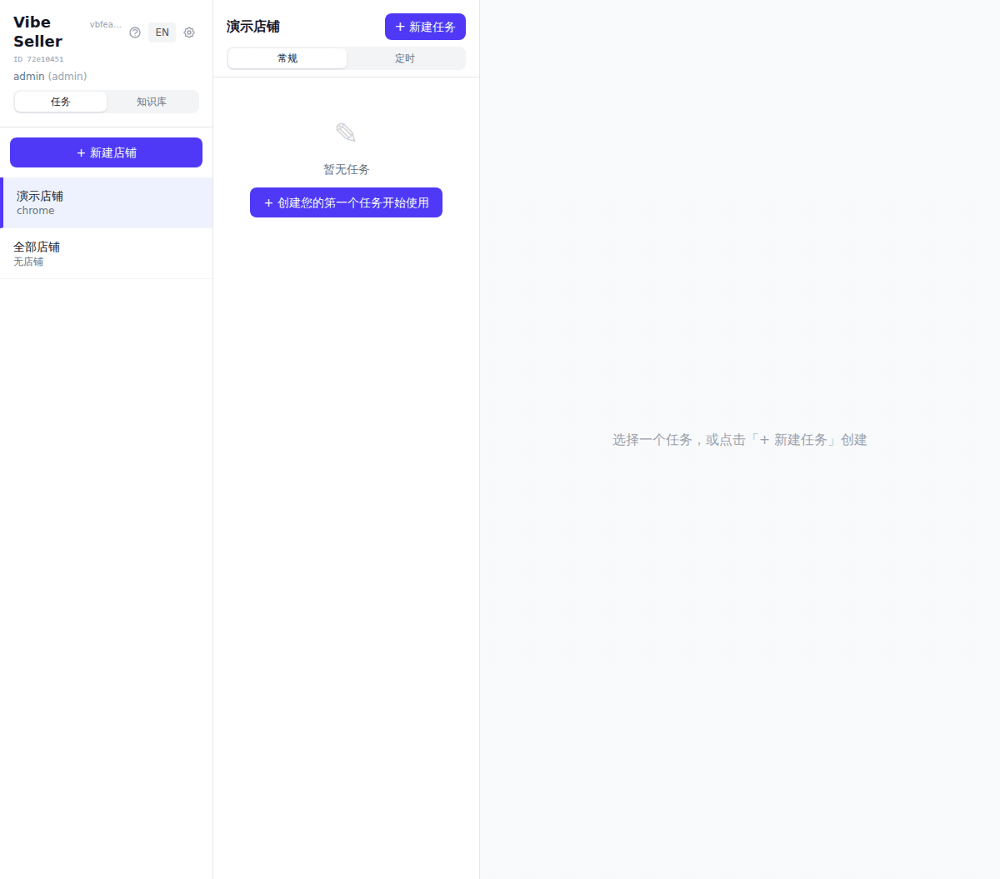
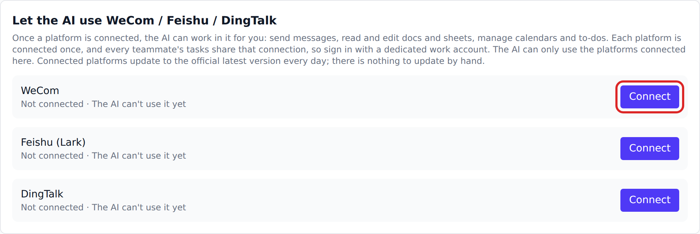
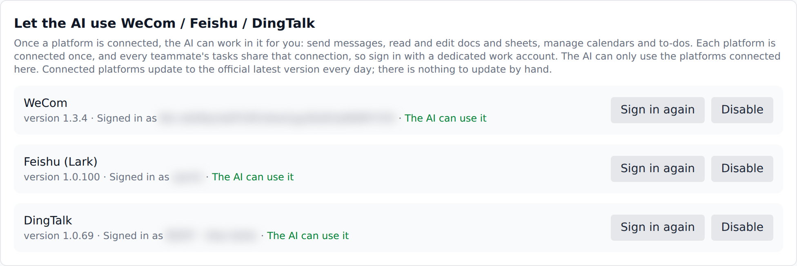

# WeCom / Feishu / DingTalk

Once connected, the AI can work in WeCom (企业微信), Feishu / Lark (飞书)
and DingTalk (钉钉) for you: write docs and sheets, send messages,
schedule events, create to-dos. For example, it can put a store's
sales numbers into a WeCom document and send you the link.

The AI uses each platform's **official** command-line program and
official skills. Vibe Seller downloads, signs in and updates them every
day: **no Node.js, no terminal**. Windows, macOS and Linux are
supported.

| Platform | Official program | What the AI can do (excerpt) | Setup |
|---|---|---|---|
| WeCom (企业微信) | `wecom-cli` ([WecomTeam/wecom-cli](https://github.com/WecomTeam/wecom-cli)) | Docs, sheets, smart sheets, mail, calendar, meetings, to-dos, drive, contacts; messages to the person who scanned, or to chats the bot has talked in recently | [WeCom](workplace-cli-wecom.en.md) |
| Feishu / Lark (飞书) | `lark-cli` ([larksuite/cli](https://github.com/larksuite/cli)) | Messages and chats, docs, sheets, Base, drive, wiki, calendar, meetings and minutes, tasks, mail, approvals, contacts | [Feishu](workplace-cli-feishu.en.md) |
| DingTalk (钉钉) | `dws` ([DingTalk-Real-AI/dingtalk-workspace-cli](https://github.com/DingTalk-Real-AI/dingtalk-workspace-cli)) | Direct, group and robot messages, AI tables, docs, drive, wiki, calendar, to-dos, mail, minutes, contacts, DING | [DingTalk](workplace-cli-dingtalk.en.md) |

Compared with [chat bots](chat-bots.md): a chat bot only pushes
messages into a group; this connects the whole office suite, read and
write. You can use both.

## See it work

In the demo store, create a task: "Check the store's units and revenue
per SKU for the last 7 days, put them in a table in a new WeCom
document, and send me the link on WeCom." The AI reads the store's
back office, creates the WeCom document and sends the link to your
WeCom (a fake back office with demo data; waits are sped up; Chinese
UI):

## Connect

Only Vibe Seller **admins** can connect, sign in again and disable.

1. Open **Settings → Integrations**, find **Let the AI use WeCom /
   Feishu / DingTalk** and click **Connect** on the platform's row:

    

2. Vibe Seller downloads the platform's latest official program
   (4–25 MB), checks the file is complete and runs on this computer,
   then shows the sign-in steps on that row. Each platform signs in
   differently; follow its page:
    - **WeCom**: scan with the WeCom app and create a smart bot. See
      [WeCom](workplace-cli-wecom.en.md).
    - **Feishu**: two steps — create a Feishu app (once), then
      authorize with your Feishu account. See
      [Feishu](workplace-cli-feishu.en.md).
    - **DingTalk**: open the link, pick your organization and authorize.
      The first time, an admin of your DingTalk organization has to
      allow it in the DingTalk console. See
      [DingTalk](workplace-cli-dingtalk.en.md).
3. Once signed in, the row shows "Signed in. Finishing the setup…",
   then "The AI can use it" a few seconds later. Done:

    

You can close the page during sign-in — Vibe Seller finishes the setup
when the sign-in completes.

## Whose identity

- Each platform is connected **once** on this Vibe Seller, and every
  teammate's tasks use that connection: Feishu and DingTalk use the
  account that authorized; WeCom uses the bot created when scanning,
  acting on the scanner's behalf.
- Whoever scans or authorizes is the account this Vibe Seller uses.
  **Use a dedicated work account**, not the owner's personal account.
- The sign-in is stored only in Vibe Seller's own data directory; it
  never reads or changes a copy you installed yourself on this
  computer.

## Who the AI can message

The platforms differ. This is what we saw when testing:

| Platform | Messages are sent as | Who it can message directly |
|---|---|---|
| WeCom | The bot created when scanning | The person who scanned, and people and groups that talked with the bot recently. To have the AI message a colleague, ask them to send the bot one message first; to post in a group, add the bot to it and @-mention it once |
| Feishu | The authorized account, or the Feishu app (bot) | Messaging someone as you needs the app's "send messages as user" permission; without it, messages go as the app, into the app's chat with you |
| DingTalk | The authorized account | People found in your DingTalk organization's contacts (by name); people outside it, not in the contacts, can't be messaged |

## Enable only what you need

The three platforms are independent: connect one, two or all three. The
AI sees **only enabled** platforms; for one that is not connected or
was disabled, the AI neither knows how to use it nor can find its
program.

## Updates, signing in again, disabling

- **Updates**: nothing to do. Vibe Seller checks for the official
  latest version once a day, downloads it, and updates the official
  skills the AI uses with it. Running tasks keep the old version; new
  tasks use the new one. If a download fails, the current version stays
  and it tries again the next day. A platform that was never connected
  is never downloaded.
- **Sign in again**: switch accounts, or re-authorize after the
  sign-in expired. Only an enabled platform shows it.
- **Disable**: the AI stops using the platform immediately. The program
  and the sign-in are kept, so **Connect** later works without signing
  in again. Disabling deletes nothing on the platform.

## Rules the AI follows

Vibe Seller adds a few rules to each platform's official skills; they
win over the official text:

- The AI never signs in, signs out or updates these programs itself,
  and never installs other skills;
- If the sign-in is missing or expired, the AI stops and tells you to
  ask an admin to click **Sign in again** in Settings;
- If a permission is missing (signing in again does not help), the AI
  stops and tells you which permission, to be granted by that
  platform's admin;
- The AI sends messages or mail, invites people, or changes or deletes
  documents only when the task asks for it.

## FAQ

<b>The download failed?</b>

The Settings page says what to do next; open **Details** to see why
each address failed. Vibe Seller tries the official address first,
then mirrors in China, and picks whichever proxy or direct connection
works. The addresses each platform uses:

| Platform | Version and program | Official skills |
|---|---|---|
| WeCom | `registry.npmjs.org`, mirror `registry.npmmirror.com` | GitHub only (`codeload.github.com`), no mirror |
| Feishu | Version: `registry.npmjs.org`, mirror `registry.npmmirror.com`; program: `github.com`, mirror `registry.npmmirror.com` | GitHub (`codeload.github.com`), then Feishu's own `open.feishu.cn` |
| DingTalk | Version: `registry.npmjs.org`, then `api.github.com`, `gitee.com`; program: `github.com`, mirror `gitee.com` | `github.com`, mirror `gitee.com` |

Make sure this computer can reach at least one address in each cell,
then try again.

<b>I already installed and signed in to the official program on my computer. Do I sign in again?</b>

Yes. Vibe Seller uses its own download with its own sign-in, separate
from yours. That way, switching organizations on your personal account
does not change what the team's tasks use.

<b>Do these official programs report data?</b>

- DingTalk's program reports usage statistics by default; Vibe Seller
  runs it with the official switch that turns this off;
- WeCom's program sends caller information with every request (the
  calling process and more, see its
  [data collection notes](https://github.com/WecomTeam/wecom-cli/blob/main/docs/data-collection.md));
  there is no official switch to turn it off;
- Feishu's program sends its version and similar details with requests.

