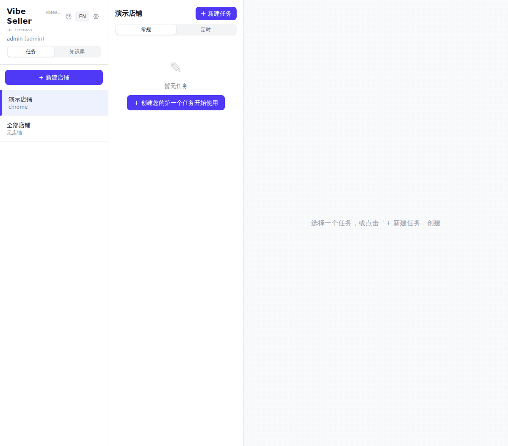
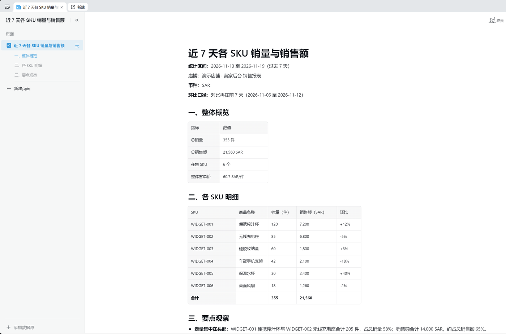
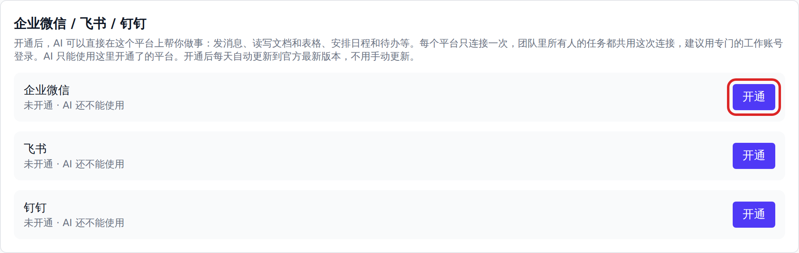
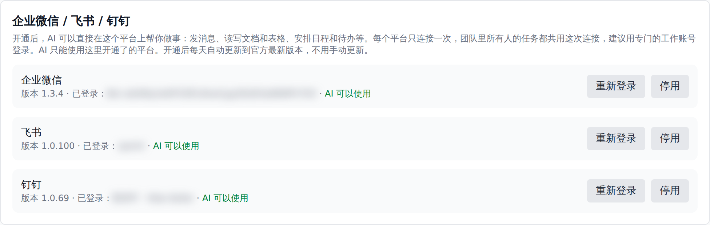

# 企业微信 / 飞书 / 钉钉

开通后，AI 可以直接在企业微信、飞书、钉钉里帮你做事：写文档和表格、
发消息、排日程、建待办。比如让它把店铺的销售数据整理成一份企业微信
文档，再把链接发给你。

AI 用的是三家平台**官方**的命令行程序和官方技能。下载、登录、每天
更新都由 Vibe Seller 完成：**不用装 Node.js，也不用打开终端**。
Windows、macOS、Linux 都支持。

| 平台 | 官方程序 | AI 能做的事（节选） | 开通步骤 |
|---|---|---|---|
| 企业微信 | `wecom-cli`（[WecomTeam/wecom-cli](https://github.com/WecomTeam/wecom-cli)） | 文档、在线表格、智能表格、邮件、日程、会议、待办、微盘、通讯录；给扫码人本人或机器人最近对话过的单聊、群聊发消息 | [企业微信](workplace-cli-wecom.md) |
| 飞书 | `lark-cli`（[larksuite/cli](https://github.com/larksuite/cli)） | 消息与群聊、云文档、电子表格、多维表格、云空间、知识库、日历、会议与妙记、任务、邮箱、审批、通讯录 | [飞书](workplace-cli-feishu.md) |
| 钉钉 | `dws`（[DingTalk-Real-AI/dingtalk-workspace-cli](https://github.com/DingTalk-Real-AI/dingtalk-workspace-cli)） | 单聊、群聊和机器人消息、AI 表格、文档、钉盘、知识库、日程、待办、邮箱、听记、通讯录、DING | [钉钉](workplace-cli-dingtalk.md) |

和[群机器人](chat-bots.md)的区别：群机器人只能往群里推送消息；这里
开通的是整套办公能力，能读能写。两者可以同时用。

## 先看效果

在「演示店铺」里新建一个任务：「看一下店铺过去 7 天各 SKU 的销量和
销售额，整理成表格，写进一个新的企业微信文档，再用企业微信把文档链接
发给我」。AI 打开店铺后台读数据，建好企业微信文档，再把链接发到你的
企业微信（演示用的是假后台和假数据，等待部分已加速）：

在企业微信里打开 AI 发来的链接，就是它建好的文档：

## 开通

只有 Vibe Seller 的**管理员**能开通、重新登录和停用。

1. 打开「设置 → 集成」，找到「企业微信 / 飞书 / 钉钉」，在
   要用的平台那一行点「开通」：

    

2. Vibe Seller 先下载这个平台最新版的官方程序（4–25 MB），确认文件
   完整、能在这台电脑上运行，然后在这一行显示登录步骤。三个平台的
   登录方式不一样，照着各自的页面做：
    - **企业微信**：用企业微信 App 扫码，创建一个智能机器人。
      见[企业微信](workplace-cli-wecom.md)。
    - **飞书**：两步，先建一个飞书应用（只做一次），再用飞书账号授权。
      见[飞书](workplace-cli-feishu.md)。
    - **钉钉**：打开链接，选组织并授权。第一次用，要钉钉组织的管理员
      先在钉钉后台放行。见[钉钉](workplace-cli-dingtalk.md)。
3. 登录成功后，这一行先显示「登录成功，正在开通，请稍候…」，几秒后
   变成「AI 可以使用」，就开通好了：

    

登录过程中关掉页面也没关系，登录完成后 Vibe Seller 会自己开通。

## 用谁的身份

- 每个平台在这台 Vibe Seller 上只连接**一次**，团队里所有人的任务都
  用这一次连接：飞书、钉钉用授权的那个账号；企业微信用扫码时创建的
  机器人，代扫码人做事。
- 谁扫码或授权，这台 Vibe Seller 就用谁的账号。**建议用一个专门的
  工作账号**，不要用老板本人的账号。
- 这份登录只保存在 Vibe Seller 自己的数据目录里，不会读取、也不会
  改动你自己在这台电脑上装的同名程序。

## 能把消息发给谁

三个平台限制不一样。下面是我们实际测试的结果：

| 平台 | 消息以谁的名义发出 | 能私信谁 |
|---|---|---|
| 企业微信 | 扫码时创建的机器人 | 扫码人本人，以及最近和机器人对话过的人和群。想让 AI 私信某位同事，请他先给机器人发一条消息；要往群里发，先把机器人拉进群并 @ 它说一句话 |
| 飞书 | 授权的账号，或飞书应用（机器人） | 以你的名义私信别人，需要飞书应用开了「以用户身份发送消息」权限；没开时，只能以应用的名义发到应用和你的单聊 |
| 钉钉 | 授权的账号 | 钉钉组织通讯录里能找到的人（按姓名找）；组织外、通讯录里没有的人发不了 |

## 只开通需要的平台

三个平台互相独立，可以只开一个、两个，或者全部开通。AI 只看得到
**已开通**的平台；没开通或已停用的平台，AI 既不知道怎么用，也找不到
它的程序。

## 自动更新、重新登录、停用

- **自动更新**：不用手动更新。Vibe Seller 每天检查一次官方最新版，
  有新版本就自动下载，并同步更新 AI 用的官方技能。正在跑的任务继续
  用旧版本，新任务用新版本。下载失败时继续用现在的版本，第二天再试。
  从没开通过的平台不会下载。
- **重新登录**：换账号，或者登录过期后重新授权。只在已开通的平台上
  显示。
- **停用**：AI 马上不再使用这个平台。程序和登录都会保留，之后再点
  「开通」可以直接用，不用重新登录。停用不会删除平台上的任何数据。

## AI 会遵守的规则

Vibe Seller 给每个平台的官方技能加了几条规则，优先于官方说明：

- AI 不会自己登录、退出或更新这些程序，也不会安装别的技能；
- 遇到没登录或登录过期，AI 会停下来，告诉你请管理员到设置页点
  「重新登录」；
- 遇到权限不够（重新登录也解决不了），AI 会停下来，告诉你缺的是哪项
  权限、要找该平台的管理员开通；
- 只有任务要求时，AI 才会发消息、发邮件、邀请成员，或者修改、删除
  文档。

## 常见问题

<b>群机器人和开通企业微信 / 飞书 / 钉钉，有什么区别？</b>

|  | 群机器人 | 开通企业微信 / 飞书 / 钉钉 |
|---|---|---|
| 怎么接入 | 粘贴群里机器人的 Webhook 地址就行，不用登录、不用授权 | 管理员扫码或打开链接，授权一次 |
| AI 能做什么 | 只能往这个机器人所在的群里发消息通知（企业微信还能发文件） | 在授权账号的权限范围内完整使用：读写文档、表格、日程、待办、邮件，发消息 |
| 能读内容吗 | 不能，只能发 | 能，读取授权账号能看到的数据 |
| 适合 | 把任务结果、日报、提醒推送到固定的群 | 让 AI 在平台上真正干活：写文档、整理表格、排日程、给人发消息 |

能私信谁见上面的[能把消息发给谁](#能把消息发给谁)。两者可以同时用：比如 AI 先在企业微信里写好文档，再用群机器人把链接推到运营群。

<b>下载失败怎么办？</b>

设置页会提示下一步；点开「详细信息」能看到每个地址失败的原因。
Vibe Seller 先试官方地址，不通时改用国内镜像，并自动选择能用的代理
或直连。各平台用到的地址：

| 平台 | 版本号和程序 | 官方技能 |
|---|---|---|
| 企业微信 | `registry.npmjs.org`，镜像 `registry.npmmirror.com` | 只有 GitHub（`codeload.github.com`），没有镜像 |
| 飞书 | 版本号：`registry.npmjs.org`，镜像 `registry.npmmirror.com`；程序：`github.com`，镜像 `registry.npmmirror.com` | GitHub（`codeload.github.com`），不通时用飞书官方地址 `open.feishu.cn` |
| 钉钉 | 版本号：`registry.npmjs.org`，再试 `api.github.com`、`gitee.com`；程序：`github.com`，镜像 `gitee.com` | `github.com`，镜像 `gitee.com` |

请确认这台电脑至少能访问每一格里的一个地址，然后重试。

<b>我自己电脑上已经装过官方程序并登录过，还要再登录吗？</b>

要。Vibe Seller 用的是它自己下载的那一份，登录也单独保存，和你个人
用的互不影响。这样你个人账号切换组织时，团队的任务不会跟着变。

