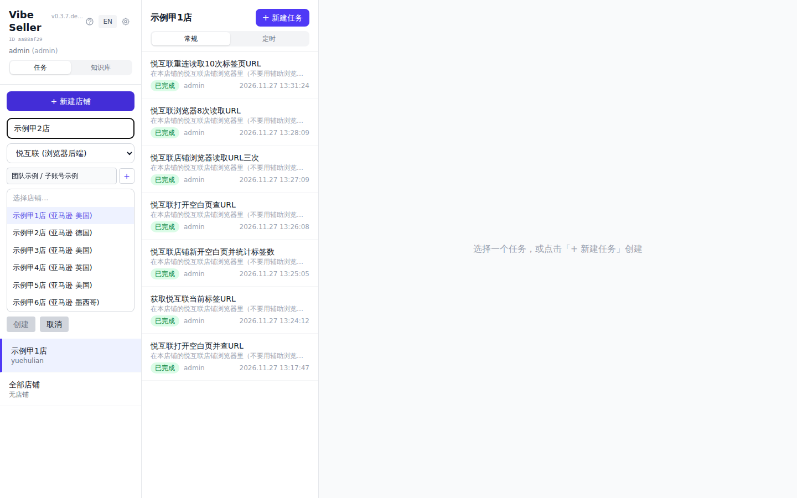
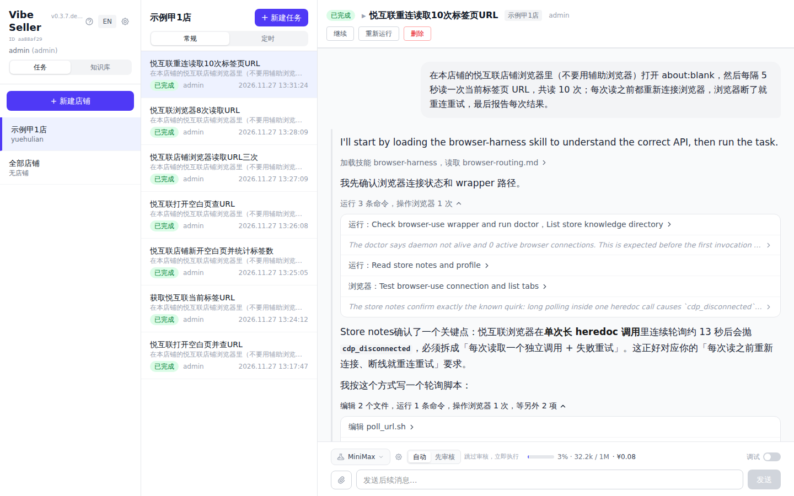

# Yuehulian: Setup Guide

Yuehulian (YueHuLian / 悦互联) is a Chinese anti-detect browser for
e-commerce sellers ([official site](https://kj.chinafic.com/)). Once a
store is bound, Vibe Seller opens and signs in to the Yuehulian client
itself and uses it to open your stores for tasks; you don't need to
operate the client by hand.

**The Yuehulian backend supports Windows and macOS; WSL is also
supported.**

Not using Yuehulian? Skip this page. Vibe Seller supports other
browsers too; see [Browsers](browsers.md).

## Download and install

1. Open the Yuehulian site <https://kj.chinafic.com/>, go to the client
   download on the home page, and install the client for your system:
   - **Windows**: download the Windows client and run the installer.
   - **macOS**: download the Mac client and drop "悦互联.app" into the
     Applications folder — or anywhere else; Vibe Seller finds it
     either way. If macOS asks on first launch whether to open an app
     "downloaded from the internet", click **Open** (it asks only
     once).
2. Launch and sign in to the Yuehulian client by hand at least once, so
   you can confirm the account works and your store list shows up. Vibe
   Seller will then auto-launch and auto-sign-in to this client (see
   "Auto-login" below).

Creating a store and running tasks on the Mac (identical to Windows):

## Create a team account

Yuehulian uses a **team login**: team name + sub-account + password.

1. Register an enterprise account on <https://kj.chinafic.com/>.
2. In the console / admin, create a sub-account for your operator under
   team (member) management and grant it per-store permissions —
   Yuehulian supports role authorization, device-login control, and
   multi-person collaboration.
3. Note three things: the **team name**, the **sub-account login**, and
   **that sub-account's password**. Those are the "team login" you enter
   in Vibe Seller.

## What to fill in when binding

When creating a store, pick "**Yuehulian**" as the browser backend and
bind it in the same form, just like Ziniao:

1. Click the "**+**" next to the account row and fill three fields, then
   save:

| Field | What it is |
|---|---|
| Team name | Your Yuehulian team identifier |
| Sub-account login | The login name of the sub-account under that team |
| Password | That sub-account's password |

2. After saving, Vibe Seller signs the client in with this team login and
   loads the stores under the account.
3. Pick the store this binding is for under "**Select a store...**" and
   hit "**Create**".

The password is encrypted on this machine and the API never returns it to
the frontend (see ["Where credentials are stored"](#where-credentials-are-stored) below).

## One account per machine

Unlike Ziniao, a machine can be signed in to exactly one Yuehulian
account at a time, so the account row has **only a
"+"** — no edit or delete. Clicking "+" and entering a new account
**overwrites** the current one.

If this machine already has Yuehulian stores bound, adding a new account
is refused with:

> 悦互联一台机器只支持一个账号，请先在设置页面删除所有悦互联店铺，再添加新账号。
> (Yuehulian supports only one account per machine — delete all Yuehulian
> stores in Settings first, then add the new account.)

To switch to a different Yuehulian account: delete every Yuehulian store
under `Settings → Stores` first, then click "+" to add the new account and
re-bind the stores. All Yuehulian stores on one machine share this one
account.

## Auto-login

If the client has exited or its session has expired, Vibe Seller signs
back in with your stored team login, so a task is never stranded on "not
logged in". You don't have to sign in to the Yuehulian client by hand each
time — just configure the team login once.

## Common statuses / errors

<b>"Not logged in — log into the 悦互联 client, then Refresh"</b>

No team login configured, or auto-login didn't take. Check the team name
/ sub-account / password in "+", and that the client can log in by hand,
then hit Refresh.

<b>"Couldn't start the 悦互联 client — open it manually (or check it's installed), then Refresh"</b>

Vibe Seller couldn't find / launch the client. Open the Yuehulian client
manually, or confirm it's installed per ["Download and
install"](#download-and-install), then hit Refresh.

<b>"No stores visible for this login"</b>

This sub-account has no stores yet, or no store permissions. Confirm in
the Yuehulian admin that the sub-account can see stores.

<b>Closed Yuehulian while a task runs, or opened a store by hand</b>

Nothing to do: the next browser use reopens the client and signs in; a
store you opened by hand is closed and reopened when a task needs it.

<b>Where credentials are stored</b>

The team login (team name / sub-account / password) is saved in your
local `~/.vibe-seller/data/vibe_seller.db` (SQLite). The password is
encrypted, with a key derived from this machine's install, and is only
decrypted in memory at the moment of auto-login; the API never returns
the password to the frontend. Because a machine has exactly one
Yuehulian account, this credential is machine-level and shared by all
Yuehulian stores. For the encryption details see the [developer
guide](dev-guide.md).

| Message | Meaning / what to do |
|---|---|
| Not logged in — log into the 悦互联 client, then Refresh. | See ["Not logged in"](#not-logged-in) above. |
| Couldn't start the 悦互联 client — open it manually (or check it's installed), then Refresh. | See ["Couldn't start the client"](#couldnt-start-the-client) above. |
| No stores visible for this login. | See ["No stores visible"](#no-stores-visible) above. |
| 悦互联 supports only one account per machine. Delete all 悦互联 stores in Settings, then add the new account. | See ["One account per machine"](#one-account-per-machine) above. |
| This browser doesn't support this system. | The Yuehulian backend is only available on Windows, macOS or WSL. |
