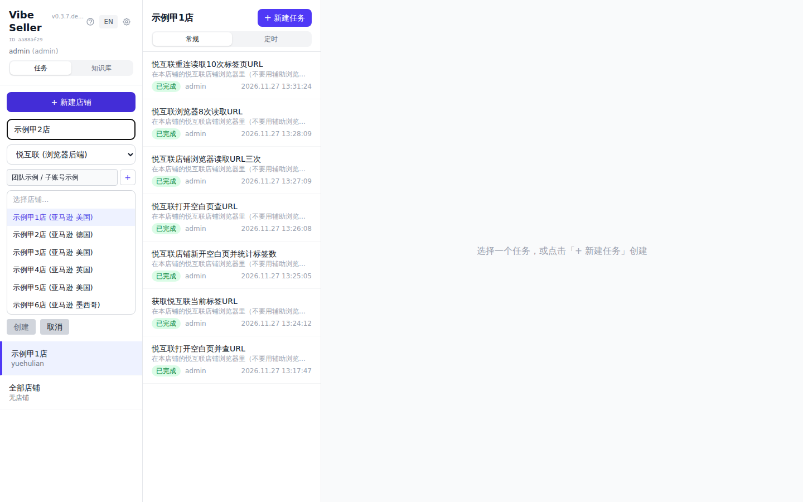
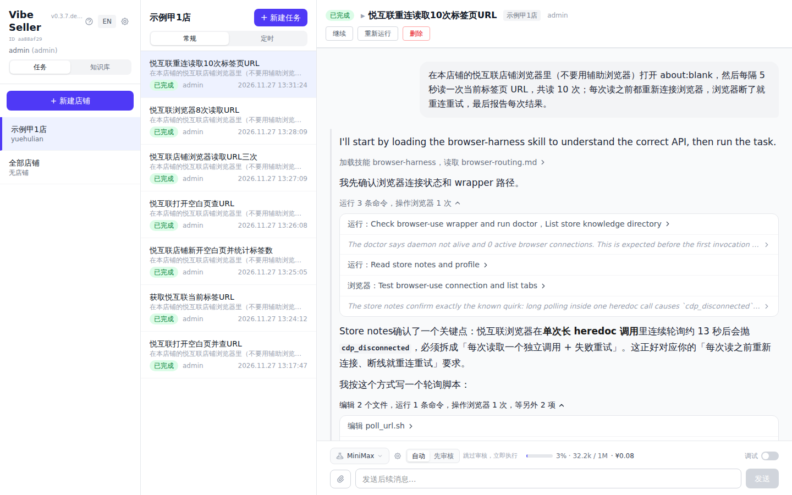

# 悦互联：配置指南

悦互联（YueHuLian）是一款国产电商防关联浏览器（[官网](https://kj.chinafic.com/)）。绑定后，Vibe Seller 会自动打开并登录悦互联客户端，再用它打开你的店铺执行任务，不需要你手动操作客户端。

**悦互联后端支持 Windows、macOS，也支持 WSL**。

不用悦互联的话，这一页可以跳过。Vibe Seller 还支持其他浏览器，见 [浏览器](browsers.md)。

## 下载与安装

1. 打开悦互联官网 <https://kj.chinafic.com/>，在首页进入「客户端下载」，下载对应系统的客户端并安装：
   - **Windows**：下载 Windows 客户端，按提示安装即可。
   - **macOS**：下载 Mac 客户端，把「悦互联.app」拖进「应用程序」（Applications）文件夹，或放到任意位置都可以——Vibe Seller 会自动找到它。如果 macOS 第一次打开时提示「来自互联网下载」，点「打开」即可（只提示一次）。
2. 安装后至少手动启动并登录一次悦互联客户端，确认账号正常、能看到你的店铺列表。之后 Vibe Seller 会自动拉起并自动登录这个客户端（见下面「自动登录」）。

在 Mac 上新建店铺和运行任务的界面（和 Windows 完全一致）：

## 创建团队账号

悦互联用「团队登录」：团队名称 + 子账号 + 密码。

1. 在官网 <https://kj.chinafic.com/> 注册企业账号。
2. 登录后台 / 控制台，在团队（成员）管理里为运营开子账号，并给子账号分配店铺操作权限——悦互联支持角色授权、设备登录控制、多人协同。
3. 记下三样东西：**团队名称**、**子账号登录账号**、**该子账号的密码**。这就是你在 Vibe Seller 里要填的「团队登录」。

## 绑定时要填什么

新建店铺时浏览器后端选「悦互联」，和紫鸟一样在同一个表单里绑定：

1. 点账号栏右侧的「+」，填写三项并保存：

| 字段 | 是什么 |
|---|---|
| 团队名称 | 你的悦互联团队标识 |
| 子账号登录账号 | 团队下那个子账号的登录名 |
| 密码 | 该子账号的密码 |

2. 保存后，Vibe Seller 会用这套团队登录自动登录客户端，并自动加载这个账号下的店铺列表。
3. 在「选择店铺...」里挑出这家店对应的那一个，点「创建」。

密码加密保存在本机，接口不会把它返回给前端（见下面[「凭据存在哪里」](#凭据存在哪里)）。

## 一台机器只支持一个账号

和紫鸟不同，一台机器同一时间只能登录一个悦互联账号，所以账号栏**只有一个「+」**，没有编辑 / 删除——再点「+」填一个新账号，就会**覆盖**原来那个。

如果这台机器上已经绑了悦互联店铺，直接加新账号会被拦下，提示：

> 悦互联一台机器只支持一个账号，请先在设置页面删除所有悦互联店铺，再添加新账号。

要换成另一个悦互联账号：先在「设置 → 店铺」里删掉所有悦互联店铺，再点「+」添加新账号、重新绑定店铺。同一台机器上的所有悦互联店铺都共用这一个账号。

## 自动登录

客户端退出了、或登录过期了，Vibe Seller 会用你保存的团队登录自动登回去，任务不会因为「没登录」而中断。所以你不用每次手动去登录悦互联客户端——把团队登录配好即可。

## 常见提示 / 报错

<b>「未登录——请先在悦互联客户端登录，再点『刷新』」</b>

没配团队登录、或自动登录没成功。确认「+」里填的团队名称 / 子账号 / 密码正确，且客户端能手动登上，然后点「刷新」。

<b>「无法自动启动悦互联客户端——请先手动打开（或确认已安装），再点『刷新』」</b>

Vibe Seller 没找到 / 没能拉起客户端。先手动打开悦互联客户端，或按上面[「下载与安装」](#下载与安装)确认已装好，然后点「刷新」。

<b>「该登录身份下没有可见店铺」</b>

这个子账号名下还没有店铺，或没有分配到店铺权限。到悦互联后台确认子账号能看到店铺。

<b>任务进行中关掉了悦互联，或手动打开过店铺</b>

不用处理：下次用到浏览器时会自动重开客户端并登录；你手动打开的店铺窗口被任务用到时，会先关掉重开。

<b>凭据存在哪里</b>

团队登录（团队名称 / 子账号 / 密码）保存在你本地的 `~/.vibe-seller/data/vibe_seller.db`（SQLite）。密码加密存储，密钥从本机安装派生，只在自动登录那一刻才在内存里解密；接口不会把密码返回给前端。因为一台机器只有一个悦互联账号，这套凭据是机器级的，所有悦互联店铺共用。想看具体加密实现见 [开发者指南](dev-guide.md)。

| 界面提示 | 含义 / 怎么办 |
|---|---|
| 未登录——请先在悦互联客户端登录，再点「刷新」。 | 见上面[「未登录」](#未登录请先在悦互联客户端登录)。 |
| 无法自动启动悦互联客户端——请先手动打开（或确认已安装），再点「刷新」。 | 见上面[「无法自动启动」](#无法自动启动悦互联客户端)。 |
| 该登录身份下没有可见店铺。 | 见上面[「没有可见店铺」](#该登录身份下没有可见店铺)。 |
| 悦互联一台机器只支持一个账号，请先在设置页面删除所有悦互联店铺，再添加新账号。 | 见上面[「一台机器只支持一个账号」](#一台机器只支持一个账号)。 |
| 这个浏览器不支持当前系统。 | 悦互联后端只在 Windows、macOS 或 WSL 上可用。 |
