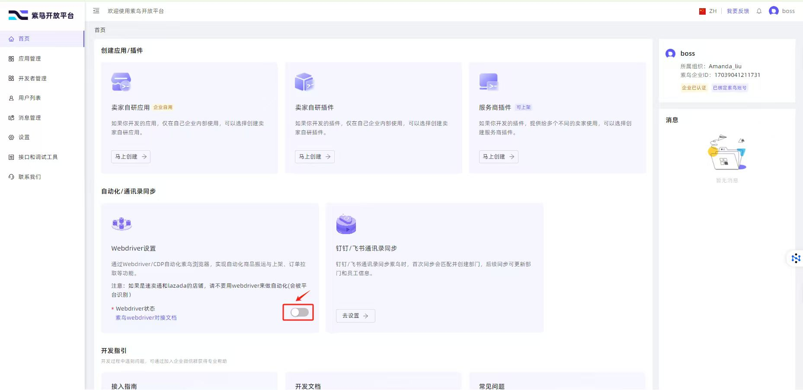
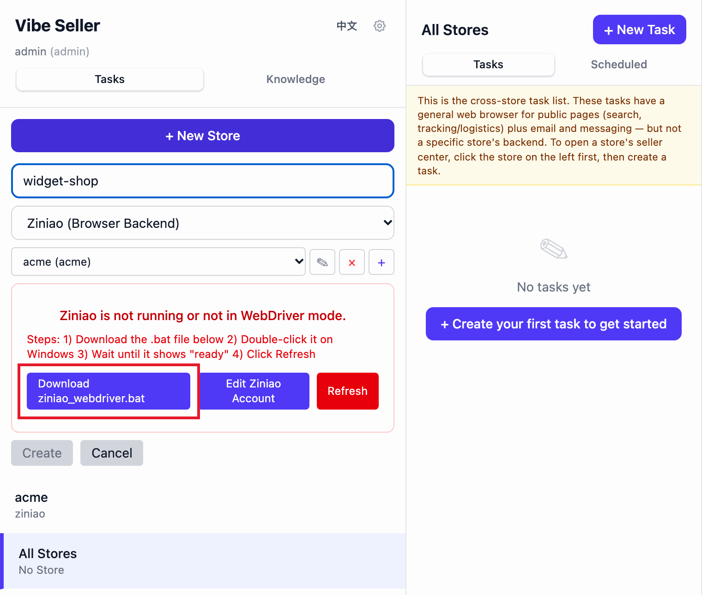

# Ziniao: Setup & Common Errors

Ziniao is a third-party anti-detect browser; Vibe Seller drives it over CDP through its developer (WebDriver) mode, and browser fingerprints stay isolated between Ziniao accounts — the right choice for stores on marketplaces with strict risk control. Before your first Ziniao store, the BOSS (admin) account has to do two one-time setups on the Ziniao side. The errors you may hit when binding a store, the extra step on Windows through WSL, and where the credentials live are all on this page.

A Ziniao store's tasks also get a Chrome auxiliary browser for the logistics and overseas sites Ziniao can't open — see [Two browsers working together](stores.md#ziniao-stores-two-browsers-working-together).

If you don't use Ziniao, skip all of this: pick "Chrome (Playwright)" as the browser backend in the new-store form.

## Prerequisites: developer mode and WebDriver login

Ziniao runs in exactly one mode at a time:

- **Normal mode** — what you get when you double-click the Ziniao icon. UI-only, designed for manual daily work. No remote control.
- **Developer mode (WebDriver)** — same Ziniao install, launched with extra flags so it exposes an HTTP API on `127.0.0.1:16851`. This is the only mode Vibe Seller (or any external tool) can drive.

The two modes share one Ziniao process, so they can't run side by side. Switching requires restarting Ziniao:

- **macOS / native Windows**: Vibe Seller handles the swap itself — it kills any normal-mode instance and relaunches with `--run_type=web_driver` when you open a store. Same automatic handling on both platforms, nothing for you to do.
- **Windows (WSL)**: WSL can't restart a Windows-side app across the VM boundary, so the Windows side runs a one-line `.bat` launcher that does the kill + relaunch (double-click it once). The steps are in [Windows (WSL): getting Ziniao into developer mode](#windows-wsl-getting-ziniao-into-developer-mode-ziniao_webdriverbat) below.

The BOSS (admin) account has to do two one-time things before a sub-account can bind a store:

1. **Enable developer mode for the company on the Ziniao Open Platform** (see <https://open.ziniao.com/docSupport?docId=99>). Without it, Ziniao rejects the login with `statusCode: -10003` — Ziniao's own error for "developer mode isn't enabled for this company".
2. **Tick the WebDriver-login option for the sub-account** that will log in via WebDriver. Without it, binding a store shows "无权限通过 webdriver 登录" — see ["无权限通过 webdriver 登录"](#无权限通过-webdriver-登录-when-binding-a-store) below.

## What you fill in when binding a store

Add a Ziniao account with the "+" button in the new-store form (backend "Ziniao") — three fields:

| Field | What it is |
|---|---|
| Company | Your Ziniao enterprise company identifier |
| Username | The sub-account username under that company — Ziniao's own console calls it the "enterprise username" |
| Password | That sub-account's password |

Same credentials you use to log into Ziniao — Vibe Seller passes them to the developer-mode HTTP API to list your browser profiles and start sessions.

Why the password at all: developer-mode auth is plain account-and-password — no OAuth / token flow exists on the Ziniao side today. If that's a deal-breaker, use plain Chrome instead (new-store form, backend "Chrome (Playwright)").

## "无权限通过 webdriver 登录" when binding a store

The BOSS (admin) account hasn't enabled WebDriver login for your sub-account yet. Follow [Ziniao's official guide](https://open.ziniao.com/docSupport?docId=99#%E7%AC%AC%E4%B8%80%E6%AD%A5%EF%BC%9A%E7%99%BB%E5%BD%95%E5%BC%80%E6%94%BE%E5%B9%B3%E5%8F%B0%E6%8E%A7%E5%88%B6%E5%8F%B00) and tick the WebDriver-login option in the Open Platform console:

The admin (BOSS) account has to do this once. After it's saved, your sub-account can log in via WebDriver and Vibe Seller will bind the store on the next refresh.

In the app this shows as "WebDriver is not enabled for this account." followed by "The BOSS account must enable WebDriver in the developer console.", with a **How to enable WebDriver** button that opens the guide above.

## "检测到您在新终端登录" when binding a store

Ziniao's new-device check: this account is logging in on this computer for the first time, and
Ziniao wants one manual approval first. Do this:

1. **Quit Ziniao**: right-click the Ziniao icon in the taskbar (the menu bar / Dock on a Mac) and quit;
2. **Open Ziniao yourself** by double-clicking it — that starts the Ziniao you use by hand, not
   the one Vibe Seller launches;
3. **Log in to the same account by hand**: Ziniao says it's a new device — submit the approval
   request it offers;
4. **Have the admin (BOSS) account approve** the device in the Ziniao back office;
5. **Once the login works**, go back to Vibe Seller and click **Refresh**.

From then on Ziniao trusts this computer and the prompt doesn't come back.

## Windows (WSL): getting Ziniao into developer mode (ziniao_webdriver.bat)

Ziniao is installed on the Windows side while Vibe Seller runs inside WSL, and WSL can't restart a Windows app across the VM boundary — so a launcher does it on Windows:

1. Once you pick the Ziniao account, a "**Ziniao is not running or not in WebDriver mode.**" banner appears — click "**Download ziniao_webdriver.bat**" inside it.
2. Double-click it on Windows.
3. Back in WSL, hit "**Refresh**" on the Ziniao page in Vibe Seller — your accounts pop in automatically, no manual fields to fill. The on-screen steps read "Steps: 1) Download the .bat file below 2) Double-click it on Windows 3) Wait until it shows "ready" 4) Click Refresh".

If a task starts before Ziniao is ready, the error reads "Ziniao is not running. Please download and run ziniao_webdriver.bat on Windows, then retry." When Ziniao is open but still in normal mode, hit **Refresh** first; if it reports "Ziniao is still running. It may not have fully exited." a **Force Kill** button appears — WSL can close Ziniao for you, but relaunching it is still the `.bat`'s job. Full Windows + WSL2 deployment, including this backend, is in the [Windows setup guide](windows-setup.md).

## Where the credentials are stored

Everything lives in `~/.vibe-seller/data/vibe_seller.db` (local SQLite). Nothing is uploaded, and no telemetry path carries credentials out.

- **Password** is encrypted at rest with a key derived from your local install — decrypted in memory only when Vibe Seller calls the Ziniao HTTP API. The field is a password box that never echoes it back, and normal endpoints never hand it out: the one way to recover it is an admin clicking "Show / Copy" inside **Edit Ziniao Account**; ordinary users don't get that control and an external agent holding an API key is refused.
- **Company** and **username** are plain strings — identifiers, not secrets (same shape as an email address).
- If you ever see "The stored password can't be decrypted on this machine…" (for example after the database was copied to another install), click "**Edit Ziniao Account**" and type the password again.

Contributors curious about the exact encryption implementation can check the [developer guide](dev-guide.md).
