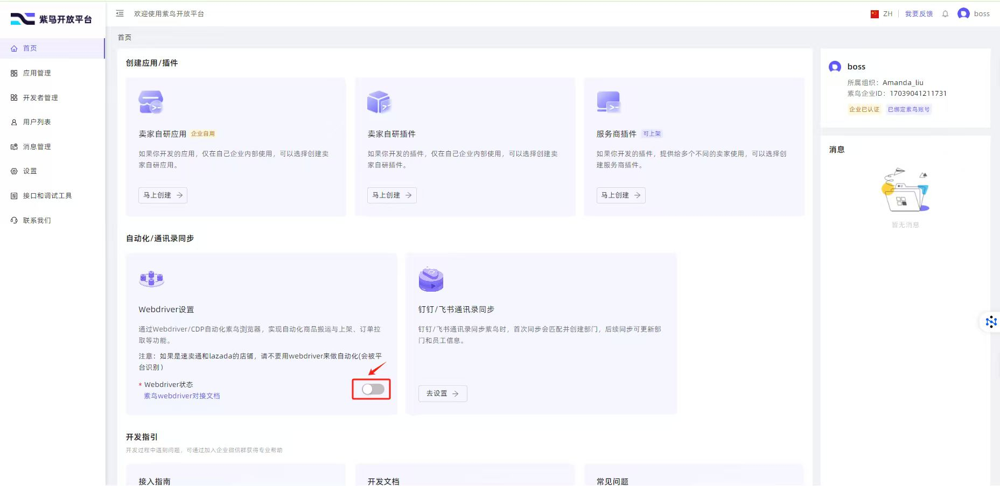
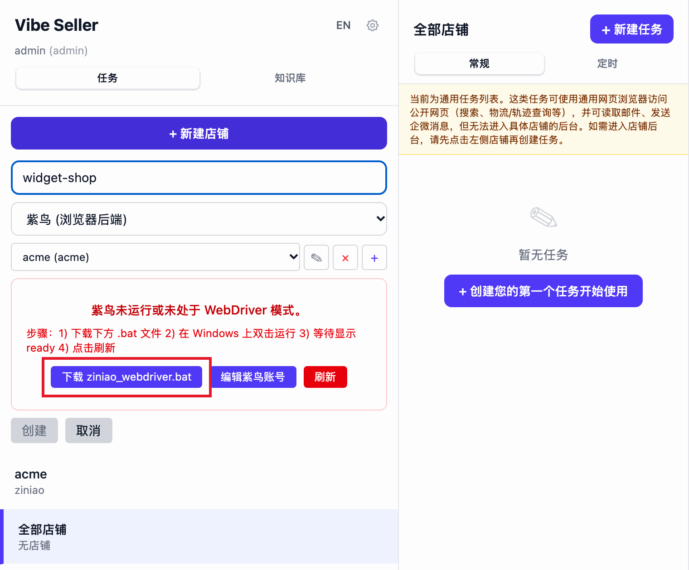

# 紫鸟：开通与常见报错

紫鸟是第三方防关联浏览器，Vibe Seller 通过它的开发者模式（WebDriver）以 CDP 直接控制它，不同紫鸟账号之间的浏览器指纹互相隔离，适合平台风控严格的店铺。第一次接入紫鸟，需要主账号（BOSS 账号）在紫鸟一侧做两步一次性开通；绑定时的报错、WSL 上多出的一步、凭据存在哪里，都在这一页。

紫鸟店铺的任务还会配一个 Chrome 辅助浏览器，打开紫鸟打不开的物流、海外网站，见[两个浏览器配合使用](stores.md#紫鸟店铺两个浏览器配合使用)。

不用紫鸟的话，这一步整体可以跳过：新建店铺时浏览器后端选择「Chrome (Playwright)」即可。

## 开通前提：开发者模式与 WebDriver 登录

紫鸟同一时间只能运行一种模式：

- **普通模式**：你双击紫鸟图标启动的就是这个模式。它只有界面，供你日常手动使用，外部程序无法接入。
- **开发者模式（WebDriver）**：同一个紫鸟，启动时带上额外参数，会在 `127.0.0.1:16851` 开放一个 HTTP API。这是 Vibe Seller（或任何外部工具）能够驱动紫鸟的**唯一**入口。

两种模式共用同一个紫鸟进程，不能同时运行，切换模式等于重启紫鸟：

- **macOS / 原生 Windows**：由 Vibe Seller 自动完成。打开店铺时它会先停止普通模式的紫鸟，再用 `--run_type=web_driver` 重新启动，两个平台都一样自动接管，不需要你操心。
- **Windows（WSL）**：WSL 无法跨越虚拟机边界去重启 Windows 上的紫鸟，因此需要在 Windows 侧运行一个单行的 `.bat` 启动器来完成停止和重启（双击运行一次即可）。步骤见下面 [Windows（WSL）：让紫鸟进入开发者模式](#windowswsl让紫鸟进入开发者模式ziniao_webdriverbat)。

主账号（BOSS 账号）需要做两步一次性配置，子账号绑定店铺才会成功：

1. **在紫鸟开放平台开通开发者模式**（见 <https://open.ziniao.com/docSupport?docId=99>）。没有开通时紫鸟会拒绝登录，报错 `statusCode: -10003`——这是紫鸟自己的错误码，含义就是「这个公司没有开通开发者模式」。
2. **给要用 WebDriver 登录的子账号勾选「WebDriver 登录」**。没有勾选时，绑定店铺会提示「无权限通过 webdriver 登录」，处理方法和截图见下面 [提示「无权限通过 webdriver 登录」](#报错无权限通过-webdriver-登录)。

## 绑定时要填什么

新建店铺（浏览器后端选择「紫鸟」）时点击「+」添加一个「紫鸟账号」，填写三个字段：

| 字段 | 是什么 |
|---|---|
| 公司名称 | 你的紫鸟企业账号的公司标识 |
| 用户名 | 企业账号下那个子账号的用户名 |
| 密码 | 那个子账号的密码 |

「用户名」在紫鸟后台里叫「企业用户名」。这三项和你登录紫鸟用的是同一套：Vibe Seller 把它们传给开发者模式的 HTTP API，用来读取你的浏览器档案、启动会话。

之所以要你填写密码：紫鸟开发者模式的 HTTP API 就是账号密码登录，没有 OAuth 或 token 可以替代。不能接受这一点，就改用普通 Chrome：新建店铺时浏览器后端选择「Chrome (Playwright)」。

## 报错：「无权限通过 webdriver 登录」

原因是主账号（BOSS）还没有给子账号开通 WebDriver 登录权限。按照[紫鸟官方指南](https://open.ziniao.com/docSupport?docId=99#%E7%AC%AC%E4%B8%80%E6%AD%A5%EF%BC%9A%E7%99%BB%E5%BD%95%E5%BC%80%E6%94%BE%E5%B9%B3%E5%8F%B0%E6%8E%A7%E5%88%B6%E5%8F%B00)，在开放平台控制台里勾选 WebDriver 登录选项：

只需要主账号操作一次。保存后子账号就能通过 WebDriver 登录，回到 Vibe Seller 点击「刷新」即可绑上店铺。

界面上对应的提示是「此账号未开通 WebDriver 权限。」和「需要由 BOSS 主账号在开发者控制台中开启 WebDriver。」，旁边有「如何开通 WebDriver」按钮，点击会直接打开上面那份指南。

## 报错：「检测到您在新终端登录」

这是紫鸟的新设备安全检测，不是 Vibe Seller 的问题。同一个账号第一次在某台机器上登录时，紫鸟要求人工审批一次：

1. 在这台机器上手动打开紫鸟（普通模式，不是 WebDriver），用同一个子账号登录。
2. 紫鸟会弹出新设备提示，按照提示提交审批申请。
3. 由主账号（BOSS）在紫鸟后台批准这台设备。

批准后这台设备就被信任了，回到 Vibe Seller 点击「刷新」，WebDriver 登录可以直接通过。

## Windows（WSL）：让紫鸟进入开发者模式（ziniao_webdriver.bat）

紫鸟装在 Windows 一侧，Vibe Seller 运行在 WSL 里。WSL 无法跨越虚拟机边界重启 Windows 上的紫鸟，因此需要在 Windows 侧使用启动器：

1. 选择紫鸟账号后，界面会出现「紫鸟未运行或未处于 WebDriver 模式。」的提示框，点击其中的「下载 ziniao_webdriver.bat」。
2. 在 Windows 上双击运行。
3. 回到 WSL 里的 Vibe Seller，在紫鸟页面点击「刷新」按钮，账号会自动出现，不需要手动填写字段。界面上的步骤提示原文是「步骤：1) 下载下方 .bat 文件 2) 在 Windows 上双击运行 3) 等待显示 ready 4) 点击刷新」。

任务开始执行时，如果紫鸟还没有就绪，报错文案是「紫鸟未运行，请在 Windows 上下载并运行 ziniao_webdriver.bat，然后重试。」。紫鸟开着但不是开发者模式时，先点击「刷新」；如果提示「紫鸟仍在运行，可能未完全退出。」，提示框里会出现「强制关闭」按钮——WSL 这一侧只能帮你停止它，重新启动仍然需要再双击一次 `.bat`。完整的 Windows + WSL2 部署（含这个后端）见 [Windows 部署指南](windows-setup.md)。

## 凭据存在哪里

全部保存在你本地的 `~/.vibe-seller/data/vibe_seller.db`（SQLite）里。不会上传，遥测通道也不会带走。

- **密码**：保存前加密，密钥从你本地的安装派生，只在 Vibe Seller 调用紫鸟 HTTP API 的那一刻才在内存里解密。输入框是密码框、平时不回显，日常接口也不会把密码返回给前端：唯一能取回它的地方是管理员在「编辑紫鸟账号」里点击「显示 / 复制」，普通用户没有这个入口，使用 API Key 连接的外部工具一律被拒绝。
- **公司名称**和**用户名**：明文存储，这两项是身份标识，性质和邮箱地址相同。
- 如果以后看到「无法解密已保存的密码…」（例如数据库被复制到了另一台机器），在「编辑紫鸟账号」里重新输入一遍密码即可。

想看具体加密实现可以查阅 [开发者指南](dev-guide.md)。
