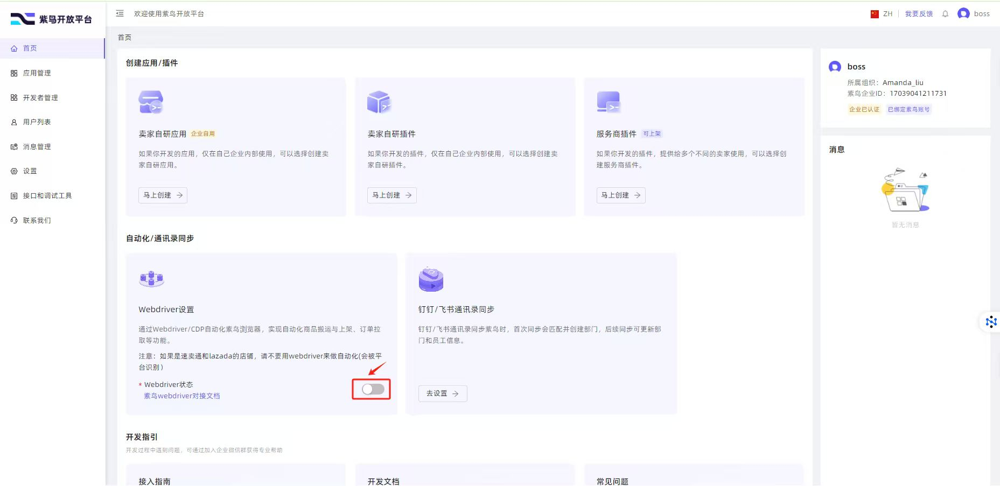
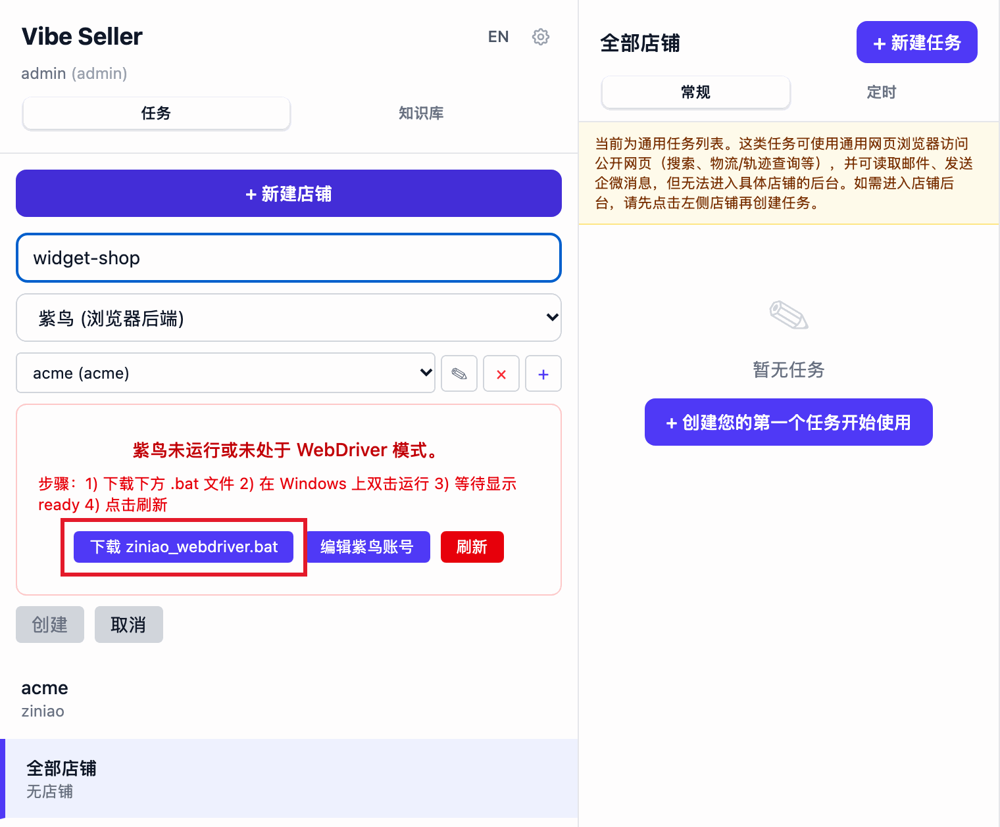

# 紫鸟：开通与常见报错

店铺开在紫鸟里的，按下面四步做一次就能接入 Vibe Seller。前两步要由紫鸟的**主账号（BOSS 账号）**在紫鸟官网操作，只需要做一次。

不用紫鸟的话，这一页可以跳过：新建店铺时选「Chrome」即可。

## 接入步骤

1. **主账号开通开发者模式**：用主账号登录 [紫鸟开放平台](https://open.ziniao.com/docSupport?docId=99)，按页面说明为公司开通开发者模式。
2. **主账号给子账号勾选「WebDriver 登录」**：在开放平台控制台里，给要接入 Vibe Seller 的那个子账号勾上 WebDriver 登录，保存。

    

3. **保存紫鸟里正在做的事**：下一步 Vibe Seller 会关掉紫鸟再重新打开，你手动打开的店铺窗口会一起关掉，没保存的操作会丢失。
4. **在 Vibe Seller 里新建店铺**：
    1. 在左侧栏点「+ 新建店铺」，填「店铺名称」，浏览器选「紫鸟 (浏览器后端)」；
    2. 点账号旁边的「+」，填「公司名称」「用户名」「密码」（就是你登录紫鸟用的那一套），保存；
    3. 在「选择紫鸟账号...」里选中它，等店铺列表出来（紫鸟重新打开要几秒到一两分钟）；
    4. 在「选择店铺配置...」里选这家店，点「创建」。

做完就可以在这家店里创建任务了。第 4 步出现报错的话，看下面的 [遇到报错](#遇到报错)，每条报错都对应上面的某一步。

!!! note "Vibe Seller 装在 WSL 里？"
    第 4 步多一个操作：选中紫鸟账号后，按界面提示下载 `ziniao_webdriver.bat`，在 Windows 上双击运行，再点「刷新」。详见 [Windows（WSL）：让紫鸟进入开发者模式](#windowswsl让紫鸟进入开发者模式ziniao_webdriverbat)。

## 遇到报错

### 报错：statusCode -10003

公司还没有开通开发者模式，这是紫鸟自己的错误码。让主账号做完上面的**第 1 步**，再回到 Vibe Seller 点「刷新」。

### 报错：「无权限通过 webdriver 登录」

主账号还没有给这个子账号勾选 WebDriver 登录。让主账号做完上面的**第 2 步**（详细操作见[紫鸟官方指南](https://open.ziniao.com/docSupport?docId=99#%E7%AC%AC%E4%B8%80%E6%AD%A5%EF%BC%9A%E7%99%BB%E5%BD%95%E5%BC%80%E6%94%BE%E5%B9%B3%E5%8F%B0%E6%8E%A7%E5%88%B6%E5%8F%B00)），保存后回到 Vibe Seller 点「刷新」即可绑上店铺。

界面上对应的提示是「此账号未开通 WebDriver 权限。」和「需要由 BOSS 主账号在开发者控制台中开启 WebDriver。」，旁边的「如何开通 WebDriver」按钮会直接打开官方指南。

### 报错：「检测到您在新终端登录」

这是紫鸟的新设备检测：这个账号第一次在这台电脑上登录，紫鸟要求先人工批准一次。照下面做：

1. **退出紫鸟**：在任务栏（Mac 是菜单栏 / 程序坞）右键紫鸟图标，选择退出；
2. **自己双击打开紫鸟**：这样打开的是平时手动用的紫鸟，而不是 Vibe Seller 启动的那个；
3. **手动登录同一个账号**：紫鸟会提示这是新设备，按提示提交审批；
4. **让主账号（BOSS）批准**：在紫鸟后台把这台设备批准；
5. **确认能正常登录**后，回到 Vibe Seller 点「刷新」。

之后这台电脑就被紫鸟信任了，不会再出现这个提示。

## Windows（WSL）：让紫鸟进入开发者模式（ziniao_webdriver.bat）

紫鸟装在 Windows 一侧，Vibe Seller 运行在 WSL 里。WSL 无法跨越虚拟机边界重启 Windows 上的紫鸟，因此需要在 Windows 侧使用启动器：

1. 选择紫鸟账号后，界面会出现「紫鸟未运行或未处于 WebDriver 模式。」的提示框，点击其中的「下载 ziniao_webdriver.bat」。
2. 在 Windows 上双击运行。
3. 回到 WSL 里的 Vibe Seller，在紫鸟页面点击「刷新」按钮，账号会自动出现，不需要手动填写字段。界面上的步骤提示原文是「步骤：1) 下载下方 .bat 文件 2) 在 Windows 上双击运行 3) 等待显示 ready 4) 点击刷新」。

任务开始执行时，如果紫鸟还没有就绪，报错文案是「紫鸟未运行，请在 Windows 上下载并运行 ziniao_webdriver.bat，然后重试。」。紫鸟开着但不是开发者模式时，Vibe Seller 会自动帮你关掉它，但 WSL 这一侧没法重新打开，需要你再双击一次 `.bat`。完整的 Windows + WSL2 部署（含这个后端）见 [Windows 部署指南](windows-setup.md)。

## 更多细节

下面是原理和细节，按上面的步骤接入时用不到。

### 选择紫鸟账号时会重新打开紫鸟

紫鸟同一时间只能运行一种模式：

- **普通模式**：你双击紫鸟图标启动的就是这个模式。它只有界面，供你日常手动使用，外部程序无法接入。
- **开发者模式（WebDriver）**：同一个紫鸟，启动时带上额外参数，会在 `127.0.0.1:16851` 开放一个 HTTP API。这是 Vibe Seller（或任何外部工具）能够驱动紫鸟的**唯一**入口。

两种模式共用同一个紫鸟进程，不能同时运行，切换模式等于重启紫鸟。macOS 和原生 Windows 上由 Vibe Seller 自动完成：新建或编辑店铺时选择紫鸟账号（或点击「刷新」）、以及任务第一次用到紫鸟店铺的浏览器时，只要紫鸟没在开发者模式下响应（没打开、你手动打开的普通模式、或上次异常退出留下的残留进程），它就会先关掉所有紫鸟进程，再用 `--run_type=web_driver` 重新打开，不会弹窗问你。不打开浏览器的任务不会动紫鸟。

重新打开通常需要几秒到一两分钟，页面会显示已等待的时间，完成后店铺列表自动出现；最多等 2 分钟，没响应会再关掉重试一次。紫鸟已经在开发者模式下运行时不会重启。Windows（WSL）上 Vibe Seller 不会自动重新打开紫鸟，按[启动器步骤](#windowswsl让紫鸟进入开发者模式ziniao_webdriverbat)操作。

### 绑定时要填什么

| 字段 | 是什么 |
|---|---|
| 公司名称 | 你的紫鸟企业账号的公司标识 |
| 用户名 | 企业账号下那个子账号的用户名 |
| 密码 | 那个子账号的密码 |

「用户名」在紫鸟后台里叫「企业用户名」。这三项和你登录紫鸟用的是同一套：Vibe Seller 把它们传给开发者模式的 HTTP API，用来读取你的浏览器档案、启动会话。

之所以要你填写密码：紫鸟开发者模式的 HTTP API 就是账号密码登录，没有 OAuth 或 token 可以替代。不能接受这一点，就改用普通 Chrome：新建店铺时浏览器后端选择「Chrome」。

### 装在哪个目录都能找到（Windows）

Windows 上 Vibe Seller 需要拿到 `ziniao.exe` 的完整路径才能带参启动它。默认装在 `C:\Program Files\ziniao` 自然没问题；装到别处（比如 `D:\紫鸟\ziniao`、带空格或中文的目录、其他盘）也一样能找到——查找顺序是：

1. 启动前还活着的紫鸟进程的安装路径（每次自动重启前会先记录再关闭它）；
2. 注册表 App Paths / Uninstall 项（`InstallLocation`、`DisplayIcon` 等）；
3. 桌面和开始菜单的快捷方式指向哪里（紫鸟自己的快捷方式装在哪就指向哪）；
4. 每个固定磁盘上的常规目录（`X:\Program Files\ziniao`、`X:\Program Files (x86)\ziniao`、`X:\ziniao` 等）。

以上每一项都会校验找到的确实是 `ziniao.exe`（绝不会把卸载器当成客户端）。如果全都找不到，报错会列出搜索过的位置；此时**手动从快捷方式打开一次紫鸟再重试**（下次启动会记下它的安装位置），或者重装到默认目录。

### Chrome 辅助浏览器

紫鸟店铺的任务还会配一个 Chrome 辅助浏览器，打开紫鸟打不开的物流、海外网站，见[两个浏览器配合使用](browsers.md#店铺浏览器与辅助浏览器)。

### 凭据存在哪里

全部保存在你本地的 `~/.vibe-seller/data/vibe_seller.db`（SQLite）里。不会上传，遥测通道也不会带走。

- **密码**：保存前加密，密钥从你本地的安装派生，只在 Vibe Seller 调用紫鸟 HTTP API 的那一刻才在内存里解密。输入框是密码框、平时不回显，日常接口也不会把密码返回给前端：唯一能取回它的地方是管理员在「编辑紫鸟账号」里点击「显示 / 复制」，普通用户没有这个入口，使用 API Key 连接的外部工具一律被拒绝。
- **公司名称**和**用户名**：明文存储，这两项是身份标识，性质和邮箱地址相同。
- 如果以后看到「无法解密已保存的密码…」（例如数据库被复制到了另一台机器），在「编辑紫鸟账号」里重新输入一遍密码即可。

想看具体加密实现可以查阅 [开发者指南](dev-guide.md)。
